# ГЛИТЧ-КОРЕ

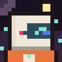

**Террария + Факторио + Among Us на чужой планете.** Двухмерная выживалка-песочница
о потерянной экспедиции «Кербер-9». Мир состоит из клеток: в нём копают, строят
фабрику, а по ночам отбиваются от фантомов. Играть можно одному или командой
до 4 человек по локальной сети. Есть сборки для Windows, Linux и Android.

Связь с орбитой потеряна, эвакуации не будет, пока вы сами не позовёте её. Для этого
на базе стоит **релей-ядро**. Чтобы его запустить, нужно запитать станцию, собрать
данные на терминалах, открыть пять узлов исследований, наладить производство пластин,
микросхем и энергоячеек и, наконец, 180 секунд удерживать сигнал. Всё это время
планета будет вас слышать.

Кобальт-9 — тёплый «Споровый луг». Розовая глина под горчичным лишайником, в небе
висит газовый гигант. Ниже идут фиолетовые пещеры, затянутые светящимся мицелием, а
у лавы начинается красная «плоть» планеты. Днём здесь спокойно. Ночью из вентиляций
выходят фантомы: эхо экипажа, споровый рой, тени, копатели и двойник, который носит
ваш скафандр. Внешних ассетов в игре нет: тайлы, флору, небо, машины, героя и звук
код рисует и синтезирует при запуске.

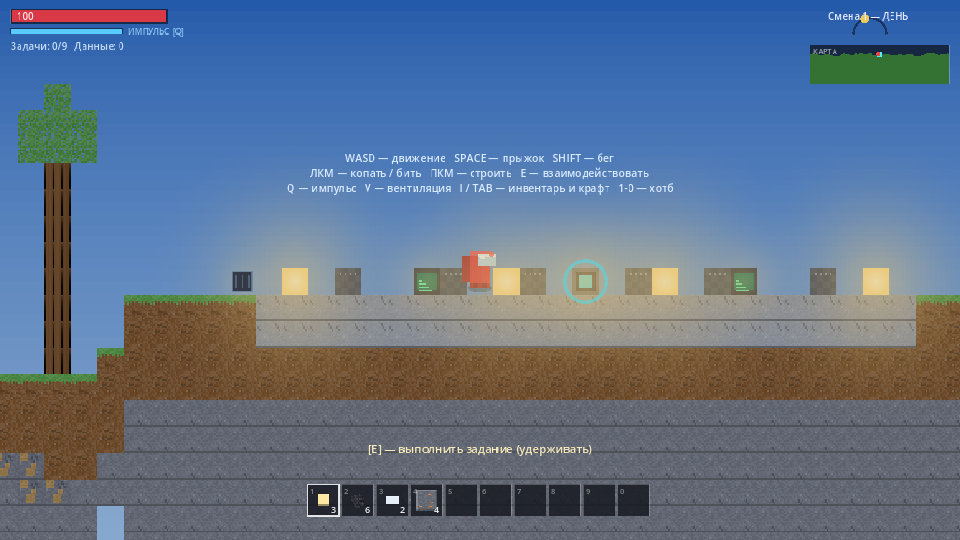

## Содержание

- [Скачать и запустить](#скачать-и-запустить)
- [Главное меню и профиль](#главное-меню-и-профиль)
- [С чего начать: первые 15 минут](#с-чего-начать-первые-15-минут)
- [Управление](#управление)
- [Интерфейс](#интерфейс)
- [Цель: четыре этапа релея](#цель-четыре-этапа-релея)
- [Фабрика и питание](#фабрика-и-питание)
- [Ночь и оборона](#ночь-и-оборона)
- [Сетевая игра](#сетевая-игра)
- [Настройки](#настройки)
- [Сохранение](#сохранение)
- [Справочник объектов](#справочник-объектов)
- [Для разработчиков](#для-разработчиков)

---

## Скачать и запустить

Готовые сборки лежат на странице
[Releases](https://github.com/grikirster-stack/glitch-core/releases/latest):

| Файл | Что это |
|---|---|
| `glitch-core-vX.Y.Z-android.apk` | Android, один APK на все устройства: arm64-v8a, armeabi-v7a, x86_64 |
| `glitch-core-vX.Y.Z-windows-x86_64.zip` | Windows: распаковать и запустить `glitch-core.exe` |
| `glitch-core-vX.Y.Z-linux-x86_64.zip` | Linux: распаковать и запустить `./glitch-core.x86_64` |

Этот README описывает игру в ветке `main`. Если чего-то из описанного в последнем
релизе ещё нет, оно появится в следующем.

**Как поставить APK на телефон.**

1. Откройте страницу релиза в браузере телефона и скачайте `...-android.apk`.
2. Откройте скачанный файл. Android попросит разрешить установку из этого источника:
   «Настройки» → «Приложения» → «Специальный доступ» → «Установка неизвестных приложений» →
   браузер (или файловый менеджер) → «Разрешить». Названия пунктов зависят от прошивки.
   Часто Android сам показывает кнопку «Настройки» прямо в окне установки.
3. Нажмите «Установить». Если Play Защита предупредит о неизвестном разработчике,
   выберите «Подробнее» → «Всё равно установить».
4. Если в заметках релиза написано «подписано debug-ключом», новая версия не встанет
   поверх старой: сначала удалите старую.

С компьютера APK можно поставить командой `adb install -r glitch-core-vX.Y.Z-android.apk`.

**Из исходников.** Нужен Godot 4.7, стандартная версия без .NET. Откройте
`project.godot` и нажмите F5, либо запустите из командной строки `godot --path .`.
Подробности — в разделе [«Для разработчиков»](#для-разработчиков).

После запуска открывается главное меню.

## Главное меню и профиль

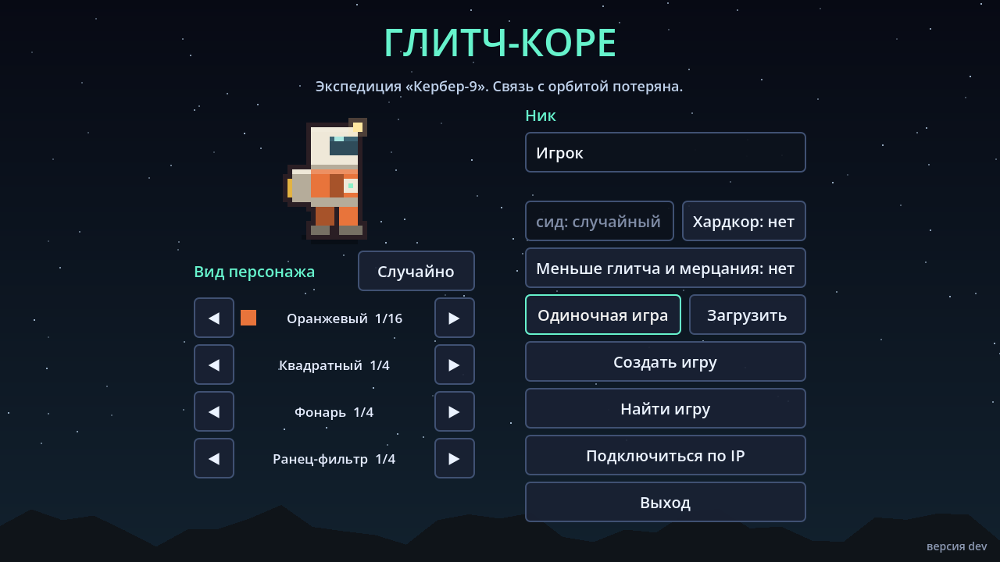

**Слева — вид персонажа.** Это скафандр «Кербер-9». У него четыре части, каждая
листается кнопками ◀ ▶:

| Часть | Варианты |
|---|---|
| Цвет скафандра | 16 цветов (первый — «Оранжевый») |
| Шлем / визор | Квадратный, Высокий, Панорамный, Щиток |
| Аксессуар | Фонарь, Антенна, Нет, Два фонаря |
| Рюкзак | Ранец-фильтр, Удлинённый, Два баллона, Компактный |

Кнопка «Случайно» собирает случайный вид. Превью рядом поворачивается раз в 2 секунды.
В сетевой игре товарищи видят вас именно в этом виде.

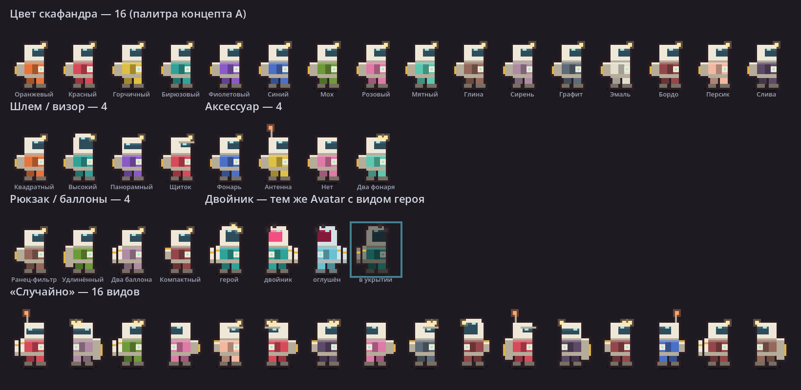

**Справа — профиль и запуск.**

- **Ник** — от 2 до 16 символов. Разрешены русские и латинские буквы, цифры, пробел
  и символы `_`, `-`, `.`. Первый и последний символ должны быть буквой или цифрой,
  два пробела подряд нельзя. Если ник неверный, под полем появится причина, и кнопки
  игры станут неактивными.
- **Сид** — номер мира. Если поле пустое, мир случайный. Тот же сид всегда даёт тот же
  мир. Текст, который не является числом, тоже превращается в сид.
- **Хардкор: нет / да** — одна жизнь, без сохранений. Действует только на «Одиночную игру».
- **Меньше глитча и мерцания: нет / да** — см. [«Настройки»](#настройки).
- **Одиночная игра**, **Создать игру**, **Найти игру**, **Подключиться по IP** —
  см. [«Сетевая игра»](#сетевая-игра). **Выход** — закрыть игру.

Ник, вид, настройка глитча, последние адреса и порт сохраняются сами при каждом изменении
в файле `user://profile.cfg`. На Windows это
`%APPDATA%\Godot\app_userdata\ГЛИТЧ-КОРЕ\profile.cfg`, на Linux —
`~/.local/share/godot/app_userdata/ГЛИТЧ-КОРЕ/profile.cfg`.
В правом нижнем углу показана версия сборки.

## С чего начать: первые 15 минут

Первые минуты подсказывает **обучение** — жёлтая строка «ОБУЧЕНИЕ n/5» в левом верхнем
углу, под трекером цели. Ниже те же шаги с подробностями. Картинки сняты с настоящей игры
(сид 31337).

**1. Осмотритесь.** Вы стоите на базе. Это стальная площадка с **релей-ядром** в центре
(голубое кольцо), двумя **терминалами** (зелёные экраны) по бокам, четырьмя
светокристаллами и **вентиляцией** у левого края. Забег начинается утром первой смены,
до ночи примерно 86 секунд. В хотбаре лежит стартовый набор: 3 светокристалла, 6 угля,
2 железные пластины и 4 медной руды. Первые 22 секунды по центру экрана видна
шпаргалка по клавишам.

**2. Копайте — «ОБУЧЕНИЕ 1/5 Копай: ЛКМ по земле — хлам n/6 на ТЭЦ».** Зажмите ЛКМ
на клетке не дальше 5,6 клетки от себя. Вокруг клетки появится рамка, снизу — полоса
прогресса. Лишайник и глина ломаются за 0,5–0,6 с и дают **хлам**. Камень (он лежит
под тремя слоями глины) ломается за 1,4 с и даёт **камень**. Выпавшие предметы
подлетают к вам сами, если подойти ближе 70 px.

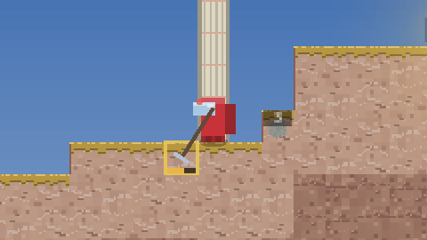

**3. Скрафтите ТЭЦ — «2/5 Крафт: I — «Угольная ТЭЦ»».** Терминалы работают **только
под питанием**. Нажмите **I**, откройте вкладку «Ручной крафт» и нажмите на
**«Угольная ТЭЦ»**. Рецепт: 2 железные пластины из стартового набора и 6 хлама.

**4. Поставьте ТЭЦ и растопите — «3/5 ТЭЦ: ПКМ — у терминала, [E] с углём — топка».**
Выберите ТЭЦ в хотбаре (клавиши 1…0) и нажмите **ПКМ** по пустой клетке рядом с релеем.
ТЭЦ питает круг радиусом 8 клеток, а терминалы базы стоят в 6 клетках от релея, так что
одна ТЭЦ у релея накрывает оба. Возьмите **уголь** в хотбар и нажмите **E** у ТЭЦ:
топка загружена. Одна единица угля горит 45 секунд, в топку влезает 12.

**5. Проверьте зону — «4/5 Питание: терминал вне зоны (P — радиус)».** Клавиша **P**
показывает круги питания. Если терминал вне круга, переставьте ТЭЦ ближе.

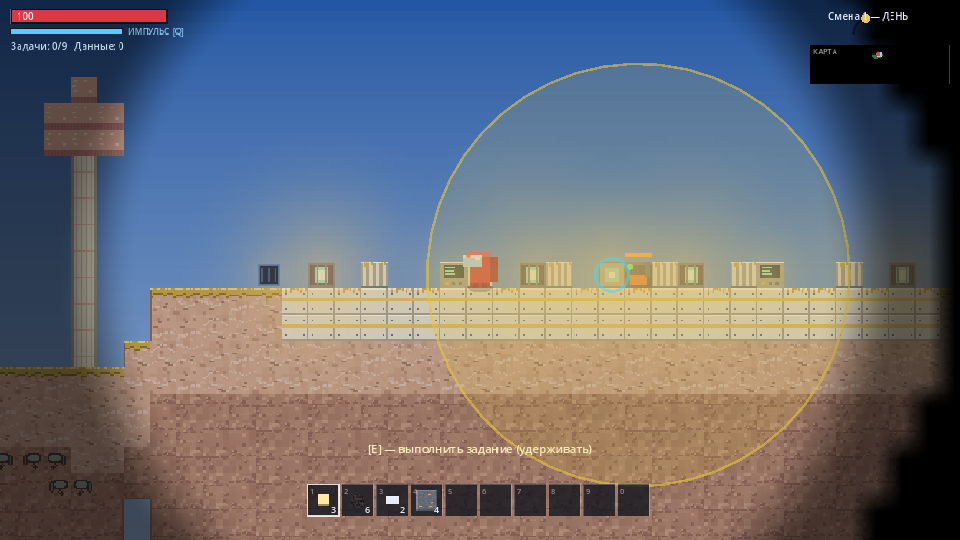

**6. Выполните задание — «5/5 Терминал под питанием: держите [E]».** Встаньте у терминала
и **удерживайте E** 2,2 секунды. Вы получите +5 данных и новую главу журнала (**J**).
Отработавший терминал гаснет. Когда отработают оба терминала базы, обучение скрывается
и начинается этап цели 2/4.

**7. Откройте первую технологию.** Нажмите **I** → вкладка «Исследования» →
**T1 «Сборка»** за 5 данных. Узел открывает сборщик, манипулятор, микросхемы, энергоячейки
и прокат пластин в плавильне. Узлы открываются строго по порядку, на всё дерево нужно
75 данных.

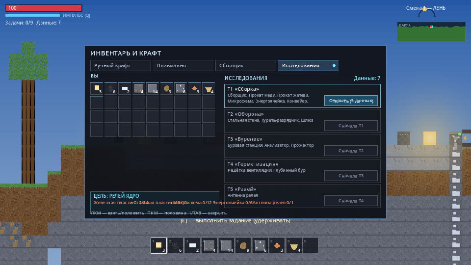

**8. Постройте плавильню.** Руками слиток стоит 2 руды, а в плавильне — 1. Рецепт: 6 камня
и 4 хлама, ставится так же, как ТЭЦ, и тоже должна стоять в круге питания. Руда лежит
глубже: уголь почти сразу под землёй, медь — примерно с 8 клеток, железо — с 30,
кристаллы глитча — с 60 (см. [таблицу тайлов](#тайлы-и-руды)).

**9. Загляните в руины и подготовьтесь к ночи.** В мире 7 руин. В каждой есть
**тайник** (сундук с 3–6 видами предметов), **табличка** с именем места и **терминал**
с главой журнала. Терминал руины тоже нужно запитать. Когда наступают сумерки, вверху
экрана появляется «НОЧЬ ЧЕРЕЗ N с». Держитесь у света и узнайте заранее, где
[вентиляция](#ночь-и-оборона).

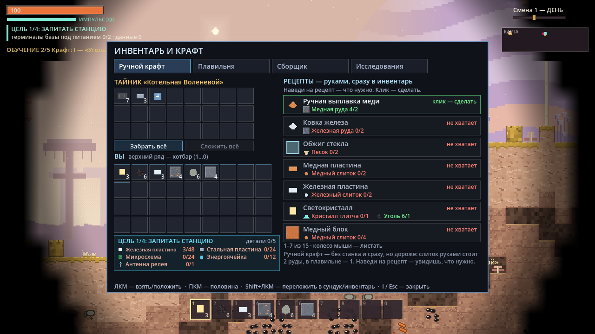

**10. Соберите линию.** ТЭЦ, буровая станция, конвейер, плавильня и сундук работают
без вас. Бур копает столбец под собой, лента везёт руду в плавильню, слитки уезжают
в сундук. Буровая открывается узлом T3, до этого руду носите сами.
Подробнее — [«Фабрика и питание»](#фабрика-и-питание).

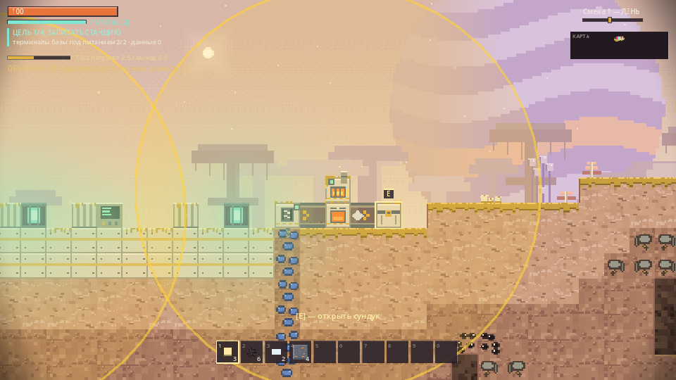

## Управление

### Клавиатура и мышь

| Клавиша | Действие |
|---|---|
| **A / D** или **← / →** | ходьба |
| **W / ↑ / Space** | прыжок |
| **Shift** | бег (громче, и фантомы это слышат) |
| **ЛКМ** | копать клетку или бить фантома под курсором (досягаемость 5,6 клетки) |
| **ПКМ** | поставить выбранный предмет; по конвейеру или манипулятору — повернуть его |
| **E** | взаимодействие (что именно — см. ниже); терминал, релей и ремонт — удерживать |
| **Q** | импульс: 10 урона и оглушение на 3 с всем фантомам ближе 130 px, перезарядка 8 с |
| **V** | залезть в вентиляцию или вылезти из неё |
| **1 … 0** | выбор ячейки хотбара |
| **I / Tab** | инвентарь, крафт и исследования |
| **J** | журнал экспедиции |
| **P** | показать или скрыть круги питания генераторов |
| **G** | в сетевой игре — начать перекличку или ответить на неё |
| **Esc** | закрыть инвентарь или журнал |
| **F5 / F9** | сохранить / загрузить забег (см. [«Сохранение»](#сохранение)) |
| **R / Enter / Space** | на экране гибели в хардкоре и на экране финала — новая попытка |

**Что делает E.** Цель всегда одна, и она обведена рамкой, а внизу экрана написана
подсказка. Сначала проверяется объект под курсором (если до него можно дотянуться),
иначе выбирается ближайший:

| Цель | Что делает E |
|---|---|
| терминал под питанием | удерживать 2,2 с — задание: +5 данных и глава журнала |
| терминал без питания | подсказка «нет питания — поставьте рядом ТЭЦ или солнечную панель» |
| релей-ядро | удерживать 3 с — сдать детали из инвентаря; когда набрано всё — запуск |
| ТЭЦ | с углём в руке — загрузить топку, иначе рубильник (вкл/выкл); у солнечной панели — рубильник |
| манипулятор | с предметом в руке — фильтр «только это», пустой рукой — снять фильтр |
| сундук, тайник руины, небесный тайник | открыть окно сундука |
| станок (плавильня, сборщик, анализатор) с подходящим предметом в руке | загрузить в него всю стопку |
| повреждённая машина, хлам в руке | удерживать — ремонт, +20 HP за единицу хлама |

### Телефон

На сенсорном экране поверх игры сами появляются джойстик и кнопки. На ПК их можно
включить флагом `--touch` (`godot --path . -- --touch`), тогда мышь нажимает кнопки, как палец.
Клавиатура и мышь по USB или Bluetooth работают и на телефоне.

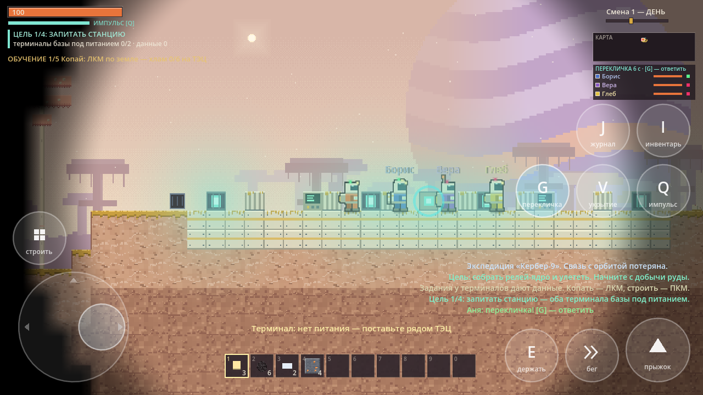

| Касание | Действие |
|---|---|
| **джойстик** слева | ходьба; отклонить вверх — прыжок |
| **прыжок** | прыжок (короткий тап тоже засчитывается) |
| **бег** | бег вкл/выкл — защёлка, держать не нужно |
| **E «держать»** | взаимодействие, как клавиша E |
| **Q «импульс»** / **V «укрытие»** | импульс / вентиляция |
| **G «перекличка»** | только в сетевой игре с товарищами: начать перекличку или ответить на неё, как клавиша G; пока идёт перекличка, кнопка подсвечена. Кнопки справа тогда встают под плашку команды, а Q, V и G — в один ряд |
| **I «инвентарь»** / **J «журнал»** | открыть или закрыть окно; пока окно открыто, видны только эти две кнопки |
| **тап по миру** | копать или бить фантома; держите палец, чтобы копать дальше |
| **долгий тап** (от 0,4 с) по пустой клетке | поставить выбранный предмет; по конвейеру — повернуть |
| **строить** | режим постройки: короткий тап по миру сразу ставит предмет |
| **тап по хотбару** | выбрать ячейку |
| в инвентаре и журнале | тап работает как ЛКМ; проведите пальцем, чтобы листать рецепты и обрывки |
| экран гибели или финала | тап — новая попытка |

Пальцев может быть сколько угодно: можно идти джойстиком и одновременно копать тапом.
Кнопки не меньше 9 мм на экране и не закрывают HUD, миникарту, хотбар и уведомления.
Поля ввода в меню открывают экранную клавиатуру: у порта она цифровая.

## Интерфейс

### HUD

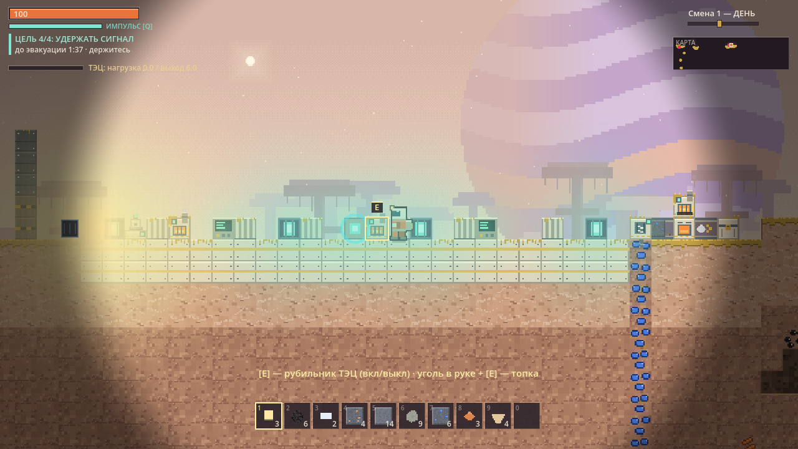

| Где | Что |
|---|---|
| слева вверху | **здоровье** (100; каждые 6 с +6) и полоса **импульса [Q]** — заполнилась, значит готов |
| под ними | **трекер цели**: «ЦЕЛЬ n/4: …» и строка прогресса, например «терминалы базы под питанием 1/2 · данные 5», «данные 12/15 · узлы 2/5 · следующий T3», «детали 3/5 · Микросхема 10/24 · [E] у ядра», «до эвакуации 1:37 · держитесь» |
| ниже | **мощность** генератора под курсором или ближайшего: «ТЭЦ: нагрузка 3.0 / выход 6.0» и пометки «ВЫКЛ», «нет угля», «ПЕРЕГРУЗ». Если перегружена сеть без генератора рядом — «ПЕРЕГРУЗ СЕТИ — станки замедлены» |
| ниже | строка **обучения** «ОБУЧЕНИЕ n/5 …» — пока не отработают терминалы базы |
| справа вверху | «Смена N — УТРО / ДЕНЬ / ВЕЧЕР / СУМЕРКИ / НОЧЬ», полоса суток и **миникарта** (рельеф, вы и релей-ядро; неразведанное скрыто) |
| вверху по центру | в сумерках — «НОЧЬ ЧЕРЕЗ N с», последние 5 с мигает |
| по углам экрана | ночью — красные уголки-скобки опасности |
| справа внизу | уведомления: задания, смена этапа, находки, «Сигнал: осталось N с» |
| внизу по центру | подсказка к цели E (например, «[E] — выполнить задание (удерживать)») и **хотбар** 1…0 |

**Туман войны.** Неразведанное — чёрное. Вокруг героя открывается круг обзора:
16 клеток на поверхности и 8 под землёй. Разведанное вне круга остаётся видно, но затемнено.

### Инвентарь и крафт (I / Tab)

Окно «ИНВЕНТАРЬ И КРАФТ» разделено на две части. Слева — сундук (если вы открыли его
через E), под ним ваши 36 ячеек: верхний ряд из 10 ячеек — хотбар (с номерами клавиш 1…0),
ниже, за чертой, — рюкзак, а ещё ниже — цель «Релей-ядро»
с отметками «есть / нужно» по каждой детали. Справа — четыре вкладки: «Ручной крафт»,
«Плавильня», «Сборщик», «Исследования».

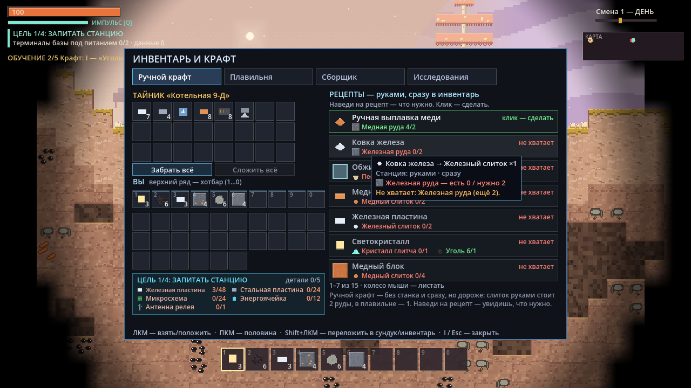

- **ЛКМ** по ячейке — взять стопку в руку (она рисуется у курсора) и положить её в другую
  ячейку. **ПКМ** — взять половину, а с предметом в руке — положить по одному.
- **Shift+ЛКМ** — переложить стопку сразу: при открытом сундуке — между сундуком и
  инвентарём, без сундука — между хотбаром и рюкзаком.
- **«Забрать всё»** переносит весь сундук в инвентарь, **«Сложить всё»** — весь рюкзак
  в сундук (хотбар остаётся при вас).
- Если закрыть окно с предметом в руке, он вернётся в инвентарь. Нет места — уйдёт
  в сундук, совсем некуда — упадёт под ноги.
- **Наведите курсор на рецепт**, чтобы увидеть подсказку: что получится, станцию и время,
  «есть N / нужно M» по каждому входу (нехватка выделена красным), «Где взять» и почему
  сейчас нельзя («Не хватает: …», «нужен T1», «Подойди к плавильне ближе (≤ 5 клеток)»).
  Справа в строке рецепта стоит короткий ярлык: «клик — сделать», «клик — загрузить»,
  «не хватает», «нужен T…», «нет станка».
- Список рецептов листается колесом мыши.

**Вкладки рецептов.** «Ручной крафт» доступен всегда и срабатывает мгновенно, но стоит
дороже: слиток руками — 2 руды. Здесь же первые постройки: плавильня, угольная ТЭЦ,
солнечная панель, конвейер, сундук, а после T1 — сборщик. На вкладках «Плавильня» и
«Сборщик» клик **загружает сырьё в станок рядом** (ближе 5 клеток), а работает станок
сам и только под питанием. Рецепты закрытых узлов показаны серым с пометкой «нужен T…».

### Исследования

Вкладка «Исследования» в том же окне. Вверху справа написано, сколько у вас данных.
Узлы открываются по порядку, кнопкой «Открыть (N данных)»:

| Узел | Цена | Что открывает |
|---|---|---|
| T1 «Сборка» | 5 | сборщик, прокат меди и железа в плавильне, микросхема, энергоячейка, конвейер и сундук в сборщике, манипулятор |
| T2 «Оборона» | 10 | стальная стена, турель-разрядник, шлюз |
| T3 «Бурение» | 15 | буровая станция, анализатор, прожектор |
| T4 «Герметизация» | 20 | решётка вентиляции, глубинный бур |
| T5 «Релей» | 25 | антенна релея |

Данные приходят из трёх источников. Задание на терминале даёт +5: терминалов 9
(2 на базе и по одному в 7 руинах), то есть всего 45. Чёрный ящик, выпавший из фантома,
даёт +1 и обрывок журнала. Анализатор даёт +1 за каждый кристалл глитча, по 20 с на
кристалл.

### Журнал экспедиции (J)

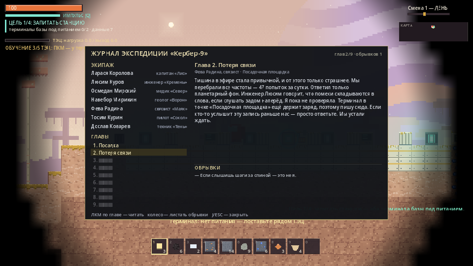

Здесь собран экипаж «Кербер-9» (7 человек с ролями и позывными), 9 глав журнала и обрывки.
Главы читаются на терминалах: 1–2 на базе, остальные в руинах. Непрочитанная глава
выглядит как «▒▒▒». **ЛКМ** по главе открывает её текст. Обрывки приходят из чёрных
ящиков и самописцев, колесо мыши листает их список. Тексты, имена и места генерируются
из сида мира. Кто-то в списке экипажа — «не тот», но журнал этого не выдаёт.

## Цель: четыре этапа релея

Текущий этап показывает трекер в HUD и блок цели в инвентаре. О смене этапа приходит
уведомление.

| Этап | Что сделать |
|---|---|
| **1/4 ЗАПИТАТЬ СТАНЦИЮ** | выполнить задания на обоих терминалах базы (им нужно питание): +10 данных, главы 1–2 |
| **2/4 СОБРАТЬ ДАННЫЕ** | накопить данные и открыть узлы по порядку до **T5 «Релей»** |
| **3/4 СОБРАТЬ РЕЛЕЙ** | сдать в релей-ядро **48 железных пластин, 24 стальные пластины, 24 микросхемы, 12 энергоячеек и антенну релея** (в сети — больше, см. «Игра по сети») |
| **4/4 УДЕРЖАТЬ СИГНАЛ** | продержаться **180 секунд** после запуска |

**Сдача деталей.** Подойдите к релей-ядру и удерживайте **E** 3 с. Ядро заберёт из
инвентаря всё, чего ему ещё не хватает («В релей сдано: …»), и напишет, сколько осталось
(«Релею не хватает: …»). Сдавать можно частями. Когда набрано всё, следующее удержание
E запускает релей.

**Удержание сигнала.** Фантомы идут волнами и днём: до 10 одновременно, бюджет ночи
растёт. Об остатке напоминают уведомления на 150, 120, 90, 60, 30 и 10 секундах.
Когда сигнал уходит, начинается эвакуация, а финальный экран показывает эпилог
экспедиции и итоги забега: добыто блоков, изготовлено предметов, уничтожено фантомов,
выполнено заданий, смертей и время.

## Фабрика и питание

- **Питание — это бюджет.** Угольная ТЭЦ даёт **6** единиц мощности в радиусе **8 клеток**.
  Солнечная панель даёт **2** в радиусе **6 клеток** и только днём: она гаснет с началом
  ночи. Потребители: буровая 2, плавильня 0,5, сборщик 2, манипулятор 0,5, анализатор 2,
  турель 2, прожектор 1, глубинный бур 4. Конвейер и сундук питания не требуют.
- Машина питается от **ближайшего** работающего генератора, в чей радиус попала. Мощности
  соседних генераторов не складываются. Если нагрузка генератора больше его мощности,
  все его машины **замедляются** в одной пропорции (выход ÷ нагрузка). Вне радиуса машина
  стоит.
- Лампа на генераторе: зелёная — норма, жёлтая — перегруз, красная — выключен
  рубильником. Выключенная ТЭЦ уголь не жжёт.
- Уголь в ТЭЦ можно положить руками (E), конвейером или манипулятором. В топку влезает 12.
- Пример: одна ТЭЦ (6) держит стартовую линию из бура (2), двух плавилен (0,5 + 0,5),
  двух манипуляторов (0,5 + 0,5) и сборщика (2) — ровно 6.

| Машина | Что делает |
|---|---|
| Буровая станция (T3) | копает столбец под собой до 16 клеток вниз, по клетке за 2 с, начиная с нижней; добытое отдаёт на соседний конвейер или в соседнюю постройку |
| Глубинный бур (T4) | то же, но клетка за 1,2 с и до 40 клеток вниз |
| Плавильня | руда → слитки, слитки → пластины и сталь, песок → стекло; сама берёт первый открытый рецепт, на который хватает загруженного |
| Сборщик (T1) | микросхемы, энергоячейки, конвейеры, сундуки, манипуляторы, буры, анализатор, турель, прожектор, шлюз, решётка, антенна |
| Конвейер | везёт предметы по стрелке со скоростью 1,5 клетки/с и сам сдаёт их в постройку, в которую упирается; при постройке поворачивается к соседней постройке, ПКМ — повернуть |
| Манипулятор (T1) | раз в 1,2 с переносит предмет из клетки сзади в клетку спереди; берёт только то, что примет приёмник; E с предметом в руке — фильтр |
| Анализатор (T3) | кристалл глитча → 1 данные за 20 с, в лотке до 10 кристаллов |
| Сундук | 24 ячейки; конвейеры и станки кладут в него, манипулятор забирает |

Станок отдаёт готовое по порядку: сначала на соседний конвейер, потом в соседнюю
постройку, которая это примет, потом манипулятору (до 20 готовых предметов ждут в
станке), а иначе бросает на землю. Станки принимают только сырьё **открытых** рецептов,
поэтому лишнее в них не застревает. Две плавильни вплотную передают слитки из первой
во вторую сами.

**Плавильня.** Рецепты при полном питании:

| Рецепт | Вход → выход | Время | Узел |
|---|---|---|---|
| Выплавка железа | 1 железная руда → 1 слиток | 2,0 с | — |
| Выплавка меди | 1 медная руда → 1 слиток | 1,6 с | — |
| Плавка стекла | 2 песка → 1 стекло | 2,2 с | — |
| Стальная пластина | 2 железных слитка + 1 уголь → 1 | 3,5 с | — |
| Прокат меди / железа | 2 слитка → 1 пластина | 2,0 с | T1 |
| Стальная стена | 2 стальные пластины → 4 | 2,0 с | T2 |

## Ночь и оборона

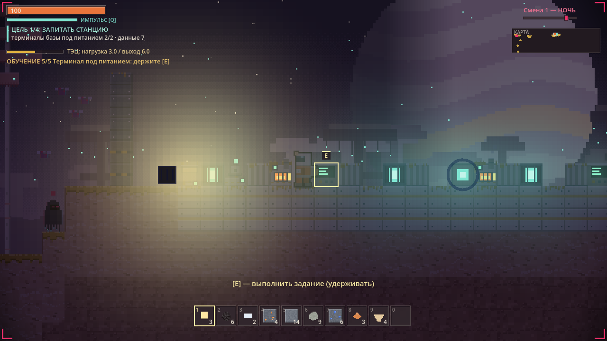

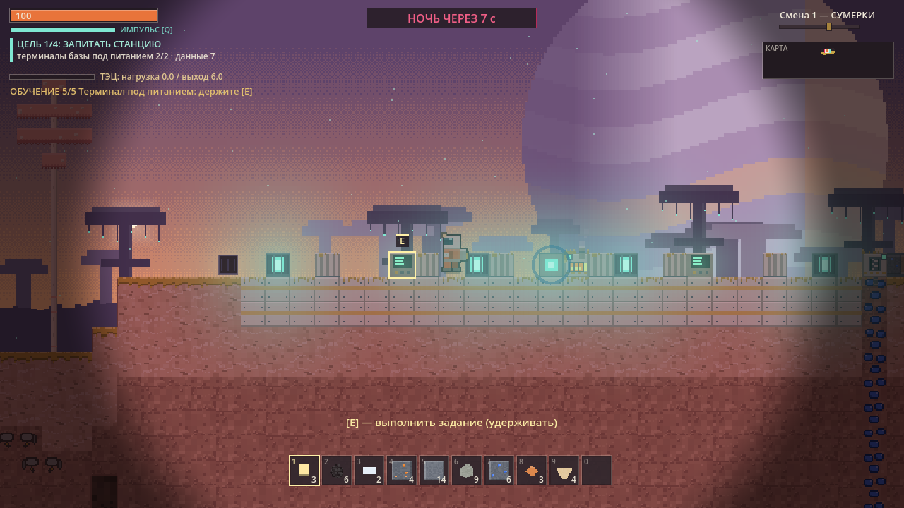

**Сутки.** Полный цикл длится 240 с. Утро, день и вечер безопасны. Сумерки длятся около
14 с: вентиляции гудят, а наверху идёт отсчёт «НОЧЬ ЧЕРЕЗ N с». Ночь длится около 91 с.
С каждым рассветом начинается новая смена («Смена N. Фантомы голоднее.»).

**Откуда приходят фантомы.** Ночью директор угрозы выдаёт бюджет: `3 + 2·T`, где
`T = номер смены + 0,25 за каждый работающий генератор + 0,02 за каждую вашу лампу`
(на удержании сигнала ещё +4). Одновременно живут до `2 + номер смены` фантомов, но не
больше 10. Новые появляются раз в 2,5–7 с. Выходят они из трёх ближайших к вам
незапечатанных вентиляций: сначала из вентиляции 2 с идёт пар и гул, потом появляется
фантом. Вентиляция ближе 160 px к вам не выпускает.

**Кто приходит.** Каждый тип — с указанной ночи:

| | Тип | HP | Удар | С ночи | Повадки |
|---|---|---|---|---|---|
| 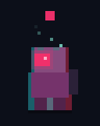 | Эхо | 100 | 24 | 1 | охотится на героя; убегает со света ярче 0,55 |
| 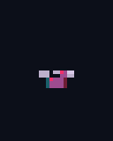 | Рой | 30 | 8 | 2 | стая из 4–6 споровых мотыльков; летит на работающий бур или сборщик ближе 300 px; свет не пугает |
| 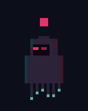 | Тень | 180 | 18 | 3 | чует генератор за 640 px; у ТЭЦ сжигает 1 уголь в 3 с; идёт бить прожектор; свет не пугает |
| 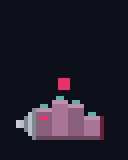 | Копатель | 140 | 30 | 4 | роет глину, камень и хлам (не твёрже 1,5), чует героя сквозь породу за 600 px, грызёт решётку вентиляции; убегает от света ярче 0,8 |
|  | Двойник | 120 | 40 | 6 | не больше одного; носит скафандр своей цели, но визор у него цвета опасности, а над головой имя одного из экипажа (в сети — ник и вид товарища, см. [«Сетевая игра»](#что-общее-а-что-личное)); замирает, когда вы смотрите на него ближе 200 px; на удержании сигнала приходит в любую ночь |

Обычный фантом замечает вас за 170 px ночью (днём за 120), если видит, и слышит шум за
260 px. Бег и копка громче ходьбы. Фантомы бьют и машины: у каждой 100 HP, у турели 120.
Разрушенная машина с вероятностью 50 % оставляет свой предмет.

**Как защищаться.**

| Средство | Как работает |
|---|---|
| Свет | эхо и копатель уходят с ярко освещённых клеток. Светокристалл — 1,0 (крафт: кристалл + уголь), прожектор — 2,0 |
| ЛКМ по фантому | 38 урона, удар раз в 0,45 с |
| Импульс **Q** | 10 урона и оглушение на 3 с всем ближе 130 px, перезарядка 8 с |
| Вентиляция **V** | спрятаться ближе 40 px от вентиляции: 6 с неуязвимости, потом выталкивает, снова — через 10 с |
| Турель-разрядник (T2) | 20 урона раз в 0,8 с по фантомам в 7 клетках при прямой видимости; тянет 2; цели по важности: тень, рой, копатель, двойник, эхо |
| Прожектор (T3) | свет 2,0 от сети, тянет 1; гаснет, если питания меньше 50 % |
| Стальная стена (T2) | самый прочный блок (копка 4,0 с); копатель её не роет |
| Шлюз (T2) | дверь: открывается, когда вы ближе 1,5 клетки, и не открывается, если фантом ближе 3 клеток |
| Решётка вентиляции (T4) | ставится только на вентиляцию и запечатывает её: оттуда фантомы не выходят; копатель прогрызает её за 8 с |
| Ремонт | E с хламом в руке у повреждённой машины, +20 HP за штуку |

Чёрный ящик выпадает с убитого фантома с шансом 25 %, а у двойника — всегда. Он сразу
вскрывается: +1 данные и обрывок журнала.

**Гибель.** Через 3 с вы появляетесь в капсуле на базе, а время перескакивает к рассвету.
**Хотбар** остаётся мешком на месте гибели: мешок не исчезает, подойдите и заберите.
Остальной инвентарь остаётся при вас. В режиме «Хардкор» гибель заканчивает забег.

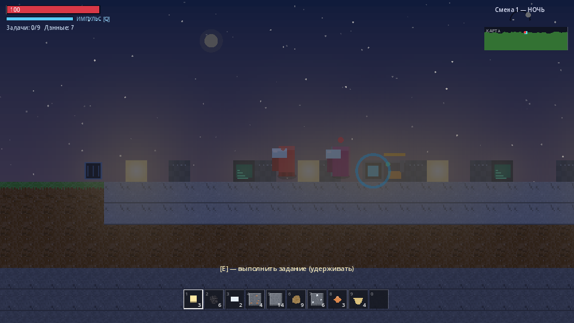

## Сетевая игра

До 4 игроков в одной локальной сети (Wi-Fi или кабель). Один из игроков — хост, мир
живёт у него. Всё делается в главном меню, мышью или тапами.

### Создать игру

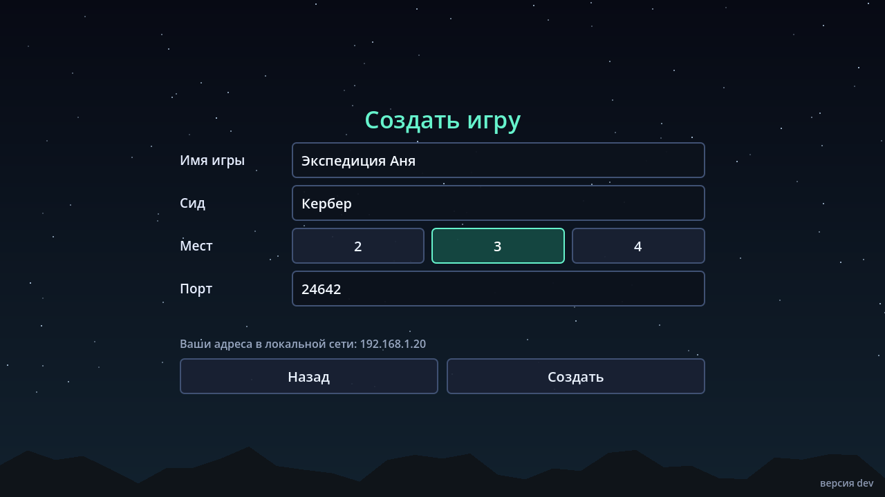

| Поле | Что вписать |
|---|---|
| Имя игры | 1–24 символа, по умолчанию «Экспедиция <ник>» |
| Сид | пусто — случайный мир |
| Мест | 2, 3 или 4 (по умолчанию 4) |
| Порт | 1024–65535, по умолчанию 24642; порт 24643 занят поиском игр |

Под формой написаны ваши адреса в локальной сети. После «Создать» хост попадает в
**лобби**: там крупно показан адрес для «По IP», список игроков с ником, видом и
отметкой «готов» / «ждём», и кнопки «Закрыть игру» и «Старт». «Старт» загорается,
когда все вошедшие нажали «Готов». Хост может начать и один. Войти можно и после
старта: игра видна в поиске всё время, пока идёт.

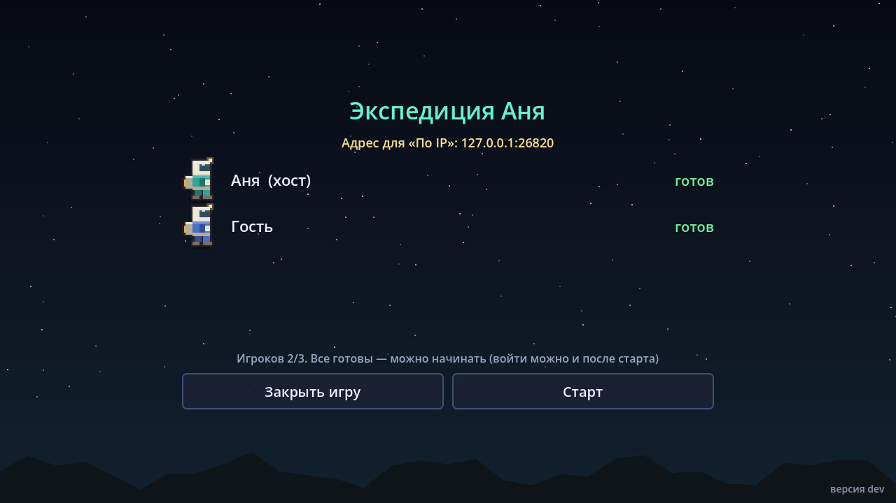

### Найти игру

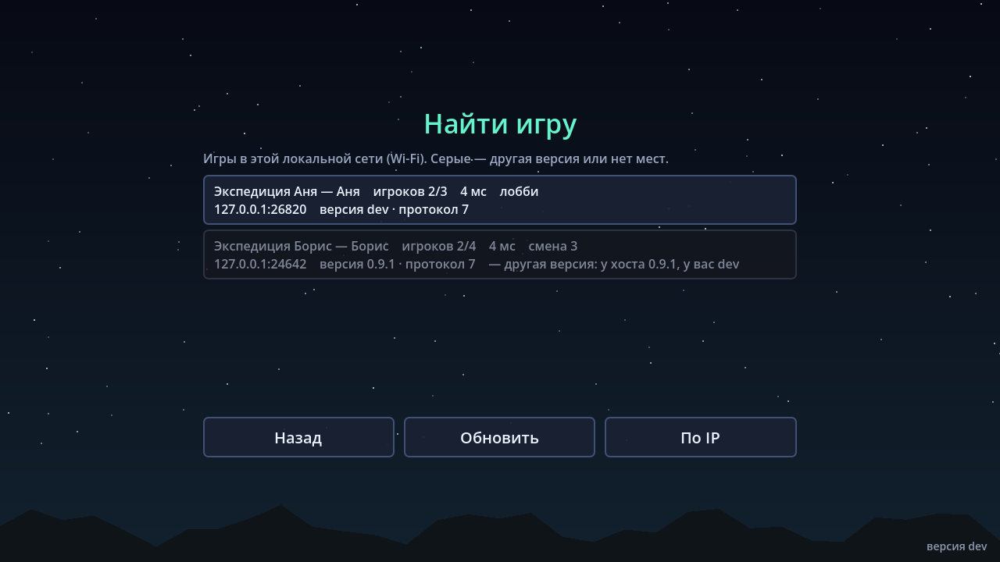

Здесь список игр в этой сети. В строке: имя, ник хоста, «игроков n/max», пинг, «лобби»
или «смена N», адрес, версия сборки и протокол. Серая строка недоступна, причина
написана рядом: «другая версия: у хоста …, у вас …», «другой протокол …», «мест нет».
Кнопка «Обновить» ищет заново, «По IP» переводит к вводу адреса. Нажмите на игру, чтобы
войти в лобби, затем нажмите «Готов».

### Подключиться по IP

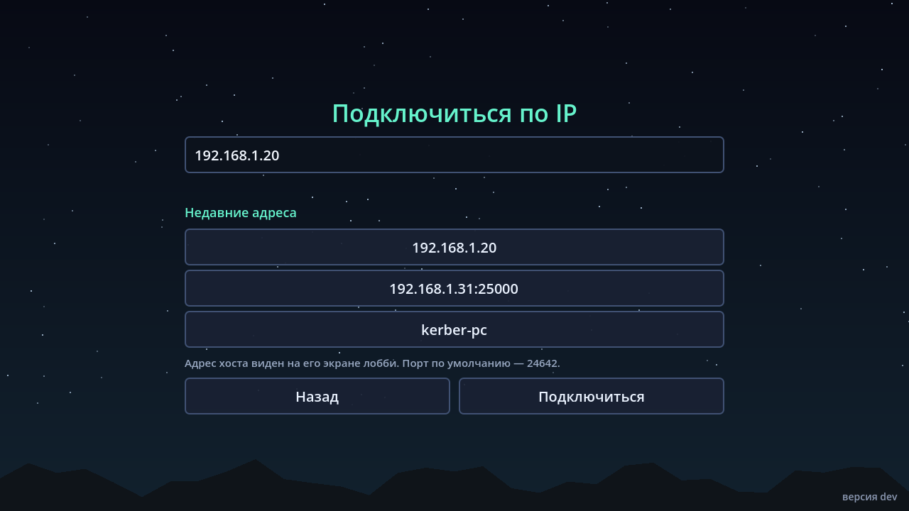

Можно ввести `192.168.1.20`, `192.168.1.20:25000` или имя компьютера. Последние 5 удачных
адресов показаны кнопками. Этот способ работает всегда, даже когда поиск игру не видит:
гостевой Wi-Fi, телефон в роли хоста. Адрес хоста показан на экране его лобби.

### Версии, порты, брандмауэр

- Подключиться можно, только если у хоста и у вас **одинаковые** версия сборки и протокол.
- Игра идёт по **24642/UDP**, поиск — по **24643/UDP** (широковещательный запрос, хост
  отвечает напрямую).
- **Брандмауэр Windows.** Когда вы первый раз создаёте игру, Windows спрашивает, пускать
  ли игру в сеть. Разрешите для **частных сетей**. Если окно закрыли кнопкой «Отмена»,
  игру никто не найдёт: «Панель управления» → «Брандмауэр Защитника Windows» →
  «Разрешение взаимодействия с приложением» → отметьте «ГЛИТЧ-КОРЕ» (или Godot) в
  столбце «Частные».
- **Телефон.** Android-клиент находит игры без дополнительных разрешений. Если телефон
  в роли хоста не виден в поиске, подключайтесь по IP с его экрана лобби. Точка доступа
  на телефоне работает так же, как обычный Wi-Fi.

### Что общее, а что личное

| Общее для команды | Личное у каждого |
|---|---|
| мир: тайлы, вода, постройки, сундуки, предметы на земле | инвентарь и хотбар |
| время суток, смена, этап цели, отсчёт релея | здоровье, импульс, укрытие |
| данные, открытые узлы, главы журнала, обрывки (открыть узел может любой) | вид и ник (видны над головой) |
| терминал: задание засчитывается один раз, всем приходит «<ник>: терминал «…» прочитан, +5 данных» | новый игрок получает стартовый набор |
| релей: детали сдаёт каждый из своего инвентаря, сданное копится в ядре | |

- **Удержание сигнала в сети.** Отсчёт идёт, только пока у ядра ближе 12 клеток есть
  живой, не спрятавшийся герой на связи. Иначе отсчёт стоит, но не сбрасывается.
  В HUD тогда горит «СИГНАЛ БЕЗ ПРИСМОТРА».
- **Релею нужно больше деталей.** При N игроках требование умножается на `1 + 0,25·(N−1)`
  и округляется по каждой детали: вдвоём — 60 железных пластин, 30 стальных, 30 микросхем,
  15 энергоячеек и 1 антенна; вчетвером — 84, 42, 42, 21 и 2. Требование пересчитывается,
  когда игрок входит или выходит, и не опускается ниже уже сданного. HUD и окно цели
  в инвентаре показывают текущие цифры.
- **Фантомов больше.** При N игроках бюджет ночи умножается на `1 + 0,5·(N−1)`, лимит
  одновременных растёт на `2·(N−1)` (не больше 16), а интервал появления делится на
  `1 + 0,35·(N−1)` (не меньше 1,5 с). Фантом идёт к ближайшему герою.
- **Команда в HUD.** Под миникартой появляется плашка «КОМАНДА»: ник каждого товарища
  цветом его скафандра, полоска здоровья или «погиб». На миникарте товарищ виден
  **маячком** цвета скафандра, только если он ближе 20 клеток к вам или стоит в зоне
  питания работающего генератора. Иначе маячка нет. Над головой у каждого — ник.
- **Двойник среди своих.** Когда живых двое и больше, двойник надевает **ник и вид
  товарища**, который сейчас дальше всех от жертвы, а охотится на того, кто дальше
  всех отбился от команды. На миникарте маячка у двойника нет никогда, на перекличку
  он не отвечает, а под взглядом любого из вас замирает. Если его ударить, на 1,5 с
  проступает настоящий облик с глитч-всплеском у всех.
- **Перекличка — клавиша G** (на телефоне кнопки для неё пока нет). Первое нажатие
  начинает перекличку: у всех «<ник>: перекличка! [G] — ответить», а в плашке команды
  появляется «ПЕРЕКЛИЧКА n с · [G] — ответить». Ответить можно в течение 6 с, нажав G.
  У ответившего на шлеме 4 с горит зелёный огонёк, у молчащего в плашке — красный.
  Начать новую перекличку один игрок может не чаще раза в 20 с.
- **Огня по своим нет.** Импульс задевает только фантомов. ЛКМ по товарищу урона не
  наносит: слышен «клац», приходит «Свой: <ник>», и удар на секунду уходит на
  перезарядку. Проверить подозрительного «товарища» можно, но это стоит времени.
- **Вентиляция.** В одной вентиляции помещается один герой. Если она занята, придёт
  «Вентиляция занята: <ник>».
- **Гибель.** Появляется экран «ТЕБЯ НАШЛИ» и смотрит глазами живого товарища (A/D —
  следующий). Через 15 с вы появляетесь в капсуле на базе, а время **не** перескакивает.
  Мешок с хотбаром первые 120 с может поднять только владелец. Если погибла вся команда,
  все появляются на базе через 3 с, а время перескакивает к рассвету. На финальном
  экране к итогам добавляются строки «<ник>: смертей N».
- **Обрыв связи.** Если клиент молчит дольше секунды, его герой стоит «без связи»: урона
  не получает и целью для фантомов не служит. Вышедший игрок («<ник> покидает
  экспедицию.») при возвращении получает своего героя обратно. Если хост завершает
  игру, у клиентов сессия заканчивается, и их возвращает в меню.

## Настройки

**Меньше глитча и мерцания** — переключатель в главном меню. В обычном режиме глитч
появляется только рядом с угрозой и не дольше 0,5 с: «артефакты сжатия» у релея, когда
он ловит сигнал, разрыв строк, когда раскрыт двойник или перегружена сеть, блоки у
вентиляции перед появлением фантома. С включённой настройкой экранных эффектов нет
совсем, а расслоение силуэта фантомов не мигает. Важные события (запуск релея,
раскрытый двойник) отмечаются спокойной плавной вспышкой. Настройка хранится в профиле.

**Хардкор** — переключатель в меню, действует на одиночную игру: одна жизнь, без
сохранений. Гибель показывает эпитафию и итоги, R начинает новую попытку.

**Профиль** — ник и вид скафандра, см. [«Главное меню и профиль»](#главное-меню-и-профиль).

## Сохранение

- **F5** сохраняет забег, **F9** загружает. Слот один, файл `user://save_1.sav` (папка —
  та же, что у профиля). Сохраняется всё: мир, вода, туман войны, постройки с
  содержимым, предметы на земле и мешок, герой с инвентарём, время, цель, исследования,
  журнал, тайники. Фантомы поштучно не пишутся: после загрузки оставшиеся этой ночью
  выйдут из вентиляций заново.
- Сохранить нельзя, если герой погиб или забег окончен. В хардкоре F5 и F9 не работают.
- **В сетевой игре** сохраняет только хост. F5 у хоста пишет тот же слот `save_1.sav`,
  а ещё хост сохраняет игру сам на каждом рассвете в слот `mp_<имя игры>_auto`. У клиента
  F5 отвечает «сохраняет хост». F9 в сети выключен у всех.

## Справочник объектов

Здесь всё, что есть в мире: картинка, где найти и что делает. Числа взяты из кода
(`DB`, `Balance`, скрипты машин и мира). «Копка» — секунды, за которые клетка ломается
под ЛКМ. Мир — 640 × 180 клеток. Глубина руды считается как доля пути от поверхности
до дна мира, примерно 136 клеток: 6 % — около 8 клеток, 22 % — около 30, 45 % — около 61.

### Тайлы и руды

Порода выглядит по-разному в трёх биомах по глубине, хотя тайл один и тот же:
**поверхность** (розовая глина под горчичным лишайником), **средние пещеры** с 25 %
глубины (фиолетовый камень с бирюзовыми нитями мицелия) и **глубина у лавы** с 55 %
(тёмно-красная «плоть» со светящимися трещинами). На листе ниже каждый тайл показан
в трёх биомах (столбцы по четыре) с разными открытыми кромками.

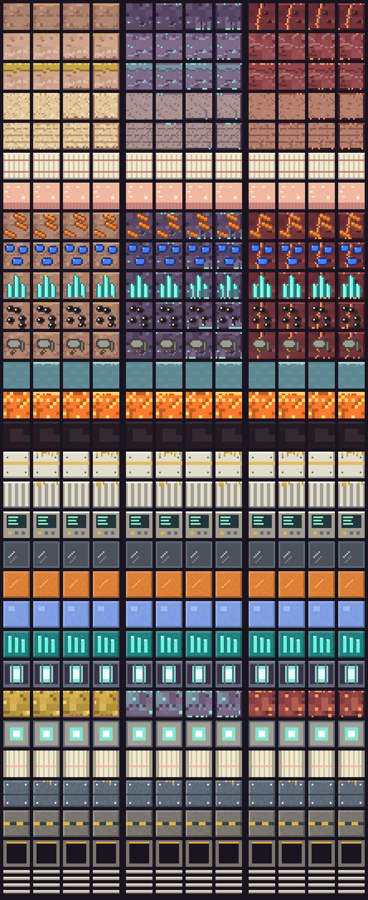

| | Тайл | Где | Копка | Что даёт |
|---|---|---|---|---|
| 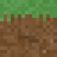 | Лишайник | верхний слой поверхности | 0,6 с | хлам |
| 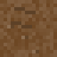 | Глина | 3 клетки под лишайником | 0,5 с | хлам |
| 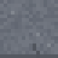 | Камень | основная порода, вид меняется по биомам | 1,4 с | камень |
| 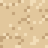 | Песок | берега у воды | 0,4 с | песок |
| 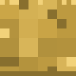 | Лишайниковая кочка | кочки на лишайнике | 0,6 с | хлам |
|  | Стебель свечника | ствол свечника; сквозь него можно пройти | 1,0 с | волокно стебля |
| 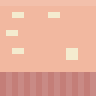 | Шляпка свечника | шляпки свечника; без опоры падает | 0,2 с | — |
| 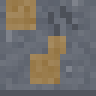 | Хлам | жилы до 35 % глубины, ряд над коренной породой, кучи у руин | 1,0 с | хлам |
| 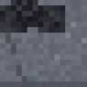 | Уголь | жилы глубже 3 %, почти сразу под землёй | 1,8 с | уголь |
| 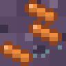 | Медная руда | жилы глубже 6 % (около 8 клеток) | 2,0 с | медная руда |
| 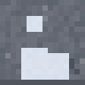 | Железная руда | жилы глубже 22 % (около 30 клеток) | 2,6 с | железная руда |
| 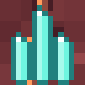 | Кристалл глитча | жилы глубже 45 % (около 61 клетки); в кристальных полосах мира — вкраплениями прямо под поверхностью; слабо светится | 3,4 с | кристалл глитча |
| 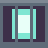 | Светокристалл | на поверхности, 4 на базе, по одному в руинах; свет 1,0 | 0,6 с | светокристалл |
|  | Вода | низины ниже уровня моря; течёт и заполняет ямы | — | не копается, в неё можно ставить блоки |
| 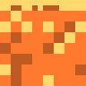 | Лава | пещеры ниже 126-й строки; светится | — | не копается, **18 урона в секунду** |
| 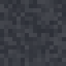 | Коренная порода | 3 нижние строки мира | — | не копается, бур на ней останавливается |
| 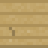 | Песчаник | в мире сейчас не генерируется | 1,2 с | камень |

Постройки станции и блоки, которые ставит игрок (**ПКМ** с предметом в руке; блоки
можно ставить прямо в воздух):

| | Тайл | Где / как поставить | Копка | Что даёт |
|---|---|---|---|---|
| 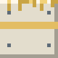 | Сталь | пол базы, руин и небесного обломка | 3,0 с | — |
| 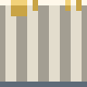 | Панель | стены руин, декор базы; в панель превращается отработавший терминал | 3,0 с | — |
|  | Терминал | 2 на базе и по одному в 7 руинах; светится | 3,0 с | — |
|  | Стекло | окна руин, иллюминатор обломка | 0,8 с | — |
|  | Релей-ядро | центр базы; светится | — | не копается |
| 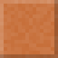 | Медный блок | из предмета | 2,4 с | медный блок |
| 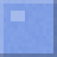 | Железный блок | из предмета | 2,8 с | железный блок |
|  | Кристальный блок | из предмета; светится | 2,6 с | кристальный блок |
| 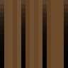 | Волокно стебля | из волокна (в отличие от стебля — твёрдое) | 1,0 с | волокно стебля |
| 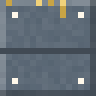 | Стальная стена | из предмета; копатель её не роет | 4,0 с | стальная стена |
| 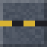  | Шлюз (закрыт / открыт) | из предмета; открывается перед героем, но не при фантоме рядом | 3,0 с | шлюз |
| 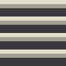 | Решётка вентиляции | только на вентиляцию; запечатывает её | 1,0 с | решётка |

### Флора

Флора — это только картинка: сквозь неё можно пройти, кроме стебля и шляпок свечника,
которые описаны выше. Растёт она по биомам: на лишайнике «пузырник», низкая «полка» и
дождевики; в средних пещерах — завеса гиф с потолка и трутовики на ножке; в глубине —
мембранные мешки и трубки. Ночью споры на флоре и в воздухе светятся.

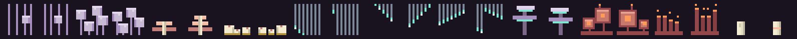

| Поверхность: свечник | Средние пещеры: завеса гиф |
|---|---|
| 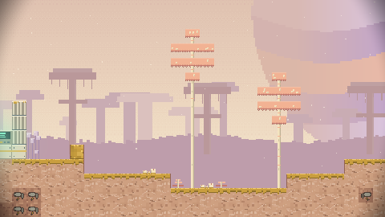 |  |

### Предметы

Рецепты: «руками» — вкладка «Ручной крафт», «плавильня» и «сборщик» — станок рядом.
Узлы T1…T5 — см. [«Исследования»](#исследования); без пометки рецепт открыт с начала.
Время указано при полном питании. «Тайники» — у каких хозяев руин встречается предмет
(роль хозяина задаёт лор сида).

**Сырьё**

| | Предмет | Как получить | Зачем |
|---|---|---|---|
|  | Хлам | лишайник, глина, кочки, тайл «хлам»; тайники: медик | ТЭЦ, плавильня; ремонт машин +20 HP |
|  | Камень | камень, песчаник; тайники: геолог | плавильня; ставится как блок |
|  | Песок | песок у воды; тайники: медик | стекло; ставится как блок |
|  | Волокно стебля | стебли свечников | ставится как блок |
|  | Уголь | угольные жилы; тайники: геолог, пилот; 6 на старте | топливо ТЭЦ (45 с), стальная пластина, светокристалл |
|  | Медная руда | медные жилы; тайники: геолог; 4 на старте | медный слиток |
|  | Железная руда | железные жилы; тайники: геолог | железный слиток |
|  | Кристалл глитча | кристальные жилы; тайники: медик, геолог, связист; небесный тайник | микросхема, энергоячейка, светокристалл, кристальный блок, прожектор; анализатор → данные |

**Слитки и компоненты**

| | Предмет | Как получить | Зачем |
|---|---|---|---|
|  | Медный слиток | руками: 2 медной руды (1,0 с); плавильня: 1 руда (1,6 с); тайники: связист, техник | медная пластина, медный блок |
|  | Железный слиток | руками: 2 железной руды (1,2 с); плавильня: 1 руда (2,0 с); тайники: пилот, техник | железная и стальная пластины, железный блок |
|  | Стекло | руками или в плавильне: 2 песка (1,0 / 2,2 с); тайники: медик, связист | солнечная панель, анализатор, прожектор, антенна |
|  | Медная пластина | руками: 2 медных слитка (1,0 с); плавильня, T1: 2 слитка (2,0 с); тайники: инженер, связист | микросхема, сборщик, манипулятор, солнечная панель, прожектор, антенна |
|  | Железная пластина | руками: 2 железных слитка (1,2 с); плавильня, T1: 2 слитка (2,0 с); тайники: капитан, инженер, техник; 2 на старте | ТЭЦ, конвейер, сундук, сборщик, буровая, анализатор, решётка; **48 — в релей** |
|  | Стальная пластина | плавильня: 2 железных слитка + 1 уголь (3,5 с); тайники: капитан, инженер, пилот; небесный тайник | глубинный бур, стальная стена, турель, шлюз; **24 — в релей** |
|  | Микросхема | сборщик, T1: 1 медная пластина + 2 кристалла (3,0 с); тайники: капитан, связист; небесный тайник | буровая, анализатор, турель, шлюз, глубинный бур; **24 — в релей** |
|  | Энергоячейка | сборщик, T1: 1 железная пластина + 1 кристалл (3,0 с); тайники: капитан, медик, пилот; небесный тайник | турель; **12 — в релей** |

**Постройки** (как они выглядят в мире — в таблице [«Машины»](#машины))

| | Предмет | Как получить | Стак |
|---|---|---|---|
|  | Угольная ТЭЦ | руками: 2 железные пластины + 6 хлама (2,5 с); тайники: пилот | 5 |
|  | Солнечная панель | руками: 1 медная пластина + 1 стекло (2,0 с); тайники: капитан, связист; небесный тайник | 5 |
|  | Плавильня | руками: 6 камня + 4 хлама (2,0 с); тайники: техник | 5 |
|  | Конвейер | руками: 1 железная пластина → 1 (1,5 с); сборщик, T1: 1 пластина → **2** (1,5 с); тайники: инженер, техник | 30 |
|  | Сундук | руками: 4 железные пластины (2,5 с); сборщик, T1: 3 пластины (2,0 с); тайники: техник | 10 |
|  | Сборщик | руками, T1: 4 железные + 2 медные пластины (3,0 с); тайники: инженер | 3 |
|  | Манипулятор | сборщик, T1: 1 железная + 1 медная пластина (2,0 с) | 30 |
|  | Буровая станция | сборщик, T3: 4 железные пластины + 2 микросхемы (4,0 с); тайники: инженер, геолог | 5 |
|  | Анализатор | сборщик, T3: 4 железные пластины + 2 микросхемы + 2 стекла (4,0 с); небесный тайник | 3 |
|  | Глубинный бур | сборщик, T4: 1 буровая + 4 стальные пластины + 2 микросхемы (6,0 с); небесный тайник | 3 |
|  | Турель-разрядник | сборщик, T2: 3 стальные пластины + 2 микросхемы + 1 энергоячейка (5,0 с) | 5 |
|  | Прожектор | сборщик, T3: 2 медные пластины + 1 стекло + 1 кристалл (2,5 с); небесный тайник | 10 |
|  | Светокристалл | руками: 1 кристалл + 1 уголь (0,8 с); тайл «светокристалл»; тайники: капитан, медик, пилот; 3 на старте | 20 |

**Блоки и оборона**

| | Предмет | Как получить | Зачем |
|---|---|---|---|
|  | Медный блок | руками: 4 медных слитка (1,0 с) | строительный блок |
|  | Железный блок | руками: 4 железных слитка (1,0 с) | строительный блок |
|  | Кристальный блок | руками: 3 кристалла (1,0 с) | светящийся блок; **2 — в антенну релея** |
|  | Стальная стена | плавильня, T2: 2 стальные пластины → **4** (2,0 с) | самый прочный блок, копатель не роет |
|  | Шлюз | сборщик, T2: 2 стальные пластины + 1 микросхема (3,0 с) | дверь базы |
|  | Решётка вентиляции | сборщик, T4: 2 железные пластины (1,5 с) | запечатать вентиляцию |

**Релей и находки**

| | Предмет | Как получить | Зачем |
|---|---|---|---|
|  | Антенна релея | сборщик, T5: 6 медных пластин + 4 стекла + 2 кристальных блока (8,0 с) | последняя деталь релея |
|  | Чёрный ящик | с убитого фантома: 25 %, с двойника — всегда | вскрывается сразу: +1 данные и обрывок журнала |
|  | Мешок | падает на месте гибели, в нём весь хотбар | подойдите и заберёте, что влезет; не исчезает |

### Машины

Ставятся **ПКМ** на пустую клетку: там должен быть воздух или вода, без другой
постройки и не там, где вы стоите. Прочность — 100 HP, у турели 120. Картинки: слева
машина работает под питанием, справа стоит без питания.

| Вид | Машина | Питание | Как выглядит |
|---|---|---|---|
|   | Угольная ТЭЦ | **даёт 6**, радиус 8 | топка светится лавовым, шкала справа — запас угля, из трубы поднимается дым из сиреневых спор; лампа зелёная / жёлтая / красная; со временем короб затягивает лишайник |
|   | Солнечная панель | **даёт 2**, радиус 6 | днём над панелью квадратное солнце: работает |
|   | Плавильня | 0,5 | горнило пульсирует лавовым; полоска над станком — идёт плавка |
|   | Сборщик | 2 | шестерня крутится под питанием |
|   | Буровая станция | 2 | шнек крутится, витки бегут вниз |
|   | Глубинный бур | 4 | усиленная рама, толстый шнек, двойная штанга |
|  | Конвейер | — | стрелка — направление |
|   | Манипулятор | 0,5 | на основании тёмная полоса — откуда берёт, жёлтая — куда кладёт; рука переносит предмет |
|   | Анализатор | 2 | кристалл в окне; кристаллы — E, конвейером или манипулятором |
|  | Сундук | — | 24 ячейки |
|   | Турель-разрядник | 2 | ствол поворачивается к цели, выстрел — дуга разряда; лампочка: бирюзовая — норма, жёлтая — мало питания, красная — нет |
|   | Прожектор | 1 | линза горит тёплым светом; лампочка: бирюзовая — светит, жёлтая — питания мало, красная — нет |

### Существа

| Вид | Кто | Что делает |
|---|---|---|
|   | Игрок | 100 HP, +6 HP раз в 6 с; ходьба 168 px/с, бег 248. Справа — в вентиляции: темнеет, обведён кольцом, неуязвим |
|    | Эхо | тёмно-фиолетовая копия скафандра, верх распадается спорами. Слева направо: бродит, погоня, оглушено (бледнеет, видна полоса HP) |
|    | Рой | споровые мотыльки |
|    | Тень | капюшон, из подола свисают гифы |
|    | Копатель | личинка из сегментов с буром |
|    | Двойник | скафандр героя, визор цвета опасности, фонарь не горит |
|  | Предмет на земле | цифра — сколько в стопке; подлетает к герою ближе 70 px; через 5 минут исчезает (последние 30 с мигает) |
|  | Мешок | хотбар погибшего; не исчезает |

Числа фантомов и их повадки — в разделе [«Ночь и оборона»](#ночь-и-оборона).

### Места мира

| Вид | Место | Где | Что там |
|---|---|---|---|
|  | База | центр мира, расчищенная площадка | релей-ядро, 2 терминала (главы 1–2), 4 светокристалла, вентиляция у левого края; здесь капсула респауна |
|  | Терминал | 2 на базе и по одному в каждой руине, всего 9 | работает **только под питанием**; E ближе 42 px, удерживать 2,2 с: +5 данных и глава журнала; после этого гаснет |
|  | Руина | 7 штук, равномерно по миру | стальной пол, стены-панели, окна, светокристалл; **тайник** — сундук с 3–6 видами предметов по роли хозяина; **табличка** — имя места проступает ближе 10 клеток, приходит уведомление «Руина: «…»»; **терминал** с главой журнала |
|  | Небесный тайник | высоко над рельефом, не ближе 40 клеток от релея; на миникарте его нет | обломок «Кербер-9»: снизу 9–12 пустых клеток, допрыгнуть нельзя (прыжок около 3 клеток), стройте лестницу из блоков. Издалека виден тёмный силуэт, ближе 6 клеток обломок проступает («Обломок в небе: «…»»). В сундуке 3–6 редких предметов (энергоячейки, микросхемы, стальные пластины, кристаллы, солнечная панель, глубинный бур, анализатор, прожектор), при первом открытии самописец даёт обрывок журнала |
|  | Вентиляция | у левого края базы и в пещерах (на сиде 31337 их 15) | **V** ближе 40 px — спрятаться на 6 с; ночью отсюда выходят фантомы; решётка её запечатывает |
|  | Вода | низины ниже уровня моря, берега из песка | течёт и заполняет ямы; не копается |
|  | Глубина | ниже примерно 60 клеток | кристаллы глитча, железо, уголь; длинные горизонтальные тоннели — удобно строить |
|  | Лава | глубокие пещеры ниже 126-й строки | 18 урона в секунду; светится |

Что лежит в тайнике руины, зависит от роли хозяина:

| Хозяин | Может лежать |
|---|---|
| капитан | энергоячейки, микросхемы, стальные и железные пластины, светокристаллы, солнечная панель |
| инженер | медные, железные и стальные пластины, конвейеры, буровая станция, сборщик |
| медик | хлам, стекло, песок, светокристаллы, энергоячейка, кристаллы |
| геолог | медная и железная руда, кристаллы, уголь, камень, буровая станция |
| связист | микросхемы, медные пластины и слитки, кристаллы, стекло, солнечная панель |
| пилот | уголь, энергоячейки, железные слитки, стальные пластины, угольная ТЭЦ, светокристаллы |
| техник | железные и медные слитки, конвейеры, сундуки, железные пластины, плавильня |

---

## Для разработчиков

Репозиторий: <https://github.com/grikirster-stack/glitch-core>. Работа идёт так:
один issue — один PR, коммиты и описания на русском.

**Запуск.** Нужен Godot 4.7, стандартная версия. В свежем клоне папки `.godot/` нет,
поэтому сначала зарегистрируйте классы, иначе скрипты не загрузятся:

```bash
godot --headless --path . --import
godot --path .                          # меню
godot --path . -- --seed=31337          # сразу в мир, сид 31337 (без меню)
godot --path . -- --hardcore --touch    # пермасмерть; сенсорные кнопки на ПК
godot --path . -- --mp-host             # сразу хост сети; клиент: -- --mp-join=192.168.1.20
```

**Структура.**

```
scenes/                  main.tscn — игра, menu.tscn — главное меню
scripts/autoload/        DB (тайлы, предметы, рецепты, палитра), World (генерация, вода, свет,
                         туман), Game (смены, питание, цель, релей), Tech (исследования),
                         Threat (директор угрозы), Lore (генеративный лор), Net (сеть), Sfx, UI
scripts/core/            Balance (все числа игры), IDs, инвентарь, Save, Profile, Avatar
scripts/entities/        игрок, фантомы, предметы на земле
scripts/machines/        генераторы, станки, буры, конвейер, манипулятор, сундук, турель, прожектор
scripts/net/             лобби, поиск в LAN, кодек, синхронизация мира, машин, фантомов, кооператив
scripts/ui/              HUD, инвентарь, журнал, меню, сенсорное управление, небо, глитч-эффекты
scripts/world/decor.gd   декор-слой флоры
tools/                   автотесты, сценарии, замеры, генераторы картинок README
docs/adr/                архитектурные решения
```

**Тесты** описаны в [`tools/README_TESTS.md`](tools/README_TESTS.md). Основные команды
повторяют CI:

```bash
godot --headless --path . -- --test --seed=31337          # и 4242, 12345
godot --headless --path . -- --scenario=all --seed=31337  # игровые сценарии
godot --headless --path . -- --mp-scenario=all --seed=31337  # сеть: хост и клиенты процессами
```

**Архитектурные решения.**
[ADR-001](docs/adr/0001-core-loop.md) — игровой цикл: баланс, автоматизация, оборона,
враги, исследования, релей, лор.
[ADR-002](docs/adr/0002-multiplayer.md) — кооператив по локальной сети.
[ADR-003](docs/adr/0003-visual-style.md) — визуальный стиль «Споровый луг».

**CI.** [`.github/workflows/ci.yml`](.github/workflows/ci.yml) на каждый PR гоняет автотест
на трёх сидах, анимацию, питание, лор, сетевые сценарии, сторож фризов и все игровые
сценарии на трёх сидах.

**Релизы** выпускаются только вручную: workflow [`Релиз`](.github/workflows/release.yml)
(Actions → «Релиз» → Run workflow с main или
`gh workflow run release.yml -f bump=auto`). Он прогоняет тесты, экспортирует
Android, Windows и Linux, проверяет APK, ставит тег `vX.Y.Z` и публикует GitHub Release
с заметками на русском. Версия считается от последнего тега: minor, если с прошлого
релиза были PR с меткой `gameplay` или `enhancement`, иначе patch. Пробная сборка без
релиза: `gh workflow run release.yml --ref <ветка> -f bump=patch -f dry_run=true`.
APK подписывается release-ключом из секретов репозитория `ANDROID_KEYSTORE_BASE64`,
`ANDROID_KEYSTORE_PASSWORD` и `ANDROID_KEY_ALIAS`. Без них (например, в форке)
используется debug-ключ, и это отмечается в заметках. Для локального экспорта нужны
шаблоны 4.7.2, а для Android ещё Android SDK, JDK 17 и импорт ETC2/ASTC
(`rendering/textures/vram_compression/import_etc2_astc=true`, в main не коммитится).

**Картинки README** лежат в `docs/img/` и пересобираются инструментами. Окно должно быть
за пределами экрана, потому что headless не рендерит:

```bash
# иконки, тайлы, листы вариантов и флоры — без окна
godot --headless --path . --script res://tools/gallery_dump.gd -- --seed=31337
# вид машин, фантомов и скриншоты shots/*
godot --path . --audio-driver Dummy --disable-vsync --fixed-fps 60 --windowed \
      --position -10000,-10000 --resolution 1280x720 \
      --script res://tools/gallery_dump.gd -- --seed=31337
# то же окно, другие скрипты:
#   tools/menu_test.gd -- --menu-shot=res://docs/img/menu.png --sheets=res://docs/img/
#   tools/mp/lobby_driver.gd -- --lobby-shot=res://docs/img
#   tools/inventory_shots.gd -- --prefix=chest
#   tools/touch_shot.gd -- --touch --net --seed=31337   (--net — сетевая раскладка с G)
```

**Иконка игры** — шлем скафандра «Кербер-9» на ночном небе Кобальта-9 со светящимися
спорами и газовым гигантом; нижняя строка визора сдвинута глитчем. Рисунок — карта 16×16
в [`tools/icon_dump.gd`](tools/icon_dump.gd), палитра только из ADR-003. Скрипт пишет
`icon.svg` (128×128, одни `<rect>`), а из него — иконки Android (`main_192x192` и слои
adaptive 432: фон, передний план в безопасной зоне 264 px, монохромный), `icon.ico` для
Windows (16–256 px) и лист предпросмотра ниже. Пути прописаны в `export_presets.cfg`.

```bash
godot --headless --path . --script res://tools/icon_dump.gd
```


