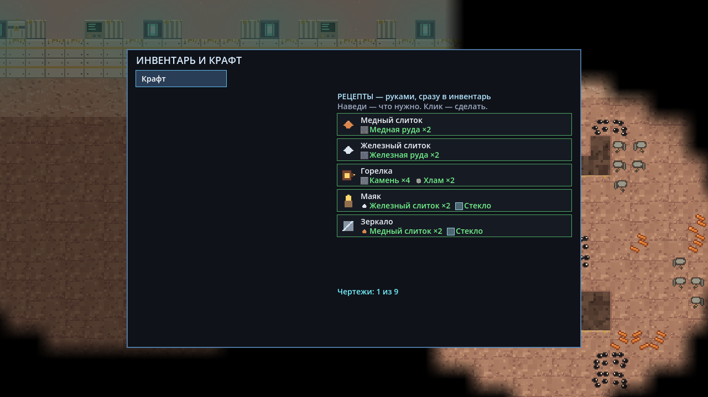
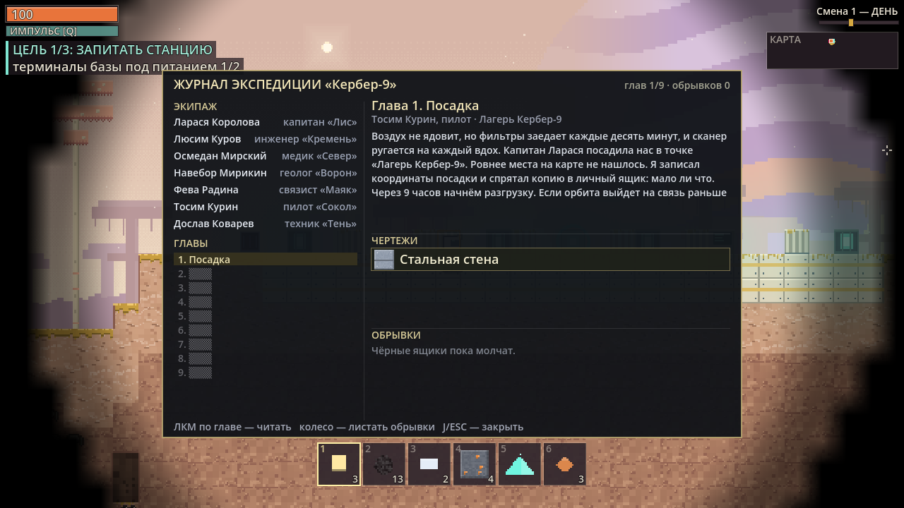
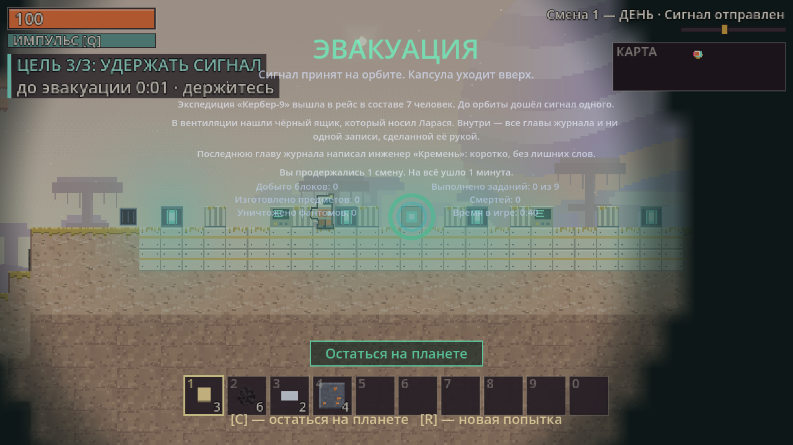

# ГЛИТЧ-КОРЕ


**Террария + Факторио + Among Us на чужой планете.** Двухмерная выживалка-песочница
о потерянной экспедиции «Кербер-9». Мир состоит из клеток: в нём копают, строят
фабрику, а по ночам отбиваются от фантомов. Играть можно одному или командой
до 4 человек по локальной сети. Есть сборки для Windows, Linux и Android.

Связь с орбитой потеряна, эвакуации не будет, пока вы сами не позовёте её. Для этого
на базе стоит **релей-ядро**. Чтобы его запустить, нужно запитать станцию, прочитать
терминалы (глава журнала, чертёж и подарок), наладить производство пластин,
микросхем и энергоячеек и, наконец, 180 секунд удерживать сигнал. Всё это время
планета будет вас слышать.

Кобальт-9 — тёплый «Споровый луг». Розовая глина под горчичным лишайником, в небе
висит газовый гигант. Ниже идут фиолетовые пещеры, затянутые светящимся мицелием, а
у лавы начинается красная «плоть» планеты. Днём здесь спокойно. Ночью из вентиляций
выходят фантомы: эхо экипажа, споровый рой, тени, копатели и двойник, который носит
ваш скафандр. Внешних ассетов в игре нет: тайлы, флору, небо, машины, героя и звук
код рисует и синтезирует при запуске.


## Содержание

- [Скачать и запустить](#скачать-и-запустить)
- [Главное меню и профиль](#главное-меню-и-профиль)
- [Кампания](#кампания)
- [С чего начать: первые 15 минут](#с-чего-начать-первые-15-минут)
- [Управление](#управление)
- [Интерфейс](#интерфейс)
- [Цель: три этапа релея](#цель-три-этапа-релея)
- [Свет вместо фабрики](#свет-вместо-фабрики)
- [Ночь и оборона](#ночь-и-оборона)
- [Сетевая игра](#сетевая-игра)
- [Настройки](#настройки)
- [Сохранение](#сохранение)
- [Справочник объектов](#справочник-объектов)
- [Для разработчиков](#для-разработчиков)

---

## Скачать и запустить

Готовые сборки лежат на странице
[Releases](https://github.com/grikirster-stack/glitch-core/releases/latest):

| Файл | Что это |
|---|---|
| `glitch-core-vX.Y.Z-android.apk` | Android, один APK на все устройства: arm64-v8a, armeabi-v7a, x86_64 |
| `glitch-core-vX.Y.Z-windows-x86_64.zip` | Windows: распаковать и запустить `glitch-core.exe` |
| `glitch-core-vX.Y.Z-linux-x86_64.zip` | Linux: распаковать и запустить `./glitch-core.x86_64` |

Этот README описывает игру в ветке `main`. Если чего-то из описанного в последнем
релизе ещё нет, оно появится в следующем.

**Как поставить APK на телефон.**

1. Откройте страницу релиза в браузере телефона и скачайте `...-android.apk`.
2. Откройте скачанный файл. Android попросит разрешить установку из этого источника:
   «Настройки» → «Приложения» → «Специальный доступ» → «Установка неизвестных приложений» →
   браузер (или файловый менеджер) → «Разрешить». Названия пунктов зависят от прошивки.
   Часто Android сам показывает кнопку «Настройки» прямо в окне установки.
3. Нажмите «Установить». Если Play Защита предупредит о неизвестном разработчике,
   выберите «Подробнее» → «Всё равно установить».
4. Если в заметках релиза написано «подписано debug-ключом», новая версия не встанет
   поверх старой: сначала удалите старую.

С компьютера APK можно поставить командой `adb install -r glitch-core-vX.Y.Z-android.apk`.

**Из исходников.** Нужен Godot 4.7, стандартная версия без .NET. Откройте
`project.godot` и нажмите F5, либо запустите из командной строки `godot --path .`.
Подробности — в разделе [«Для разработчиков»](#для-разработчиков).

После запуска открывается главное меню.

## Главное меню и профиль


**Слева — вид персонажа.** Это скафандр «Кербер-9». У него четыре части, каждая
листается кнопками ◀ ▶:

| Часть | Варианты |
|---|---|
| Цвет скафандра | 16 цветов (первый — «Оранжевый») |
| Шлем / визор | Квадратный, Высокий, Панорамный, Щиток |
| Аксессуар | Фонарь, Антенна, Нет, Два фонаря |
| Рюкзак | Ранец-фильтр, Удлинённый, Два баллона, Компактный |

Кнопка «Случайно» собирает случайный вид. Превью рядом поворачивается раз в 2 секунды.
В сетевой игре товарищи видят вас именно в этом виде.


**Справа — профиль и запуск.**

- **Ник** — от 2 до 16 символов. Разрешены русские и латинские буквы, цифры, пробел
  и символы `_`, `-`, `.`. Первый и последний символ должны быть буквой или цифрой,
  два пробела подряд нельзя. Если ник неверный, под полем появится причина, и кнопки
  игры станут неактивными.
- **Сид** — номер мира. Если поле пустое, мир случайный. Тот же сид всегда даёт тот же
  мир. Текст, который не является числом, тоже превращается в сид.
- **Хардкор: нет / да** — одна жизнь, без сохранений. Действует только на «Одиночную игру».
  В той же строке — **Ячеек: 6 / 10**, размер хотбара; см. [«Настройки»](#настройки).
- **Меньше глитча и мерцания: нет / да** — см. [«Настройки»](#настройки).
- **100 %** — размер интерфейса игры, в одной строке с «Меньше глитча и мерцания»;
  см. [«Настройки»](#настройки).
- **Продолжить · смена N** — сразу вернуться в последний одиночный забег (самое новое
  одиночное сохранение). Кнопка появляется, когда такое сохранение есть.
- **Кампания** — глава «Тёмная станция» на готовой базе, см. [«Кампания»](#кампания). Главы «Свет» — в работе.
- **Одиночная игра** — новый забег. **Загрузить** — выбрать сохранение из списка.
- **Создать игру**, **Найти игру**, **Подключиться по IP** —
  см. [«Сетевая игра»](#сетевая-игра). **Выход** — закрыть игру.

Ник, вид, настройка глитча, последние адреса и порт сохраняются сами при каждом изменении
в файле `user://profile.cfg`. На Windows это
`%APPDATA%\Godot\app_userdata\ГЛИТЧ-КОРЕ\profile.cfg`, на Linux —
`~/.local/share/godot/app_userdata/ГЛИТЧ-КОРЕ/profile.cfg`.
В правом нижнем углу показана версия сборки.

## Кампания

Свободная игра начинается с пустой станции. Кампания — главы на уже построенной базе.
Главы «Свет» — в работе: сейчас играется только «Тёмная станция».

| Глава | Что на базе | Цель | Чему учит |
|---|---|---|---|
| 1. Тёмная станция | тёмная станция, горелка в наборе | поставить горелку, прочитать терминал, поставить свет, пережить первую ночь | копка, ручной крафт, терминал, свет против фантомов |

- **Глава открывается**, когда пройдена предыдущая; пройденные отмечены в профиле.
- **Карточка «Сейчас»** в левом верхнем углу показывает одну задачу этапа: картинка,
  короткая фраза и счётчик. Строка под ней — подсказка, что нажимать. В главах без ночи
  солнце стоит; в «Осаде» сумерки ждут, пока база не готова.
- **Ствол шахты** — проём в 3 клетки, уступы попеременно у стен. Вниз — по центру. Наверх —
  с разбега: сойдите с уступа к центру и сразу прыгайте.
- **Сохранений в главе нет**: она короткая и всегда начинается с готовой базы. Esc → «Выйти в
  меню». Погибли — капсула на базе, но ночь не перематывается: её надо пережить.
- **Итог главы**: **N** (на телефоне — тап) — следующая глава, **R** — заново.
- **По сети**: «Создать игру» → строка «Режим» листает «Свободная игра» и открытые главы.
  Товарищи получают главу и базу при входе, у каждого — свой набор главы.

## С чего начать: первые 15 минут

Первые минуты подсказывает **карточка «Сейчас»** («Запитай терминалы базы»).
Шаг копки, крафта и ТЭЦ игра помнит, но отдельной жёлтой строкой больше не
рисует. Ниже те же шаги с подробностями. Картинки сняты с настоящей игры
(сид 31337).

**Остановиться и продолжить потом.** **Esc** (на телефоне — кнопка **II**) ставит игру на
паузу. Чтобы закончить на сегодня, выберите «Сохранить и выйти в меню». В следующий раз
нажмите в главном меню **«Продолжить»**, и вы окажетесь там же: та же смена, тот же
инвентарь, герой на том же месте. Подробнее — [«Пауза»](#пауза).

**1. Осмотритесь.** Вы стоите на базе. Это стальная площадка с **релей-ядром** в центре
(голубое кольцо), двумя **терминалами** (зелёные экраны) по бокам, четырьмя
светокристаллами и **вентиляцией** у левого края. Забег начинается на рассвете,
до ночи примерно 150 секунд. В хотбаре лежит стартовый набор: 3 светокристалла, 6 угля,
2 железные пластины и 4 медной руды. Первые 22 секунды по центру экрана видна
шпаргалка по клавишам.

**2. Копайте.** Зажмите ЛКМ
на клетке не дальше 5,6 клетки от себя. Вокруг клетки появится рамка, снизу — полоса
прогресса. Лишайник и глина ломаются за 0,5–0,6 с и дают **хлам**. Камень (он лежит
под тремя слоями глины) ломается за 1,4 с и даёт **камень**. Выпавшие предметы
подлетают к вам сами, если подойти ближе 70 px.


**3. Скрафтите горелку — «2/4 Крафт: I — «Горелка»».** Питания больше нет: терминал
читается и без ТЭЦ. Нажмите **I**, вкладка одна — «Крафт». Рецепт горелки: 4 камня
и 2 хлама.

**4. Поставьте горелку — «3/4 Горелка: ПКМ — у базы».** Выберите горелку в хотбаре
и нажмите **ПКМ** по пустой клетке. Уголь в топку — **E**. Одна единица горит 45 секунд.

**5. Прочитайте терминал — «4/4 Терминал: держите [E]».** Встаньте у терминала
и **удерживайте E** 2,2 секунды. Терминал отдаёт главу журнала (**J**), следующий чертёж
и подарок на пол. Отработавший терминал гаснет. Когда отработают оба терминала базы,
обучение скрывается и начинается этап цели 2/3.

**7. Посмотрите чертежи.** Нажмите **I**: под списком рецептов строка «Чертежи: N из M».
Рецепт, чей выход ещё не выдан терминалом, в списке не показывается. Следующий чертёж —
в следующем терминале, какой бы вы ни нашли. Сам чертёж — иконка и короткое имя
в журнале (**J**), не счётчик деталей слева внизу.

**7. Слиток — руками.** Две руды дают один слиток, сразу, без станка. Руда лежит
глубже: уголь почти сразу под землёй, медь — примерно с 8 клеток, железо — с 30,
кристаллы глитча — с 60 (см. [таблицу тайлов](#тайлы-и-руды)).

**9. Загляните в руины и подготовьтесь к ночи.** В мире 7 руин, и почти все
под землёй: комнаты в породе, на разной глубине, ход из пещеры или короткой
трещины, не лестница от травы. Прогулка по поверхности их не открывает, и на
миникарте терминал руины не светится, пока до него не дойдёте. В каждой есть
**тайник** (сундук с 3–6 видами предметов), **табличка** с именем места и **терминал**
с главой журнала. Терминал руины читается так же, без питания. Когда наступают сумерки, вверху
экрана появляется «НОЧЬ ЧЕРЕЗ N с». Держитесь у света и узнайте заранее, где
[вентиляция](#ночь-и-оборона).


**9. Свет вместо линии.** Бура, ленты и плавильни больше нет. Горелка, зеркало и маяк
держат ночь. Подробнее — [«Свет вместо фабрики»](#свет-вместо-фабрики).



## Управление

### Клавиатура и мышь

| Клавиша | Действие |
|---|---|
| **A / D** или **← / →** | ходьба |
| **W / ↑ / Space** | прыжок |
| **Shift** | бег (громче, и фантомы это слышат) |
| **ЛКМ** | копать первую твёрдую клетку по лучу от героя к курсору (сквозь стену нельзя, досягаемость 5,6 клетки; цель обведена рамкой, недостижимая клетка под курсором — красный крест) или бить фантома под курсором |
| **ПКМ** | поставить выбранный предмет; по зеркалу, призме и горелке — повернуть |
| **E** | взаимодействие (что именно — см. ниже); терминал, релей, ремонт и разбор постройки — удерживать |
| **Q** | импульс: 10 урона и оглушение на 3 с всем фантомам ближе 130 px, перезарядка 8 с |
| **V** | залезть в вентиляцию или вылезти из неё |
| **1 … 0** | выбор ячейки хотбара (при хотбаре из 6 ячеек клавиши 7–0 ничего не делают) |
| **колесо мыши** или **+ / −** | зум: ближе или дальше (от вдвое шире обычного обзора до вдвое ближе); **средняя кнопка** — обычный зум. Выбранный зум запоминается |
| **I / Tab** | инвентарь и крафт |
| **J** | журнал экспедиции |
| **P** | свободно |
| **G** | в сетевой игре — начать перекличку или ответить на неё |
| **Esc** | закрыть инвентарь или журнал; если окон нет — пауза (см. [«Пауза»](#пауза)) |
| **F5 / F9** | сохранить / загрузить забег (см. [«Сохранение»](#сохранение)) |
| **R / Enter / Space** | на экране гибели в хардкоре и на экране финала — новая попытка |

**Что делает E.** Цель всегда одна, и она обведена рамкой, а внизу экрана написана
подсказка. Сначала проверяется объект под курсором (если до него можно дотянуться),
иначе выбирается ближайший:

| Цель | Что делает E |
|---|---|
| терминал | удерживать 2,2 с — задание: глава журнала и чертёж. Питание не нужно |
| релей-ядро | удерживать 3 с — сдать детали из инвентаря; когда набрано всё — запуск |
| горелка | с топливом в руке — загрузить топку |
| сундук, тайник руины, небесный тайник | открыть окно сундука |
| повреждённая машина, хлам в руке | удерживать — ремонт, +20 HP за единицу хлама |
| пустая машина и пустой сундук | удерживать 0,9 с — **разобрать**: постройка снимается, её предмет возвращается в рюкзак |

**Разбор постройки.** Поставили не туда — машину можно снять: пустая рука, курсор на
постройке, **удержать E** 0,9 с. Постройка исчезает, её предмет возвращается в рюкзак
(если места нет — падает под ноги). Содержимое (руда в станке, вещи в сундуке)
высыпается на землю — ничего не пропадает. Постройки кампании и тайники руин не
разбираются; сундук с вещами сначала открывают и выкладывают.

### Телефон

На сенсорном экране поверх игры сами появляются джойстик и кнопки. На ПК их можно
включить флагом `--touch` (`godot --path . -- --touch`), тогда мышь нажимает кнопки, как палец.
Клавиатура и мышь по USB или Bluetooth работают и на телефоне.


| Касание | Действие |
|---|---|
| **джойстик** слева | ходьба; отклонить вверх — прыжок |
| **прыжок** | прыжок (короткий тап тоже засчитывается) |
| **бег** | бег вкл/выкл — защёлка, держать не нужно |
| **E «держать»** | взаимодействие, как клавиша E |
| **Q «импульс»** / **V «укрытие»** | импульс / вентиляция |
| **G «перекличка»** | только в сетевой игре с товарищами: начать перекличку или ответить на неё, как клавиша G; пока идёт перекличка, кнопка подсвечена. Кнопки справа тогда встают под плашку команды, а Q, V и G — в один ряд |
| **I «инвентарь»** / **J «журнал»** | открыть или закрыть окно; пока окно открыто, видны только эти две кнопки |
| **II «пауза»** | слева от J: пауза, как Esc на клавиатуре |
| **тап по миру** | копать или бить фантома; держите палец, чтобы копать дальше |
| **долгий тап** (от 0,4 с) по пустой клетке | поставить выбранный предмет; по конвейеру — повернуть |
| **строить** | режим постройки: короткий тап по миру сразу ставит предмет |
| **тап по хотбару** | выбрать ячейку; на телефоне хотбар — 6 крупных ячеек, не 10 |
| **щипок** двумя пальцами по миру | зум: развести — ближе, свести — дальше; щипок ничего не копает и не ставит |
| в инвентаре и журнале | тап работает как ЛКМ; проведите пальцем, чтобы листать рецепты и обрывки |
| экран гибели или финала | тап — новая попытка |

Пальцев может быть сколько угодно: можно идти джойстиком и одновременно копать тапом.
Второй палец, положенный на мир, пока первый там, начинает щипок: поэтому палец по миру
начинает копать через долю секунды (~70 мс), а короткий тап всё равно срабатывает.
Кнопки не меньше 9 мм на экране и не закрывают HUD, миникарту, хотбар и уведомления.
Поля ввода в меню открывают экранную клавиатуру: у порта она цифровая.

### Пауза

**Esc** открывает паузу, если инвентарь и журнал закрыты. Если окно открыто, первый
Esc закрывает его. На телефоне то же делает кнопка **II**. Ещё один Esc закрывает паузу.

| Пункт | Что делает |
|---|---|
| **Продолжить** | вернуться в игру |
| **Сохранить** | то же, что F5: забег записывается в слот F5, пауза остаётся открытой |
| **Сохранить и выйти в меню** | сохранить в тот же слот F5 и выйти в главное меню. Там появится «Продолжить» |
| **Выход из игры** | закрыть игру |

- В одиночной игре на паузе мир стоит: время, ночь и фантомы ждут.
- **В хардкоре** «Сохранить» серая. Вместо «Сохранить и выйти в меню» стоит «Выйти в меню»:
  сначала появится предупреждение «Забег не сохранён». Так же пауза работает, если герой
  погиб или забег окончен.
- **В сетевой игре** мир на паузе не останавливается: товарищи играют дальше, а ваш герой
  стоит. У клиента «Сохранить» серая (сохраняет хост). Выход в меню у клиента называется
  «Отключиться и выйти в меню»: героя с вещами хранит хост, и при повторном входе вы
  его получите. У хоста работают «Сохранить» и «Сохранить и выйти в меню», но выход
  закончит игру для всех.

## Интерфейс

### HUD


| Где | Что |
|---|---|
| слева вверху | **здоровье** (100; каждые 6 с +6) и полоса **импульса [Q]** — заполнилась, значит готов |
| под ними | **карточка «Сейчас»**: одна цель — картинка, не больше 6 слов и счётчик «3 / 5», если нужно больше одного. Стрелка на краю экрана ведёт к цели, на месте цели мигает рамка. Клик по карточке на 2 с показывает цель камерой |
| ниже | в главе — одна строка **подсказки**, что нажимать. В свободной игре шаг обучения уже на карточке |
| справа вверху | «Смена N — УТРО / ДЕНЬ / ВЕЧЕР / СУМЕРКИ / НОЧЬ», полоса суток и **миникарта** (рельеф, вы и релей-ядро; неразведанное скрыто) |
| вверху по центру | в сумерках — «НОЧЬ ЧЕРЕЗ N с», последние 5 с мигает |
| по углам экрана | ночью — красные уголки-скобки опасности |
| справа внизу | уведомления: задания, смена этапа, находки, «Сигнал: осталось N с» |
| внизу по центру | подсказка к цели E (например, «[E] — выполнить задание (удерживать)») и **хотбар**: 10 ячеек (1…0) на ПК, 6 крупных (1…6) на телефоне |

**Туман войны.** Неразведанное — чёрное. Вокруг героя открывается круг обзора:
16 клеток на поверхности и 8 под землёй. Разведанное вне круга остаётся видно, но затемнено.

### Инвентарь и крафт (I / Tab)

Окно «ИНВЕНТАРЬ И КРАФТ» разделено на две части. Слева — сундук (если вы открыли его
через E), под ним ваши 36 ячеек: верхний ряд — хотбар (10 ячеек с номерами 1…0 или 6 с номерами 1…6),
ниже, за чертой, — рюкзак. Счётчика деталей релея (микросхема, энергоячейка,
антенна) на панели нет: прогресс сдачи — на карточке «Сейчас» и в тексте у ядра.
Справа — одна вкладка «Крафт».


- **ЛКМ** по ячейке — взять стопку в руку (она рисуется у курсора) и положить её в другую
  ячейку. **ПКМ** — взять половину, а с предметом в руке — положить по одному.
- **Shift+ЛКМ** — переложить стопку сразу: при открытом сундуке — между сундуком и
  инвентарём, без сундука — между хотбаром и рюкзаком.
- **«Забрать всё»** переносит весь сундук в инвентарь, **«Сложить всё»** — весь рюкзак
  в сундук (хотбар остаётся при вас).
- Если закрыть окно с предметом в руке, он вернётся в инвентарь. Нет места — уйдёт
  в сундук, совсем некуда — упадёт под ноги.
- **Наведите курсор на рецепт**, чтобы увидеть подсказку: что получится, станцию и время,
  «есть N / нужно M» по каждому входу (нехватка выделена красным), «Где взять» и почему
  сейчас нельзя («Не хватает: …»).
  Справа в строке рецепта стоит короткий ярлык: «клик — сделать», «клик — загрузить»,
  «не хватает», «нет станка».
- Список рецептов листается колесом мыши. Под списком — строка «Чертежи: N из M».

**Крафт.** Вкладка одна, «Крафт»: слиток — две руды руками, сразу. Здесь же горелка,
зеркало, маяк, коллектор, накопитель, призма, смеситель и сундук. Рецепт, чей выход
есть в списке чертежей, без чертежа не рисуется. Плавильни и верстака нет.

### Чертежи

Дерева исследований нет. Девять терминалов (2 на базе и по одному в 7 руинах) выдают
чертёж по фиксированному порядку чтения: какой терминал ни прочитайте первым — чертёж
всё равно первый из списка. Вместе с чертежом терминал отдаёт главу журнала и подарок
на пол (2–3 вида из угля, стекла, слитков и кристалла; состав зависит от сида и роли места).
Чёрный ящик даёт 2 кристалла и обрывок журнала. Анализатора нет.

### Журнал экспедиции (J)


Кадр приёмки чертежа — журнал, не панель крафта:



Здесь собран экипаж «Кербер-9» (7 человек с ролями и позывными), 9 глав журнала, обрывки
и полученные чертежи: иконка предмета и короткое имя, без рецепта.
Главы читаются на терминалах: 1–2 на базе, остальные в руинах. Непрочитанная глава
выглядит как «▒▒▒». **ЛКМ** по главе открывает её текст. Обрывки приходят из чёрных
ящиков и самописцев, колесо мыши листает их список. Тексты, имена и места генерируются
из сида мира. Кто-то в списке экипажа — «не тот», но журнал этого не выдаёт.

## Цель: четыре этапа ядра

Текущий этап показывает карточка «Сейчас» в HUD. О смене этапа приходит
уведомление. Терминалы базы в этапах не участвуют: это журнал и подарок.

| Этап | Что сделать |
|---|---|
| **1/4 ПОСТАВЬ ЯДРО** | поставить Радужное ядро (лежит в сундуке лагеря; ещё одно — 4 железных слитка и 3 кристалла) |
| **2/4 ЗАЖГИ СЕМЬ ДУГ** | пустить в ядро луч каждого чистого цвета: красный, зелёный, синий, жёлтый, голубой, пурпурный, белый |
| **3/4 ЗАПУСТИ ЯДРО** | у активного ядра удерживать **E** 3 с, когда горят все семь |
| **4/4 УДЕРЖИ СИГНАЛ** | продержаться **180 секунд** после запуска |

**Семь дуг.** Горелка на угле, медной руде и кристалле даёт красный, зелёный и синий.
Жёлтый, голубой, пурпурный и белый — смеситель. Дуга зажигается навсегда: снял ядро
и перенёс — уже горящие не гаснут. Не хватает цвета — запуск напишет, какого именно.

**Возрождение.** После смерти герой встаёт в клетке над активным ядром (последнее
поставленное). Клетка занята — в ближайшей свободной. Ядра нет — у капсулы лагеря.

**Удержание сигнала.** Фантомы идут волнами и днём: до 10 одновременно, бюджет ночи
растёт. Об остатке напоминают уведомления на 150, 120, 90, 60, 30 и 10 секундах.
Когда сигнал уходит, начинается эвакуация, а финальный экран показывает эпилог
экспедиции и итоги забега: добыто блоков, изготовлено предметов, уничтожено фантомов,
выполнено заданий, смертей и время.

## Бесконечная игра

Планета не пустеет. Каждый рассвет в породе, которую вы ещё не видели, — глубже
десяти клеток от поверхности и только в тумане — камень рядом с жилой становится
той же рудой. За рассвет возвращается один процент от того, сколько этой руды было
в мире вначале: уголь — около 42 клеток. Разведанная шахта остаётся выработанной,
на глазах ничего не прорастает. Хлам не отрастает.

Отбитая ночь возвращает часть топлива. Тень при смерти роняет 2 угля, каждый мотылёк
роя — 1 медную руду; чёрный ящик по-прежнему даёт обрывок журнала и данные. Горелки
жжёт уголь. Ночь не окупается целиком:
оборона кормит себя, но за день всё равно надо копать.

После сигнала игра не кончается. На экране эвакуации есть кнопка **«Остаться на
планете»** (клавиша **C** или тап по кнопке): мир тот же, ядро на месте, в карточке
цели — «Смена N · Сигнал отправлен», а ночи идут как раньше. Новой цели нет. Ядро
можно запустить снова — ещё 180 секунд удержания, и эпилог отметит «вторую передачу».
**R** по-прежнему начинает заново. В хардкоре остаться нельзя: забег завершён.



## Свет вместо фабрики

Бур, лента, плавильня, сборщик, манипулятор, анализатор, ТЭЦ, солнечная панель,
турель и прожектор сняты. Бюджета мощности нет: терминал читается без генератора.
Слиток — две руды руками.

| Машина | Что делает |
|---|---|
| Горелка | жжёт уголь и руду, бьёт лучом цвета топлива |
| Зеркало | поворачивает луч |
| Смеситель | складывает цвета лучей |
| Призма | делит белый луч |
| Коллектор | днём даёт белый луч |
| Накопитель | копит луч днём и отдаёт ночью |
| Маяк | принимает луч и держит ночь цветом луча |
| Сундук | 24 ячейки |

Готовое из сундука забирается руками. Слиток, стекло и стена крафтятся сразу.

## Ночь и оборона


**Сутки.** Полный цикл длится 240 с. Утро, день и вечер безопасны. Сумерки длятся около
14 с: вентиляции гудят, а наверху идёт отсчёт «НОЧЬ ЧЕРЕЗ N с». Ночь длится около 91 с.
С каждым рассветом начинается новая смена («Смена N. Фантомы голоднее.»).
Забег начинается на рассвете: до первой ночи полный день, около 150 с.

**Откуда приходят фантомы.** Ночью директор угрозы выдаёт бюджет от готовности базы,
а не от календаря: `1 + 2·T`, где
`T = min(номер смены, 3) + 0,5 за каждую горящую горелку + 1,0 за каждый маяк под лучом + 0,25 за каждый накопитель`
(на удержании сигнала ещё +4). Смена в формуле не выше 3: кто ничего не строит, получает
ту же ночь, что и раньше. Две первые ночи тихие — бюджет не больше 2, одновременно не
больше одного фантома, и это только эхо. С третьей ночи одновременно живут до `1 + T`
фантомов, но не больше 10. Новые появляются раз в 2,5–7 с. Выходят они из трёх ближайших к вам
незапечатанных вентиляций: сначала из вентиляции 2 с идёт пар и гул, потом появляется
фантом. Вентиляция ближе 160 px к вам не выпускает.

**Кто приходит.** Каждый тип — с указанной ночи:

| | Тип | HP | Удар | Когда приходит | Повадки |
|---|---|---|---|---|---|
|  | Эхо | 100 | 24 | всегда | охотится на героя; убегает со света ярче 0,55 |
|  | Рой | 30 | 8 | горят 2 горелки и больше | стая из 4–6 споровых мотыльков; летит на горящую горелку ближе 300 px; свет не пугает |
|  | Тень | 180 | 18 | есть накопитель или сундук с топливом | чует горелку за 640 px; съедает 1 единицу топлива в 3 с; идёт бить маяк под жёлтым; свет не пугает |
|  | Копатель | 140 | 30 | смена 4 и в мире есть стальная стена | роет глину, камень и хлам (не твёрже 1,5), чует героя сквозь породу за 600 px, грызёт решётку вентиляции; убегает от света ярче 0,8 |
|  | Двойник | 120 | 40 | свободная игра, смена 6 (в главе кампании не приходит) | не больше одного; носит скафандр своей цели, но визор у него цвета опасности, а над головой имя одного из экипажа (в сети — ник и вид товарища, см. [«Сетевая игра»](#что-общее-а-что-личное)); замирает, когда вы смотрите на него ближе 200 px; на удержании сигнала приходит в любую ночь |

Обычный фантом замечает вас за 170 px ночью (днём за 120), если видит, и слышит шум за
260 px. Бег и копка громче ходьбы. Фантомы бьют и машины: у сундука и горелки 100 HP, у маяка 120.
Разрушенная машина с вероятностью 50 % оставляет свой предмет.

**Как защищаться.**

| Средство | Как работает |
|---|---|
| Свет | эхо и копатель уходят с ярко освещённых клеток. Светокристалл — 1,0 (крафт: кристалл + уголь). Маяк под лучом держит ночь цветом луча |
| ЛКМ по фантому | 38 урона, удар раз в 0,45 с |
| Импульс **Q** | 10 урона и оглушение на 3 с всем ближе 130 px, перезарядка 8 с |
| Вентиляция **V** | спрятаться ближе 40 px от вентиляции: 6 с неуязвимости, потом выталкивает, снова — через 10 с |
| Маяк | принимает луч: красный бьёт, жёлтый манит тень, белый светит. Турели и прожектора нет |
| Стальная стена | самый прочный блок (копка 4,0 с); копатель её не роет |
| Шлюз | старый сейв превращает предмет в слитки; клетка в мире остаётся, пока файл не из фабрики |
| Решётка вентиляции (T4) | ставится только на вентиляцию и запечатывает её: оттуда фантомы не выходят; копатель прогрызает её за 8 с |
| Сирена (чертёж 7) | E при полном заряде: все фантомы в 10 клетках, включая рой и тень, бегут 10 с. Заряд копится 60 с под любым лучом, без луча стоит. Лампа: зелёная — готова, жёлтая — заряжается, красная — луча нет |
| Линза (чертёж 8, всегда в небесном тайнике) | E с линзой в руке у маяка: красный бьёт на 10 клеток вместо 7, урон и жёлтый свет × 1,5 (20 → 30, свет 2,0 → 3,0), синий и купол +2 клетки, приманка +32 px, белый радиус 12. Разбор маяка возвращает и маяк, и линзу |
| Радужный кот | страж на 90 с: выходит из ядра в ночь удержания, сносит фантома касанием, рой — стаей. Потом сидит в ядре и копит 60 с любого луча. После сигнала выходит каждую ночь, если заряжен |
| Ремонт | E с хламом в руке у повреждённой машины, +20 HP за штуку |

Чёрный ящик выпадает с убитого фантома с шансом 25 %, а у двойника — всегда. Он сразу
вскрывается: +1 данные и обрывок журнала.

**Гибель.** Через 3 с вы появляетесь в капсуле на базе, а время перескакивает к рассвету.
**Хотбар** остаётся мешком на месте гибели: мешок не исчезает, подойдите и заберите.
Остальной инвентарь остаётся при вас. В режиме «Хардкор» гибель заканчивает забег.


## Сетевая игра

До 4 игроков в одной локальной сети (Wi-Fi или кабель). Один из игроков — хост, мир
живёт у него. Всё делается в главном меню, мышью или тапами.

### Создать игру


| Поле | Что вписать |
|---|---|
| Имя игры | 1–24 символа, по умолчанию «Экспедиция <ник>» |
| Сид | пусто — случайный мир |
| Мест | 2, 3 или 4 (по умолчанию 4) |
| Порт | 1024–65535, по умолчанию 24642; порт 24643 занят поиском игр |
| Мир | новый или «Из сохранения…» |
| Режим | «Свободная игра» или открытая глава [кампании](#кампания) — тогда мир кампании, сохранение не берётся |

Под формой написаны ваши адреса в локальной сети. После «Создать» хост попадает в
**лобби**: там крупно показан адрес для «По IP», список игроков с ником, видом и
отметкой «готов» / «ждём», и кнопки «Закрыть игру» и «Старт». «Старт» загорается,
когда все вошедшие нажали «Готов». Хост может начать и один. Войти можно и после
старта: игра видна в поиске всё время, пока идёт.


### Найти игру


Здесь список игр в этой сети. В строке: имя, ник хоста, «игроков n/max», пинг, «лобби»
или «смена N», адрес, версия сборки и протокол. Серая строка недоступна, причина
написана рядом: «другая версия: у хоста …, у вас …», «другой протокол …», «мест нет».
Кнопка «Обновить» ищет заново, «По IP» переводит к вводу адреса. Нажмите на игру, чтобы
войти в лобби, затем нажмите «Готов».

### Подключиться по IP


Можно ввести `192.168.1.20`, `192.168.1.20:25000` или имя компьютера. Последние 5 удачных
адресов показаны кнопками. Этот способ работает всегда, даже когда поиск игру не видит:
гостевой Wi-Fi, телефон в роли хоста. Адрес хоста показан на экране его лобби.

### Версии, порты, брандмауэр

- Подключиться можно, только если у хоста и у вас **одинаковые** версия сборки и протокол.
- Игра идёт по **24642/UDP**, поиск — по **24643/UDP** (широковещательный запрос, хост
  отвечает напрямую).
- **Брандмауэр Windows.** Когда вы первый раз создаёте игру, Windows спрашивает, пускать
  ли игру в сеть. Разрешите для **частных сетей**. Если окно закрыли кнопкой «Отмена»,
  игру никто не найдёт: «Панель управления» → «Брандмауэр Защитника Windows» →
  «Разрешение взаимодействия с приложением» → отметьте «ГЛИТЧ-КОРЕ» (или Godot) в
  столбце «Частные».
- **Телефон.** Android-клиент находит игры без дополнительных разрешений. Если телефон
  в роли хоста не виден в поиске, подключайтесь по IP с его экрана лобби. Точка доступа
  на телефоне работает так же, как обычный Wi-Fi.

### Что общее, а что личное

| Общее для команды | Личное у каждого |
|---|---|
| мир: тайлы, вода, постройки, сундуки, предметы на земле | инвентарь и хотбар |
| время суток, смена, этап цели, отсчёт релея | здоровье, импульс, укрытие |
| данные, открытые узлы, главы журнала, обрывки (открыть узел может любой) | вид и ник (видны над головой) |
| терминал: задание засчитывается один раз, всем приходит «<ник>: терминал «…» прочитан, +5 данных» | новый игрок получает стартовый набор |
| релей: детали сдаёт каждый из своего инвентаря, сданное копится в ядре | |

- **Удержание сигнала в сети.** Отсчёт идёт, только пока у ядра ближе 12 клеток есть
  живой, не спрятавшийся герой на связи. Иначе отсчёт стоит, но не сбрасывается.
  В HUD тогда горит «СИГНАЛ БЕЗ ПРИСМОТРА».
- **Релею нужно больше деталей.** При N игроках требование умножается на `1 + 0,25·(N−1)`
  и округляется по каждой детали: вдвоём — 60 железных пластин, 30 стальных, 30 микросхем,
  15 энергоячеек и 1 антенна; вчетвером — 84, 42, 42, 21 и 2. Требование пересчитывается,
  когда игрок входит или выходит, и не опускается ниже уже сданного. Текущие цифры
  показывает карточка «Сейчас», не панель крафта.
- **Фантомов больше.** При N игроках бюджет ночи умножается на `1 + 0,5·(N−1)`, лимит
  одновременных растёт на `2·(N−1)` (не больше 16), а интервал появления делится на
  `1 + 0,35·(N−1)` (не меньше 1,5 с). Фантом идёт к ближайшему герою.
- **Команда в HUD.** Под миникартой появляется плашка «КОМАНДА»: ник каждого товарища
  цветом его скафандра, полоска здоровья или «погиб». На миникарте товарищ виден
  **маячком** цвета скафандра, только если он ближе 20 клеток к вам или стоит в зоне
  питания работающего генератора. Иначе маячка нет. Над головой у каждого — ник.
- **Двойник среди своих.** Когда живых двое и больше, двойник надевает **ник и вид
  товарища**, который сейчас дальше всех от жертвы, а охотится на того, кто дальше
  всех отбился от команды. На миникарте маячка у двойника нет никогда, на перекличку
  он не отвечает, а под взглядом любого из вас замирает. Если его ударить, на 1,5 с
  проступает настоящий облик с глитч-всплеском у всех.
- **Перекличка — клавиша G** (на телефоне кнопки для неё пока нет). Первое нажатие
  начинает перекличку: у всех «<ник>: перекличка! [G] — ответить», а в плашке команды
  появляется «ПЕРЕКЛИЧКА n с · [G] — ответить». Ответить можно в течение 6 с, нажав G.
  У ответившего на шлеме 4 с горит зелёный огонёк, у молчащего в плашке — красный.
  Начать новую перекличку один игрок может не чаще раза в 20 с.
- **Огня по своим нет.** Импульс задевает только фантомов. ЛКМ по товарищу урона не
  наносит: слышен «клац», приходит «Свой: <ник>», и удар на секунду уходит на
  перезарядку. Проверить подозрительного «товарища» можно, но это стоит времени.
- **Вентиляция.** В одной вентиляции помещается один герой. Если она занята, придёт
  «Вентиляция занята: <ник>».
- **Гибель.** Появляется экран «ТЕБЯ НАШЛИ» и смотрит глазами живого товарища (A/D —
  следующий). Через 15 с вы появляетесь в капсуле на базе, а время **не** перескакивает.
  Мешок с хотбаром первые 120 с может поднять только владелец. Если погибла вся команда,
  все появляются на базе через 3 с, а время перескакивает к рассвету. На финальном
  экране к итогам добавляются строки «<ник>: смертей N».
- **Обрыв связи.** Если клиент молчит дольше секунды, его герой стоит «без связи»: урона
  не получает и целью для фантомов не служит. Вышедший игрок («<ник> покидает
  экспедицию.») при возвращении получает своего героя обратно. Если хост завершает
  игру, у клиентов сессия заканчивается, и их возвращает в меню.

## Настройки

**Меньше глитча и мерцания: нет / да** — переключатель в главном меню. В обычном режиме глитч
появляется только рядом с угрозой и не дольше 0,5 с: «артефакты сжатия» у релея, когда
он ловит сигнал, разрыв строк, когда раскрыт двойник или перегружена сеть, блоки у
вентиляции перед появлением фантома. С включённой настройкой экранных эффектов нет
совсем, а расслоение силуэта фантомов не мигает. Важные события (запуск релея,
раскрытый двойник) отмечаются спокойной плавной вспышкой. Настройка хранится в профиле.

**Размер интерфейса** — кнопка «100 %» в главном меню (в одной строке с «Меньше глитча и мерцания»):
100, 150, 200 или 250 %, по кругу, применяется сразу. Увеличивается всё, что в
забеге поверх мира: здоровье, подсказки, уведомления, миникарта, хотбар, инвентарь,
журнал, пауза; мир, камера и зум не меняются. Меньше 14 px в интерфейсе нет, основной
текст — 18 px. При первом запуске размер выбирается по экрану: на мониторе — 100 %, на
телефоне — наименьший, при котором основной текст не ниже 4 мм (на 6,1″ это 250 %). Если
блоки не помещаются на низком экране, лишняя строка подсказки и уведомления скрываются,
а не налезают друг на друга; окна (инвентарь, журнал, пауза) сами уменьшаются, чтобы
влезть в экран целиком. Настройка хранится в профиле.

**Хотбар** — кнопка «Ячеек: 6» / «Ячеек: 10» в главном меню, в одной строке с полем сида
и «Хардкор» (строка «Глитч» и размера интерфейса и так заполнена: три кнопки в колонку
360 px не встают). На телефоне (сенсорный экран или запуск с `--touch`) по умолчанию
6 крупных ячеек, на ПК — 10. Переключение на 6 не теряет вещи из ячеек 7–10: они
переезжают в рюкзак, а если рюкзак полон — падают под ноги. Клавиши 7–0 при шести ячейках
ничего не делают. Настройка хранится в профиле.

**Хардкор** — переключатель в меню, действует на одиночную игру: одна жизнь, без
сохранений. Гибель показывает эпитафию и итоги, R начинает новую попытку.

**Профиль** — ник и вид скафандра, см. [«Главное меню и профиль»](#главное-меню-и-профиль).

## Сохранение

- **F5** сохраняет забег, **F9** загружает. Слот один, файл `user://save_1.sav` (папка —
  та же, что у профиля). Сохраняется всё: мир, вода, туман войны, постройки с
  содержимым, предметы на земле и мешок, герой с инвентарём, время, цель, чертежи,
  журнал, тайники. Поля `research` и `tech.unlocked` старых сохранений игнорируются.
  Фантомы поштучно не пишутся: после загрузки оставшиеся этой ночью
  выйдут из вентиляций заново.
- Пауза (**Esc**): «Сохранить» и «Сохранить и выйти в меню» пишут в тот же слот, что F5.
  Отдельного автосохранения нет: выход в меню через паузу сохраняет забег поверх F5.
  В главном меню **«Продолжить»** загружает самое новое одиночное сохранение,
  **«Загрузить»** показывает список всех сохранений.
- Сохранить нельзя, если герой погиб или забег окончен. В хардкоре F5 и F9 не работают.
- **В сетевой игре** сохраняет только хост. F5 у хоста пишет тот же слот `save_1.sav`,
  а ещё хост сохраняет игру сам на каждом рассвете в слот `mp_<имя игры>_auto`. У клиента
  F5 отвечает «сохраняет хост». F9 в сети выключен у всех.

## Справочник объектов

Здесь всё, что есть в мире: картинка, где найти и что делает. Числа взяты из кода
(`DB`, `Balance`, скрипты машин и мира). «Копка» — секунды, за которые клетка ломается
под ЛКМ. Мир — 640 × 180 клеток. Глубина руды считается как доля пути от поверхности
до дна мира, примерно 136 клеток: 6 % — около 8 клеток, 22 % — около 30, 45 % — около 61.

### Тайлы и руды

Порода выглядит по-разному в трёх биомах по глубине, хотя тайл один и тот же:
**поверхность** (розовая глина под горчичным лишайником), **средние пещеры** с 25 %
глубины (фиолетовый камень с бирюзовыми нитями мицелия) и **глубина у лавы** с 55 %
(тёмно-красная «плоть» со светящимися трещинами). На листе ниже каждый тайл показан
в трёх биомах (столбцы по четыре) с разными открытыми кромками.


| | Тайл | Где | Копка | Что даёт |
|---|---|---|---|---|
|  | Лишайник | верхний слой поверхности | 0,6 с | хлам |
|  | Глина | 3 клетки под лишайником | 0,5 с | хлам |
|  | Камень | основная порода, вид меняется по биомам | 1,4 с | камень |
|  | Песок | берега у воды | 0,4 с | песок |
|  | Лишайниковая кочка | кочки на лишайнике | 0,6 с | хлам |
|  | Стебель свечника | ствол свечника; сквозь него можно пройти | 1,0 с | волокно стебля |
|  | Шляпка свечника | шляпки свечника; без опоры падает | 0,2 с | — |
|  | Хлам | жилы до 35 % глубины, ряд над коренной породой, кучи у руин | 1,0 с | хлам |
|  | Уголь | жилы глубже 3 %, почти сразу под землёй | 1,8 с | уголь |
|  | Медная руда | жилы глубже 6 % (около 8 клеток) | 2,0 с | медная руда |
|  | Железная руда | жилы глубже 22 % (около 30 клеток) | 2,6 с | железная руда |
|  | Кристалл глитча | жилы глубже 45 % (около 61 клетки); в кристальных полосах мира — вкраплениями прямо под поверхностью; слабо светится | 3,4 с | кристалл глитча |
|  | Светокристалл | на поверхности, 4 на базе, по одному в руинах; свет 1,0 | 0,6 с | светокристалл |
|  | Вода | низины ниже уровня моря; течёт и заполняет ямы | — | не копается, в неё можно ставить блоки |
|  | Лава | пещеры ниже 126-й строки; светится | — | не копается, **18 урона в секунду** |
|  | Коренная порода | 3 нижние строки мира | — | не копается, бур на ней останавливается |
|  | Песчаник | в мире сейчас не генерируется | 1,2 с | камень |

Постройки станции и блоки, которые ставит игрок (**ПКМ** с предметом в руке; блоки
можно ставить прямо в воздух):

| | Тайл | Где / как поставить | Копка | Что даёт |
|---|---|---|---|---|
|  | Сталь | пол базы, руин и небесного обломка | 3,0 с | — |
|  | Панель | стены руин, декор базы; в панель превращается отработавший терминал | 3,0 с | — |
|  | Терминал | 2 на базе и по одному в 7 руинах; светится | 3,0 с | — |
|  | Стекло | окна руин, иллюминатор обломка | 0,8 с | — |
|  | Релей-ядро | центр базы; светится | — | не копается |
|  | Медный блок | из предмета | 2,4 с | медный блок |
|  | Железный блок | из предмета | 2,8 с | железный блок |
|  | Кристальный блок | из предмета; светится | 2,6 с | кристальный блок |
|  | Волокно стебля | из волокна (в отличие от стебля — твёрдое) | 1,0 с | волокно стебля |
|  | Стальная стена | из предмета; копатель её не роет | 4,0 с | стальная стена |
|   | Шлюз (закрыт / открыт) | из предмета; открывается перед героем, но не при фантоме рядом | 3,0 с | шлюз |
|  | Решётка вентиляции | только на вентиляцию; запечатывает её | 1,0 с | решётка |

### Флора

Флора — это только картинка: сквозь неё можно пройти, кроме стебля и шляпок свечника,
которые описаны выше. Растёт она по биомам: на лишайнике «пузырник», низкая «полка» и
дождевики; в средних пещерах — завеса гиф с потолка и трутовики на ножке; в глубине —
мембранные мешки и трубки. Ночью споры на флоре и в воздухе светятся.


| Поверхность: свечник | Средние пещеры: завеса гиф |
|---|---|
|  |  |

### Предметы

Рецепты руками — мгновенно, вкладка «Ручной крафт». Список #171 (ADR-005 § 4).
Предметов, которых ещё нет в игре, в таблице нет: их заведут свои задачи.

| Выход | Вход | Когда виден |
|---|---|---|
| Медный слиток | 2 медной руды | первый подбор руды |
| Железный слиток | 2 железной руды | первый подбор руды |
| Стекло | 2 песка | первый подбор песка |
| Светокристалл | 1 кристалл + 1 уголь | первый подбор (уголь есть в стартовом наборе) |
| Горелка | 4 камня + 2 хлама | первый подбор (камень и хлам есть в стартовом наборе) |
| Сундук | 4 медных слитка | первый подбор слитка |
| Маяк | 2 железных слитка + 1 стекло + 1 кристалл | чертёж |
| Стальная стена ×4 | 2 железных слитка + 1 уголь | чертёж |
| Решётка | 2 железных слитка | чертёж |
| Зеркало | 2 медных слитка + 1 стекло | первый подбор слитка или стекла |
| Призма | 3 стекла | первый подбор стекла |
| Смеситель | 2 медных слитка + 2 стекла | чертёж |
| Сирена | 2 медных слитка + 1 кристалл + 1 стекло | чертёж 7 |
| Линза | 3 стекла + 2 кристалла | чертёж 8; одна всегда лежит в небесном тайнике |

Коллектор, накопитель и радужное ядро — в той же таблице ADR,
рецепт появится вместе с предметом.
Плавильня и верстак фабрики ещё живы (#170): пластины и схемы по-прежнему
делаются на станках. «Тайники» — у каких хозяев руин встречается предмет.
(роль хозяина задаёт лор сида).

**Сырьё**

| | Предмет | Как получить | Зачем |
|---|---|---|---|
|  | Хлам | лишайник, глина, кочки, тайл «хлам»; тайники: медик | ТЭЦ, плавильня; ремонт машин +20 HP |
|  | Камень | камень, песчаник; тайники: геолог | плавильня; ставится как блок |
|  | Песок | песок у воды; тайники: медик | стекло; ставится как блок |
|  | Волокно стебля | стебли свечников | ставится как блок |
|  | Уголь | угольные жилы; тайники: геолог, пилот; 6 на старте | топливо ТЭЦ (45 с), стальная пластина, светокристалл |
|  | Медная руда | медные жилы; тайники: геолог | медный слиток |
|  | Железная руда | железные жилы; тайники: геолог | железный слиток |
|  | Кристалл глитча | кристальные жилы; тайники: медик, геолог, связист; небесный тайник; чёрный ящик (2) | микросхема, энергоячейка, светокристалл, кристальный блок, прожектор; анализатор сжигает кристалл |

**Слитки и компоненты**

| | Предмет | Как получить | Зачем |
|---|---|---|---|
|  | Медный слиток | руками: 2 медной руды; тайники: связист, техник | сундук, зеркало, смеситель |
|  | Железный слиток | руками: 2 железной руды; тайники: пилот, техник | стена, решётка, маяк |
|  | Стекло | руками: 2 песка; тайники: медик, связист | зеркало, призма, коллектор |
|  | Медная пластина | старый сейв → 2 медных слитка | не крафтится |
|  | Железная пластина | старый сейв → 2 железных слитка | **48 — в релей** до F1 |
|  | Стальная пластина | старый сейв → 2 железных слитка + 1 уголь | **24 — в релей** до F1 |
|  | Микросхема | старый сейв → 1 медный слиток + 2 кристалла | **24 — в релей** до F1 |
|  | Энергоячейка | старый сейв → 1 железный слиток + 1 кристалл | **12 — в релей** до F1 |

**Постройки** (как они выглядят в мире — в таблице [«Машины»](#машины))

| | Предмет | Как получить | Стак |
|---|---|---|---|
|  | Сундук | руками: 4 медных слитка | 10 |
|  | Светокристалл | руками: 1 кристалл + 1 уголь; 3 на старте | 20 |
|  | Угольная ТЭЦ | старый сейв → горелка и 2 хлама; не ставится | — |
|  | Солнечная панель | старый сейв → коллектор; не ставится | — |
|  | Буровая станция | старый сейв → 4 железных слитка; не ставится | — |
|  | Конвейер | старый сейв → 1 слиток за 2 ленты; не ставится | — |
|  | Плавильня | старый сейв → 6 камня; не ставится | — |
|  | Турель-разрядник | старый сейв → маяк; не ставится | — |
|  | Прожектор | старый сейв → маяк; не ставится | — |

**Блоки и оборона**

| | Предмет | Как получить | Зачем |
|---|---|---|---|
|  | Стальная стена | руками, чертёж: 2 железных слитка + 1 уголь → **4** | самый прочный блок, копатель не роет |
|  | Шлюз | старый сейв → слитки по рецепту; тайл в мире → камень | не ставится |
|  | Решётка | руками, чертёж: 2 железных слитка | запечатать вентиляцию |

**Релей и находки**

| | Предмет | Как получить | Зачем |
|---|---|---|---|
|  | Антенна релея | старый сейв → 6 медных слитков + 4 стекла + 6 кристаллов | последняя деталь релея, до F1 |
|  | Чёрный ящик | с убитого фантома: 25 %, с двойника — всегда | вскрывается сразу: +1 данные и обрывок журнала |
|  | Мешок | падает на месте гибели, в нём весь хотбар | подойдите и заберёте, что влезет; не исчезает |

### Машины

Ставятся **ПКМ** на пустую клетку. Питания нет. Бур, лента, плавильня, верстак,
манипулятор, анализатор, ТЭЦ, панель, турель и прожектор больше не ставятся.

| Вид | Машина | Что делает |
|---|---|---|
|  | Сундук | 24 ячейки |
| | Горелка | жжёт топливо, бьёт лучом |
| | Зеркало | поворачивает луч |
| | Маяк | держит ночь цветом луча |
| | Коллектор | днём даёт белый луч |
| | Накопитель | копит луч и отдаёт ночью |

### Существа

| Вид | Кто | Что делает |
|---|---|---|
|   | Игрок | 100 HP, +6 HP раз в 6 с; ходьба 168 px/с, бег 248. Справа — в вентиляции: темнеет, обведён кольцом, неуязвим |
|    | Эхо | тёмно-фиолетовая копия скафандра, верх распадается спорами. Слева направо: бродит, погоня, оглушено (бледнеет, видна полоса HP) |
|    | Рой | споровые мотыльки |
|    | Тень | капюшон, из подола свисают гифы |
|    | Копатель | личинка из сегментов с буром |
|    | Двойник | скафандр героя, визор цвета опасности, фонарь не горит |
|  | Предмет на земле | цифра — сколько в стопке; подлетает к герою ближе 70 px; через 5 минут исчезает (последние 30 с мигает) |
|  | Мешок | хотбар погибшего; не исчезает |

Числа фантомов и их повадки — в разделе [«Ночь и оборона»](#ночь-и-оборона).

### Места мира

| Вид | Место | Где | Что там |
|---|---|---|---|
|  | База | центр мира, расчищенная площадка | релей-ядро, 2 терминала (главы 1–2), 4 светокристалла, вентиляция у левого края; здесь капсула респауна |
|  | Терминал | 2 на базе и по одному в каждой руине, всего 9 | читается без питания; E ближе 42 px, удерживать 2,2 с: глава журнала; после этого гаснет |
|  | Руина | 7 штук, равномерно по миру, большинство под землёй | комната в породе: стальной пол, стены-панели, окна, светокристалл; над станцией камень, не трава; **тайник** — сундук с 3–6 видами предметов по роли хозяина; **табличка** — имя места проступает ближе 10 клеток, приходит уведомление «Руина: «…»»; **терминал** с главой журнала. На миникарте не виден, пока не подойдёте |
|  | Небесный тайник | высоко над рельефом, не ближе 40 клеток от релея; на миникарте его нет | обломок «Кербер-9»: снизу 9–12 пустых клеток, допрыгнуть нельзя (прыжок около 3 клеток), стройте лестницу из блоков. Издалека виден тёмный силуэт, ближе 6 клеток обломок проступает («Обломок в небе: «…»»). В сундуке 3–6 редких предметов (энергоячейки, микросхемы, стальные пластины, кристаллы, солнечная панель, глубинный бур, анализатор, прожектор), при первом открытии самописец даёт обрывок журнала |
|  | Вентиляция | у левого края базы и в пещерах (на сиде 31337 их 15) | **V** ближе 40 px — спрятаться на 6 с; ночью отсюда выходят фантомы; решётка её запечатывает |
|  | Вода | низины ниже уровня моря, берега из песка | течёт и заполняет ямы; не копается |
|  | Глубина | ниже примерно 60 клеток | кристаллы глитча, железо, уголь; длинные горизонтальные тоннели — удобно строить |
|  | Лава | глубокие пещеры ниже 126-й строки | 18 урона в секунду; светится |

Что лежит в тайнике руины, зависит от роли хозяина:

| Хозяин | Может лежать |
|---|---|
| капитан | энергоячейки, микросхемы, стальные и железные пластины, светокристаллы, солнечная панель |
| инженер | медные, железные и стальные пластины, конвейеры, буровая станция, сборщик |
| медик | хлам, стекло, песок, светокристаллы, энергоячейка, кристаллы |
| геолог | медная и железная руда, кристаллы, уголь, камень, буровая станция |
| связист | микросхемы, медные пластины и слитки, кристаллы, стекло, солнечная панель |
| пилот | уголь, энергоячейки, железные слитки, стальные пластины, угольная ТЭЦ, светокристаллы |
| техник | железные и медные слитки, конвейеры, сундуки, железные пластины, плавильня |

---

## Для разработчиков

Репозиторий: <https://github.com/grikirster-stack/glitch-core>. Работа идёт так:
один issue — один PR, коммиты и описания на русском. Правила работы — в [CONTRIBUTING.md](CONTRIBUTING.md).

**Запуск.** Нужен Godot 4.7, стандартная версия. В свежем клоне папки `.godot/` нет,
поэтому сначала зарегистрируйте классы, иначе скрипты не загрузятся:

```bash
godot --headless --path . --import
godot --path .                          # меню
godot --path . -- --seed=31337          # сразу в мир, сид 31337 (без меню)
godot --path . -- --hardcore --touch    # пермасмерть; сенсорные кнопки на ПК
godot --path . -- --mp-host             # сразу хост сети; клиент: -- --mp-join=192.168.1.20
```

**Структура.**

```
scenes/                  main.tscn — игра, menu.tscn — главное меню
scripts/autoload/        DB (тайлы, предметы, рецепты, палитра), World (генерация, вода, свет,
                         туман), Game (смены, питание, цель, релей, чертежи), Tech (журнал),
                         Threat (директор угрозы), Lore (генеративный лор), Net (сеть), Sfx, UI
scripts/core/            Balance (все числа игры), IDs, инвентарь, Save, Profile, Avatar
scripts/entities/        игрок, фантомы, предметы на земле
scripts/machines/        генераторы, станки, буры, конвейер, манипулятор, сундук, турель, прожектор
scripts/net/             лобби, поиск в LAN, кодек, синхронизация мира, машин, фантомов, кооператив
scripts/ui/              HUD, инвентарь, журнал, меню, сенсорное управление, небо, глитч-эффекты
scripts/world/decor.gd   декор-слой флоры
tools/                   автотесты, сценарии, замеры, генераторы картинок README
docs/adr/                архитектурные решения
```

**Тесты** описаны в [`tools/README_TESTS.md`](tools/README_TESTS.md). Основные команды
повторяют CI:

```bash
godot --headless --path . -- --test --seed=31337          # и 4242, 12345
godot --headless --path . -- --scenario=all --seed=31337  # игровые сценарии
godot --headless --path . -- --mp-scenario=all --seed=31337  # сеть: хост и клиенты процессами
```

**Архитектурные решения.**
[ADR-001](docs/adr/0001-core-loop.md) — игровой цикл: баланс, автоматизация, оборона,
враги, релей, лор.
[ADR-002](docs/adr/0002-multiplayer.md) — кооператив по локальной сети.
[ADR-003](docs/adr/0003-visual-style.md) — визуальный стиль «Споровый луг».
[ADR-004](docs/adr/0004-campaign.md) — кампания: главы на готовой базе.
[ADR-005](docs/adr/0005-light-constructor.md) — световой конструктор вместо фабрики: лучи, цвета, читаемость (предложен).

**CI.** [`.github/workflows/ci.yml`](.github/workflows/ci.yml) на каждый PR гоняет автотест
на трёх сидах, анимацию, питание, лор, сетевые сценарии, сторож фризов и все игровые
сценарии на трёх сидах.

**Релизы** выпускаются только вручную: workflow [`Релиз`](.github/workflows/release.yml)
(Actions → «Релиз» → Run workflow с main или
`gh workflow run release.yml -f bump=auto`). Он прогоняет тесты, экспортирует
Android, Windows и Linux, проверяет APK, ставит тег `vX.Y.Z` и публикует GitHub Release
с заметками на русском. Версия считается от последнего тега: minor, если с прошлого
релиза были PR с меткой `gameplay` или `enhancement`, иначе patch. Пробная сборка без
релиза: `gh workflow run release.yml --ref <ветка> -f bump=patch -f dry_run=true`.
APK подписывается release-ключом из секретов репозитория `ANDROID_KEYSTORE_BASE64`,
`ANDROID_KEYSTORE_PASSWORD` и `ANDROID_KEY_ALIAS`. Без них (например, в форке)
используется debug-ключ, и это отмечается в заметках. Для локального экспорта нужны
шаблоны 4.7.2, а для Android ещё Android SDK, JDK 17 и импорт ETC2/ASTC
(`rendering/textures/vram_compression/import_etc2_astc=true`, в main не коммитится).

**Картинки README** лежат в `docs/img/` и пересобираются инструментами. Окно должно быть
за пределами экрана, потому что headless не рендерит:

```bash
# иконки, тайлы, листы вариантов и флоры — без окна
godot --headless --path . --script res://tools/gallery_dump.gd -- --seed=31337
# вид машин, фантомов и скриншоты shots/*
godot --path . --audio-driver Dummy --disable-vsync --fixed-fps 60 --windowed \
      --position -10000,-10000 --resolution 1280x720 \
      --script res://tools/gallery_dump.gd -- --seed=31337
# то же окно, другие скрипты:
#   tools/menu_test.gd -- --menu-shot=res://docs/img/menu.png --sheets=res://docs/img/
#   tools/mp/lobby_driver.gd -- --lobby-shot=res://docs/img
#   tools/inventory_shots.gd -- --prefix=chest
#   tools/touch_shot.gd -- --touch --net --seed=31337   (--net — сетевая раскладка с G)
```

**Иконка игры** — шлем скафандра «Кербер-9» на ночном небе Кобальта-9 со светящимися
спорами и газовым гигантом; нижняя строка визора сдвинута глитчем. Рисунок — карта 16×16
в [`tools/icon_dump.gd`](tools/icon_dump.gd), палитра только из ADR-003. Скрипт пишет
`icon.svg` (128×128, одни `<rect>`), а из него — иконки Android (`main_192x192` и слои
adaptive 432: фон, передний план в безопасной зоне 264 px, монохромный), `icon.ico` для
Windows (16–256 px) и лист предпросмотра ниже. Пути прописаны в `export_presets.cfg`.

```bash
godot --headless --path . --script res://tools/icon_dump.gd
```


