# ГЛИТЧ-КОРЕ


**Световой конструктор на чужой планете.** Двухмерная песочница о потерянной
экспедиции «Кербер-9». Мир состоит из клеток: в нём копают руками, ставят блоки
и светят лучами. Цвет луча — это действие. Играть можно одному или командой
до 4 человек по локальной сети. Есть сборки для Windows, Linux и Android.

Связь с орбитой потеряна. Чтобы её вернуть, прочитайте терминал лагеря, накопайте
руду, пережите ночь, поставьте **Радужное ядро**, зажгите в нём шесть цветов и
удержите сигнал 180 секунд. Белый луч солнца дугу не зажигает. Пока сигнал
идёт, из ядра выходит **Радужный кот**. После сигнала можно остаться на планете.

Кобальт-9 — тёплый «Споровый луг». Розовая глина под горчичным лишайником, в небе
висит газовый гигант. Ниже идут фиолетовые пещеры, затянутые светящимся мицелием, а
у лавы начинается красная «плоть» планеты. Днём здесь спокойно. Ночью из вентиляций
выходят фантомы. Внешних ассетов нет: тайлы, флору, небо, блоки, героя и звук
код рисует и синтезирует при запуске.

Три правила, которые узнаются за первые минуты:

1. **Через пустоту.** Кирка берёт первую твёрдую клетку по лучу от героя к курсору
   или пальцу. Луч света летит по воздуху, пока не упрётся в твёрдое.
2. **Цвет — это действие.** Уголь, медь и кристалл дают красный, зелёный и синий.
   Смесь даёт новый цвет и новое действие маяка. Таблица из семи строк — весь
   справочник света.
3. **Поставил — сразу увидел.** Горелка с углём загорается в ту же секунду, луч
   виден на весь экран. Скрытых чисел нет: если лучу не хватает длины, он сам
   укорачивается и тускнеет.

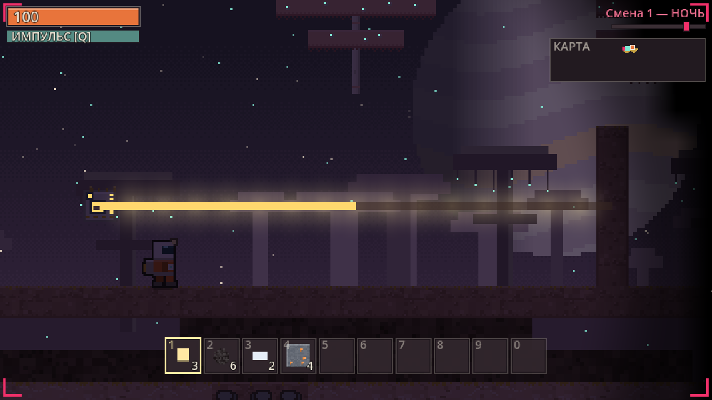

## Содержание

- [Скачать и запустить](#скачать-и-запустить)
- [Главное меню и профиль](#главное-меню-и-профиль)
- [Кампания «Свет»](#кампания-свет)
- [С чего начать: первые 15 минут](#с-чего-начать-первые-15-минут)
- [Управление](#управление)
- [Интерфейс](#интерфейс)
- [Свет и цвета](#свет-и-цвета)
- [Ночь и оборона](#ночь-и-оборона)
- [Бесконечная игра](#бесконечная-игра)
- [Сетевая игра](#сетевая-игра)
- [Настройки](#настройки)
- [Сохранение](#сохранение)
- [Справочник объектов](#справочник-объектов)
- [Для разработчиков](#для-разработчиков)

---

## Скачать и запустить

Готовые сборки лежат на странице
[Releases](https://github.com/grikirster-stack/glitch-core/releases/latest):

| Файл | Что это |
|---|---|
| `glitch-core-vX.Y.Z-android.apk` | Android, один APK на все устройства: arm64-v8a, armeabi-v7a, x86_64 |
| `glitch-core-vX.Y.Z-windows-x86_64.zip` | Windows: распаковать и запустить `glitch-core.exe` |
| `glitch-core-vX.Y.Z-linux-x86_64.zip` | Linux: распаковать и запустить `./glitch-core.x86_64` |

Этот README описывает игру в ветке `main`. Если чего-то из описанного в последнем
релизе ещё нет, оно появится в следующем.

**Как поставить APK на телефон.**

1. Откройте страницу релиза в браузере телефона и скачайте `...-android.apk`.
2. Откройте скачанный файл. Android попросит разрешить установку из этого источника:
   «Настройки» → «Приложения» → «Специальный доступ» → «Установка неизвестных приложений» →
   браузер (или файловый менеджер) → «Разрешить». Названия пунктов зависят от прошивки.
   Часто Android сам показывает кнопку «Настройки» прямо в окне установки.
3. Нажмите «Установить». Если Play Защита предупредит о неизвестном разработчике,
   выберите «Подробнее» → «Всё равно установить».
4. Если в заметках релиза написано «подписано debug-ключом», новая версия не встанет
   поверх старой: сначала удалите старую.

С компьютера APK можно поставить командой `adb install -r glitch-core-vX.Y.Z-android.apk`.

**Из исходников.** Нужен Godot 4.7, стандартная версия без .NET. Откройте
`project.godot` и нажмите F5, либо запустите из командной строки `godot --path .`.
Подробности — в разделе [«Для разработчиков»](#для-разработчиков).

После запуска открывается главное меню.

## Главное меню и профиль


Кадр меню снят до кнопок «Кампания», размера интерфейса и числа ячеек хотбара.
В текущей игре они есть: см. [«Настройки»](#настройки).

**Слева — вид персонажа.** Это скафандр «Кербер-9». У него четыре части, каждая
листается кнопками ◀ ▶:

| Часть | Варианты |
|---|---|
| Цвет скафандра | 16 цветов (первый — «Оранжевый») |
| Шлем / визор | Квадратный, Высокий, Панорамный, Щиток |
| Аксессуар | Фонарь, Антенна, Нет, Два фонаря |
| Рюкзак | Ранец-фильтр, Удлинённый, Два баллона, Компактный |

Кнопка «Случайно» собирает случайный вид. Превью рядом поворачивается раз в 2 секунды.
В сетевой игре товарищи видят вас именно в этом виде.


**Справа — профиль и запуск.**

- **Ник** — от 2 до 16 символов. Разрешены русские и латинские буквы, цифры, пробел
  и символы `_`, `-`, `.`. Первый и последний символ должны быть буквой или цифрой,
  два пробела подряд нельзя. Если ник неверный, под полем появится причина, и кнопки
  игры станут неактивными.
- **Сид** — номер мира. Если поле пустое, мир случайный. Тот же сид всегда даёт тот же
  мир. Текст, который не является числом, тоже превращается в сид.
- **Хардкор: нет / да** — одна жизнь, без сохранений. Действует только на «Одиночную игру».
  В той же строке — **Ячеек: 6 / 10**, размер хотбара; см. [«Настройки»](#настройки).
- **Меньше глитча и мерцания: нет / да** — см. [«Настройки»](#настройки).
- **100 %** — размер интерфейса, в одной строке с «Меньше глитча и мерцания»;
  см. [«Настройки»](#настройки).
- **Продолжить · смена N** — сразу вернуться в последний одиночный забег (самое новое
  одиночное сохранение). Кнопка появляется, когда такое сохранение есть.
- **Кампания** — главы «Свет» на готовой базе, см. [«Кампания «Свет»»](#кампания-свет).
- **Одиночная игра** — новый забег. **Загрузить** — выбрать сохранение из списка.
- **Создать игру**, **Найти игру**, **Подключиться по IP** —
  см. [«Сетевая игра»](#сетевая-игра). **Выход** — закрыть игру.

Ник, вид, настройка глитча, размер интерфейса, число ячеек, последние адреса и порт
сохраняются сами при каждом изменении в файле `user://profile.cfg`. На Windows это
`%APPDATA%\Godot\app_userdata\ГЛИТЧ-КОРЕ\profile.cfg`, на Linux —
`~/.local/share/godot/app_userdata/ГЛИТЧ-КОРЕ/profile.cfg`.
В правом нижнем углу показана версия сборки.

## Кампания «Свет»

Свободная игра начинается с пустого лагеря и сундука. Кампания — короткие главы,
каждая на уже построенной базе: одна идея, одна цель на карточке «Сейчас» и фраза
бортового ИИ станции — ПСА. Все главы идут на одном мире (сид 31337).

В игре **шесть глав**. Пятая и шестая — «Солнце» и «Радуга» (#179).

| Глава | Что на базе | Цель на карточке | Что видно в конце |
|---|---|---|---|
| 1. Копай | лагерь и жила угля в пещере | «Накопай 5 угля», затем «Поставь свет у входа» | клетка за стеной не ломается; эхо подходит к свету и отступает |
| 2. Огонь | тот же лагерь, метка на полу | «Поставь горелку у входа», «Положи уголь», «Дождись сумерек» | красный луч; эхо от луча отступает |
| 3. Зеркало | горелка светит вниз, подвал за углом | «Доведи луч до подвала» | подвал зажигается, в сундуке стекло и медь |
| 4. Цвета | вторая горелка, смеситель, маяк | «Положи медь», «Сведи лучи», «Направь жёлтый в маяк» | маяк разгорается ярким светом; короткая ночь, 40 с |
| 5. Солнце | лагерь, маяк, ствол с кристаллами в стене | «Поставь коллектор под небом», «Направь белый к стволу шахты», «Накопай 3 кристалла», «Накопи синий на ночь» | ночь 60 с: накопитель отдаёт синий, маяк морозит копателя |
| 6. Радуга | сундук: уголь 12, медь 12, кристалл 8 и ядро | «Поставь ядро», «Зажги семь дуг», «Запусти ядро», «Удержи сигнал» | ночь осады; из ядра выходит Радужный кот |

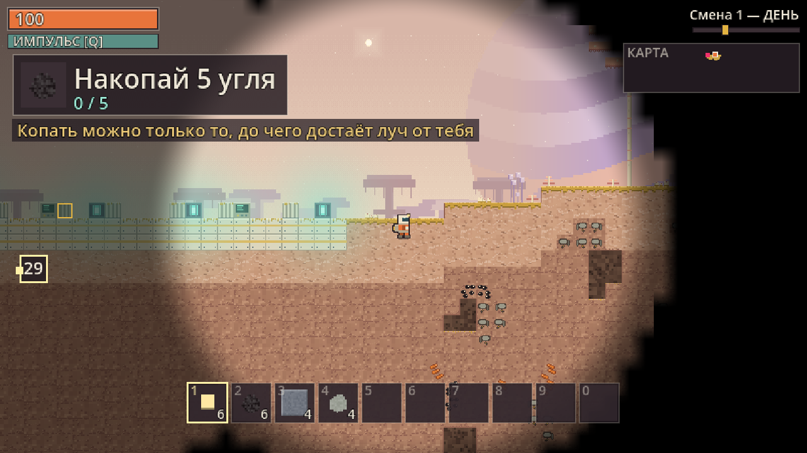

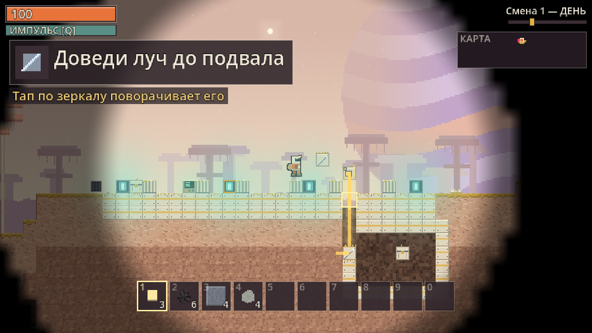

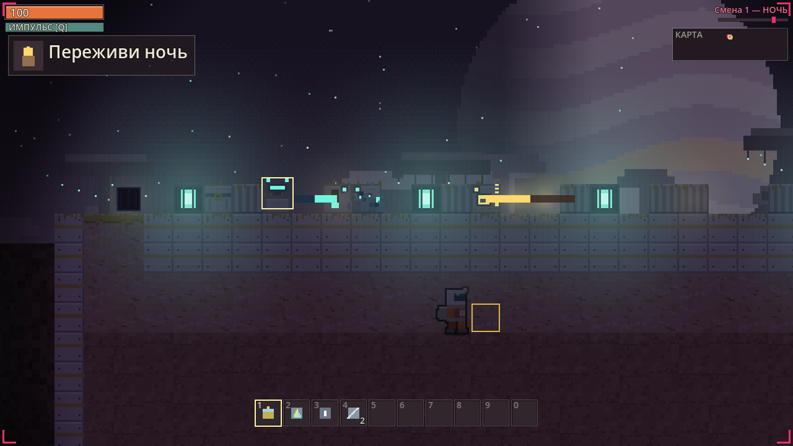

- **Глава открывается**, когда пройдена предыдущая; пройденные отмечены в профиле.
- **Карточка «Сейчас»** показывает одну задачу: картинка, короткая фраза и счётчик.
  Строка под ней — подсказка, что нажимать.
- В главах 1–2 ночь короткая, эхо не бьёт. В «Зеркале» солнце стоит. С «Цветов»
  эхо бьёт, но жёлтый свет его не подпускает.
- **Ствол шахты** в свободной игре — проём в 3 клетки, уступы попеременно у стен.
  Вниз — по центру. Наверх — с разбега: сойдите с уступа к центру и сразу прыгайте.
- **Сохранений в главе нет**: она короткая и всегда начинается с готовой базы. Esc →
  «Выйти в меню». Погибли — капсула на базе, но ночь не перематывается.
- **Итог главы**: **N** (на телефоне — тап) — следующая глава, **R** — заново.
- **По сети**: «Создать игру» → строка «Режим» листает «Свободная игра» и открытые главы.
  Товарищи получают главу и базу при входе, у каждого — свой набор главы.

## С чего начать: первые 15 минут

Ниже — свободная игра, не глава. Карточка «Сейчас» ведёт к ядру. Картинки сняты
с настоящей игры (сид 31337), кроме меню и кадров лобби: они старше и подписаны отдельно.

**Остановиться и продолжить потом.** **Esc** (на телефоне — кнопка **II**) ставит игру на
паузу. Чтобы закончить на сегодня, выберите «Сохранить и выйти в меню». В следующий раз
нажмите в главном меню **«Продолжить»**. Подробнее — [«Пауза»](#пауза).

**1. Осмотритесь.** Вы стоите на лагере: стальная площадка, два терминала, четыре
светокристалла и вентиляция у левого края. В сундуке слева — 3 светокристалла, 8 угля
и **Радужное ядро**. У героя в руках: 3 светокристалла, 6 угля, 4 камня и 4 хлама.
Забег начинается на рассвете, до ночи полный день, около 150 секунд.

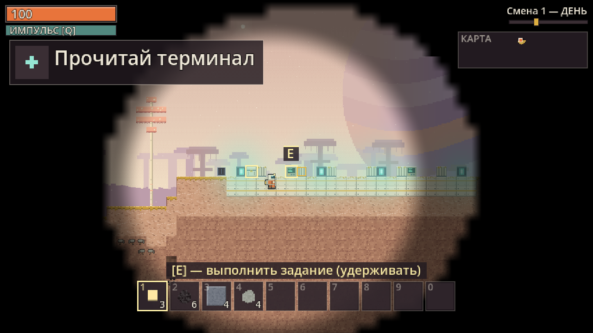

**2. Копайте через пустоту.** Зажмите ЛКМ на клетке не дальше 5,6 клетки от себя.
Ломается первая твёрдая клетка на луче от героя к курсору. Клетка за стеной не
ломается: на ней красный крест. Лишайник и глина — 0,5–0,6 с и дают **хлам**. Камень
под тремя слоями глины — 1,4 с и даёт **камень**. Выпавшее подлетает само, если
подойти ближе 70 px.

**3. Скрафтите горелку.** Нажмите **I**. Вкладка одна — «Крафт». Рецепт горелки
появляется, когда в рюкзаке уже были камень и хлам: 4 камня и 2 хлама, сразу.


**4. Поставьте горелку и положите уголь.** Выберите горелку в хотбаре и нажмите
**ПКМ** по пустой клетке. Носик смотрит в сторону поворота; ещё один ПКМ по горелке
поворачивает её (восемь положений, в том числе наискосок). **E** с углём в руке
кладёт стопку в топку (до 12). Одна единица угля горит 45 секунд, луч красный.
Пустой рукой **E** — рубильник: горелка не жжёт, пока выключена.

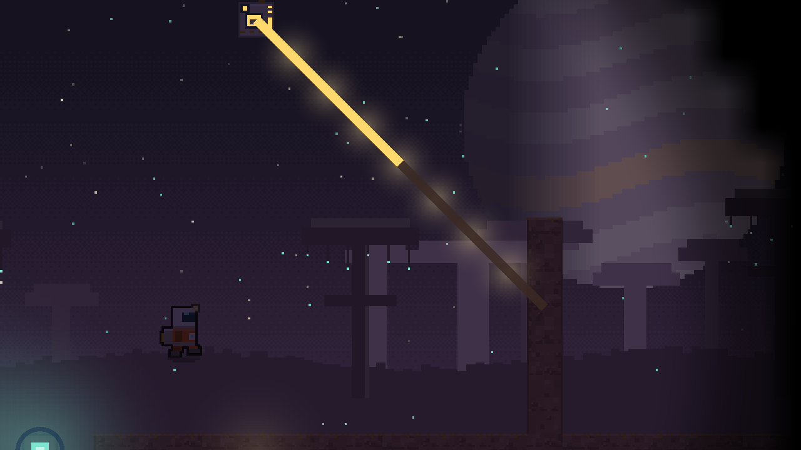

**5. Прочитайте терминал.** Встаньте у терминала и **удерживайте E** 2,2 секунды.
Терминал отдаёт главу журнала (**J**), следующий чертёж и подарок на пол.
Отработавший гаснет. Питание для чтения не нужно.

**6. Посмотрите чертежи.** В крафте под списком рецептов строка «Чертежи: N из 9».
Рецепт из списка чертежей без чертежа не показывается. Порядок один, какой терминал
ни найдите: смеситель, маяк, коллектор, накопитель, стальная стена, решётка,
сирена, линза, второе ядро. В журнале чертёж — иконка и короткое имя.

**7. Слиток — руками.** Две руды дают один слиток сразу. Уголь почти под землёй,
медь — примерно с 8 клеток, железо — с 30, кристаллы — с 60
(см. [таблицу тайлов](#тайлы-и-руды)). Песок у воды даёт стекло: 2 песка.

**8. Загляните в руину до ночи.** В мире 7 руин, почти все под землёй: комната в
породе, ход из пещеры, не колодец от травы. На миникарте терминал руины не светится,
пока до него не дойдёте. В каждой — тайник, табличка и терминал. Когда наступают
сумерки, вверху появляется «НОЧЬ ЧЕРЕЗ N с».

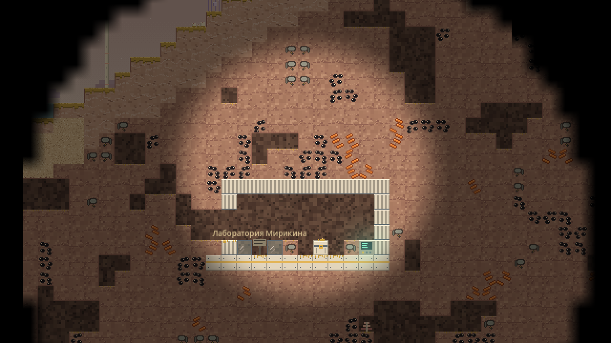

## Управление

### Клавиатура и мышь

| Клавиша | Действие |
|---|---|
| **A / D** или **← / →** | ходьба |
| **W / ↑ / Space** | прыжок |
| **Shift** | бег (громче, и фантомы это слышат) |
| **ЛКМ** | копать первую твёрдую клетку по лучу от героя к курсору (сквозь стену нельзя, досягаемость 5,6 клетки; цель обведена рамкой, недостижимая клетка — красный крест) или бить фантома под курсором |
| **ПКМ** | поставить выбранный предмет; по горелке, зеркалу, призме, смесителю, коллектору и накопителю — повернуть |
| **E** | взаимодействие (что именно — см. ниже); терминал, запуск ядра, ремонт и разбор — удерживать |
| **Q** | импульс: 10 урона и оглушение на 3 с всем фантомам ближе 130 px, перезарядка 8 с |
| **V** | залезть в вентиляцию или вылезти из неё |
| **1 … 0** | выбор ячейки хотбара (при хотбаре из 6 ячеек клавиши 7–0 ничего не делают) |
| **колесо мыши** или **+ / −** | зум: от вдвое шире обычного обзора до вдвое ближе; **средняя кнопка** — обычный зум. Выбранный зум запоминается |
| **I / Tab** | инвентарь и крафт |
| **J** | журнал экспедиции |
| **P** | свободно |
| **G** | в сетевой игре — начать перекличку или ответить на неё |
| **Esc** | закрыть инвентарь или журнал; если окон нет — пауза (см. [«Пауза»](#пауза)) |
| **F5 / F9** | сохранить / загрузить забег (см. [«Сохранение»](#сохранение)) |
| **R** | на экране гибели в хардкоре и на экране финала — новая попытка |

**Что делает E.** Цель одна: она обведена рамкой, а внизу экрана написана подсказка.
Сначала проверяется объект под курсором (если до него можно дотянуться), иначе ближайший:

| Цель | Что делает E |
|---|---|
| терминал | удерживать 2,2 с — глава журнала, чертёж и подарок |
| Радужное ядро, все дуги горят и сданы добыча с ночью | удерживать 3 с — запуск |
| горелка, топливо в руке | загрузить топку (до 12) |
| горелка, пустая рука | рубильник: не жечь зря |
| накопитель | рубильник: копить или отдавать |
| сирена с полным зарядом | 10 с все фантомы в 10 клетках бегут |
| маяк, линза в руке | вставить линзу навсегда |
| сундук, тайник руины, небесный тайник | открыть окно сундука |
| повреждённый блок, хлам в руке | удерживать — ремонт, +20 HP за единицу хлама |
| пустой блок и пустой сундук | удерживать 0,9 с — **разобрать**: предмет возвращается в рюкзак |

**Разбор.** Поставили не туда — снимите: пустая рука, курсор на блоке, **удержать E**
0,9 с. Предмет возвращается в рюкзак (нет места — падает под ноги). Топливо и вещи
из сундука высыпаются на землю. Постройки кампании, тайники руин и сундук лагеря
не разбираются. Разбор маяка с линзой возвращает и маяк, и линзу.

### Телефон

На сенсорном экране сами появляются джойстик и кнопки. На ПК их можно включить
флагом `--touch` (`godot --path . -- --touch`). Клавиатура и мышь по USB или
Bluetooth работают и на телефоне.

Отдельного кадра текущей раскладки с хотбаром из 6 ячеек и без старых подписей
в репозитории нет. Старый `docs/img/touch_controls.png` в этот README не вставлен:
на нём ещё написано про питание. Раскладка кнопок та же.

| Касание | Действие |
|---|---|
| **джойстик** слева | ходьба; отклонить вверх — прыжок |
| **прыжок** | прыжок (короткий тап тоже засчитывается) |
| **бег** | бег вкл/выкл — защёлка, держать не нужно |
| **E «держать»** | взаимодействие, как клавиша E |
| **Q «импульс»** / **V «укрытие»** | импульс / вентиляция |
| **G «перекличка»** | только в сетевой игре: начать или ответить; пока идёт, кнопка подсвечена |
| **I «инвентарь»** / **J «журнал»** | открыть или закрыть окно; пока окно открыто, видны только эти две кнопки |
| **II «пауза»** | слева от J: пауза, как Esc |
| **тап по миру** | копать первую твёрдую по лучу или бить фантома; держите палец, чтобы копать дальше |
| **долгий тап** (от 0,4 с) по пустой клетке | поставить выбранный предмет |
| **тап по уже стоящему блоку** | повернуть горелку, зеркало, призму, смеситель, коллектор, накопитель |
| **строить** | режим постройки: короткий тап по миру сразу ставит предмет |
| **тап по хотбару** | выбрать ячейку; на телефоне хотбар по умолчанию — 6 крупных ячеек |
| **щипок** двумя пальцами по миру | зум: развести — ближе, свести — дальше |
| в инвентаре и журнале | тап работает как ЛКМ; проведите пальцем, чтобы листать |
| экран гибели или финала | тап — новая попытка |

Пальцев может быть сколько угодно: можно идти джойстиком и одновременно копать.
Второй палец на мире, пока первый там, начинает щипок: поэтому палец по миру
начинает копать через долю секунды (~70 мс), а короткий тап всё равно срабатывает.
Кнопки не меньше 9 мм и не закрывают HUD, миникарту, хотбар и уведомления.
Поля ввода в меню открывают экранную клавиатуру: у порта она цифровая.

Горелка рядом с сундуком сама берёт топливо, если в топке меньше двух единиц:
уголь по одной стопке носить не нужно.

### Пауза

**Esc** открывает паузу, если инвентарь и журнал закрыты. Если окно открыто, первый
Esc закрывает его. На телефоне то же делает кнопка **II**. Ещё один Esc закрывает паузу.

| Пункт | Что делает |
|---|---|
| **Продолжить** | вернуться в игру |
| **Сохранить** | то же, что F5: забег пишется в слот F5, пауза остаётся открытой |
| **Сохранить и выйти в меню** | сохранить в тот же слот и выйти в главное меню. Там появится «Продолжить» |
| **Выход из игры** | закрыть игру |

- В одиночной игре на паузе мир стоит: время, ночь и фантомы ждут.
- **В хардкоре** «Сохранить» серая. Вместо «Сохранить и выйти в меню» стоит «Выйти в меню»:
  сначала предупреждение «Забег не сохранён». Так же, если герой погиб или забег окончен.
- **В сетевой игре** мир на паузе не останавливается. У клиента «Сохранить» серая
  (сохраняет хост). Выход в меню у клиента — «Отключиться и выйти в меню»: героя
  хранит хост. У хоста «Сохранить» и «Сохранить и выйти в меню» работают, но выход
  закончит игру для всех.

## Интерфейс

### HUD

| Где | Что |
|---|---|
| слева вверху | **здоровье** (100; каждые 6 с +6) и полоса **импульса [Q]** — заполнилась, значит готов |
| под ними | **карточка «Сейчас»**: одна цель — картинка, короткая фраза и счётчик «3 / 5», если нужно больше одного. Стрелка на краю экрана ведёт к цели, на месте цели мигает рамка. Клик по карточке на 2 с показывает цель камерой |
| ниже | в главе — одна строка **подсказки**, что нажимать |
| справа вверху | «Смена N — УТРО / ДЕНЬ / ВЕЧЕР / СУМЕРКИ / НОЧЬ», полоса суток и **миникарта** (рельеф, вы и ядро; неразведанное скрыто) |
| вверху по центру | в сумерках — «НОЧЬ ЧЕРЕЗ N с», последние 5 с мигает |
| по углам экрана | ночью — красные уголки-скобки опасности |
| справа внизу | уведомления: чертежи, находки, «Сигнал: осталось N с» |
| внизу по центру | подсказка к цели E и **хотбар**: 10 ячеек (1…0) на ПК, 6 крупных (1…6) на телефоне |

Карточка на кадре ниже — первая цель свободной игры: «Прочитай терминал».


**Туман войны.** Неразведанное — чёрное. Вокруг героя открывается круг обзора:
16 клеток на поверхности и 8 под землёй. Разведанное вне круга остаётся видно, но затемнено.
Белый маяк дополнительно проявляет руду в стенах, см. [таблицу цветов](#цвета).

### Инвентарь и крафт (I / Tab)

Окно «ИНВЕНТАРЬ И КРАФТ» разделено на две части. Слева — сундук (если открыли его
через E), под ним 36 ячеек: верхний ряд — хотбар, ниже — рюкзак. Справа — одна
вкладка «Крафт». Вкладок станков нет.

- **ЛКМ** по ячейке — взять стопку в руку и положить в другую ячейку. **ПКМ** — взять
  половину, а с предметом в руке — положить по одному.
- **Shift+ЛКМ** — переложить стопку сразу: при открытом сундуке — между сундуком и
  инвентарём, без сундука — между хотбаром и рюкзаком.
- **«Забрать всё»** переносит весь сундук в инвентарь, **«Сложить всё»** — весь рюкзак
  в сундук (хотбар остаётся при вас).
- Если закрыть окно с предметом в руке, он вернётся в инвентарь. Нет места — уйдёт
  в сундук, совсем некуда — упадёт под ноги.
- Наведите курсор на рецепт: что получится, «есть N / нужно M», «Где взять» и почему
  сейчас нельзя. Список листается колесом. Под списком — «Чертежи: N из 9».

**Крафт руками, сразу.** Слиток — две руды. Стекло — два песка. Светокристалл —
кристалл и уголь. Остальные рецепты — в [справочнике](#предметы). Рецепт из списка
чертежей без чертежа не рисуется.

### Чертежи

Дерева узлов нет. Девять терминалов (2 в лагере и по одному в 7 руинах)
выдают чертёж **по порядку прочтения**, какой терминал ни найдите:

| № | Чертёж | Рецепт руками |
|---|---|---|
| 1 | Смеситель | 2 медных слитка + 2 стекла |
| 2 | Маяк | 2 железных слитка + 1 стекло + 1 кристалл |
| 3 | Коллектор | 1 медный слиток + 1 стекло |
| 4 | Накопитель | 2 железных слитка + 1 кристалл |
| 5 | Стальная стена ×4 | 2 железных слитка + 1 уголь |
| 6 | Решётка | 2 железных слитка |
| 7 | Сирена | 2 медных слитка + 1 кристалл + 1 стекло |
| 8 | Линза | 3 стекла + 2 кристалла |
| 9 | Радужное ядро | 4 железных слитка + 3 кристалла |

Два терминала лагеря рядом с капсулой: смеситель и маяк можно получить в первые
минуты. Остальное — награда за руины. Вместе с чертежом терминал отдаёт главу
журнала и подарок на пол: 2–3 вида из угля, стекла, слитков и кристалла.
Простое открывается само, когда ингредиент впервые попал в рюкзак: песок — стекло,
зеркало и призма; камень и хлам — горелка; медь — слиток и сундук. Приходит
уведомление «Теперь можно сделать: …».

Чёрный ящик даёт 2 кристалла и обрывок журнала, не очки и не чертёж.

Кадр журнала в репозитории (`docs/img/shots/blueprint_journal.png`,
`docs/img/shots/journal.png`) ещё показывает старую строку цели. В этот README
он не вставлен. Чертёж в текущей игре — иконка и короткое имя, без рецепта на полоске.

### Журнал экспедиции (J)

Здесь экипаж «Кербер-9» (7 человек с ролями и позывными), 9 глав, обрывки и
полученные чертежи. Главы читаются на терминалах: 1–2 в лагере, остальные в руинах.
Непрочитанная глава выглядит как «▒▒▒». **ЛКМ** по главе открывает текст. Обрывки
приходят из чёрных ящиков и самописцев. Тексты, имена и места генерируются из сида.
Кто-то в списке экипажа — «не тот», но журнал этого не выдаёт.

## Свет и цвета

Луч летит по пустым клеткам. Длина от горелки — **24 клетки**, белый — **32**.
Каждое зеркало, смеситель и накопитель на пути съедают **2 клетки**. Направлений
восемь: четыре стороны и четыре диагонали. Шаг в соседнюю клетку, в том числе
наискосок, стоит 1 клетку. Луч останавливается на первой твёрдой клетке и не
проходит наискосок сквозь угол двух стен. У источника он яркий, к концу гаснет.
Клетки на пути освещены (сила 1,0, белый — 1,5).

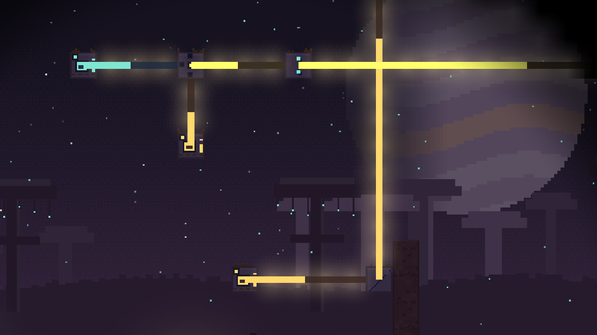

### Блоки

Ставятся **ПКМ** или тапом в режиме «строить». Поворот — ПКМ или тап по уже
стоящему блоку. Крафт только руками. Ничего не заперто числом очков.

| | Блок | Из чего | Что делает |
|---|---|---|---|
| 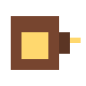 | **Горелка** | 4 камня + 2 хлама | жжёт топливо и бьёт лучом своего цвета. Топка до 12. Рядом с сундуком сама берёт топливо, если в топке меньше двух |
|  | **Зеркало** | 2 медных слитка + 1 стекло | поворачивает луч на 90° и на 45°, восемь положений. Полоска показывает грань |
|  | **Смеситель** | 2 медных слитка + 2 стекла, чертёж 1 | лучи входят с любых сторон, кроме выхода; выходит смесь |
|  | **Призма** | 3 стекла | белый → красный прямо, зелёный налево, синий направо. Другой цвет проходит прямо |
| 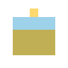 | **Коллектор** | 1 медный слиток + 1 стекло, чертёж 3 | днём, если над ним до неба пусто, даёт белый луч на 32 клетки. Ночью и под крышей молчит |
|  | **Накопитель** | 2 железных слитка + 1 кристалл, чертёж 4 | хранит 120 с луча одного цвета. Отдаёт, когда вход пуст, или по рубильнику E |
|  | **Маяк** | 2 железных слитка + 1 стекло + 1 кристалл, чертёж 2 | приёмник: действие зависит от цвета луча. 100 HP, пока зелёный — не ломается |
| 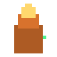 | **Сирена** | 2 медных слитка + 1 кристалл + 1 стекло, чертёж 7 | E при полном заряде гонит всех фантомов в 10 клетках на 10 с. Заряд 60 с, только под лучом |
| 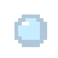 | **Линза** | 3 стекла + 2 кристалла, чертёж 8; одна всегда в небесном тайнике | E у маяка: вставить. Дальше и ярче, см. таблицу ниже |
|  | **Ядро** | в сундуке лагеря; ещё одно — чертёж 9: 4 железных слитка + 3 кристалла | шесть дуг. Белый луч дугу не зажигает. Точка возрождения |

Рядом с оптикой остаются сундук (4 медных слитка, 24 ячейки), светокристалл
(кристалл + уголь, свет 1,0 навсегда), стальная стена, решётка вентиляции,
камень, песок и волокно стебля. Их можно ставить в воздух: лестница к небесному
тайнику строится из блоков.

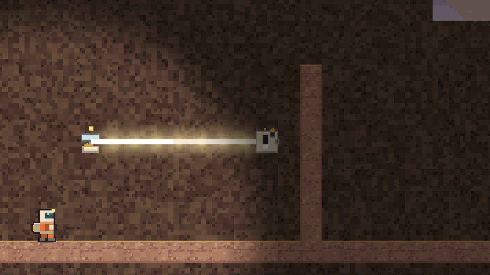

### Цвета

Три топлива — три основных цвета. Смешение — сложение света: два луча в смеситель
дают третий цвет. Призма делает обратное с белым.

| Цвет | Откуда | Маяк под этим цветом |
|---|---|---|
| **Красный** | горелка + уголь, 45 с/шт | **жгучий луч**: 20 урона раз в 0,8 с первому фантому на линии, дальность 7 клеток, сквозь стену не бьёт |
| **Зелёный** | горелка + медная руда, 30 с/шт | **починка**: +20 HP раз в 3 с каждому блоку в 3 клетках; сам маяк под зелёным не ломается |
| **Синий** | горелка + кристалл, 60 с/шт | **мороз**: фантомы в 4 клетках идут вдвое медленнее и не бьют 1 с из каждых 3 |
| **Жёлтый** = красный + зелёный | смеситель | **яркий свет** силы 2,0: эхо и копатель уходят |
| **Голубой** = зелёный + синий | смеситель | **купол**: блоки в 3 клетках неуязвимы, пока купол не примет 100 урона; потом 10 с тишины и снова 100 |
| **Пурпурный** = красный + синий | смеситель | **приманка**: рой и тень идут к маяку, а не к горелкам; у маяка 200 HP |
| **Белый** = все три, или коллектор днём | смеситель / коллектор | **ясный свет**: в 8 клетках руда и кристаллы проступают сквозь породу. Луч длиннее — 32 |

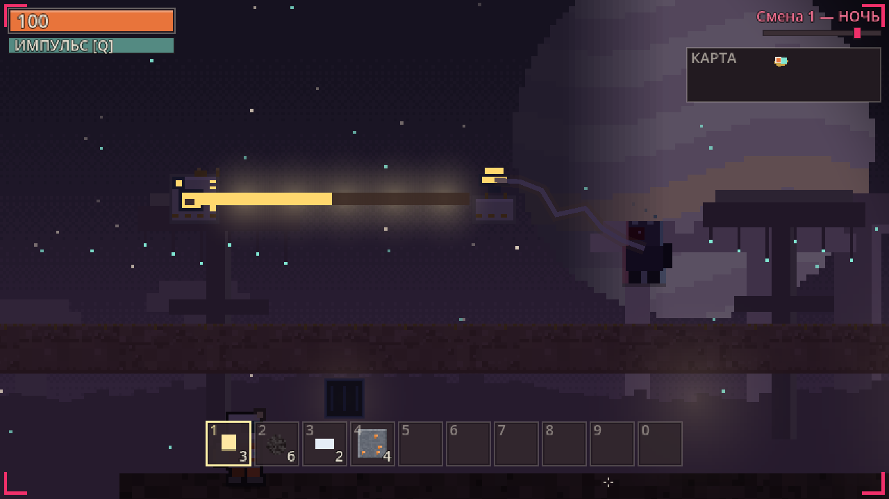

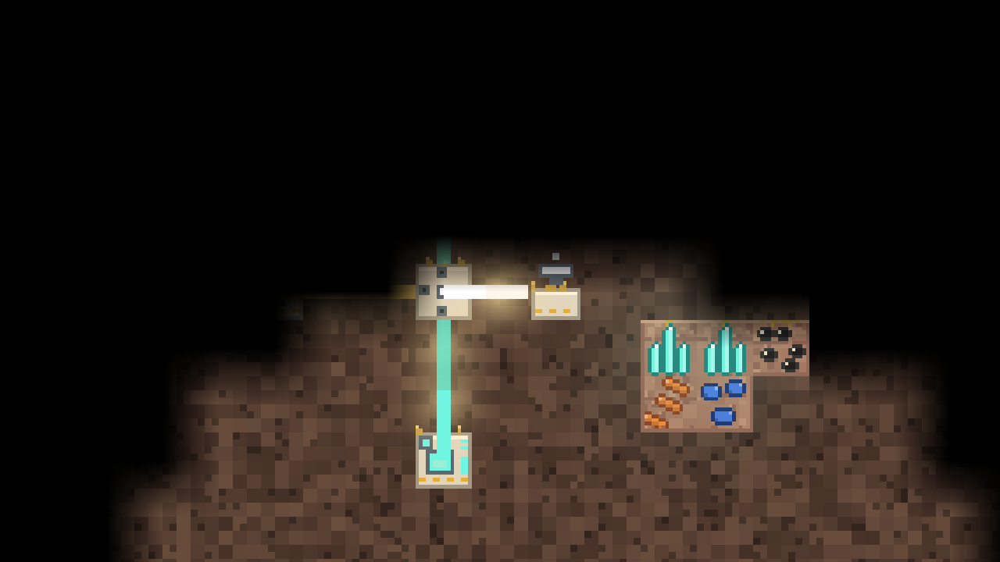

**Линза в маяке.** Красный бьёт на 10 клеток вместо 7. Урон и сила жёлтого света
× 1,5 (20 → 30, свет 2,0 → 3,0). Синий и купол — на 2 клетки дальше. Приманка —
ещё 32 px. Белый радиус — 12 клеток вместо 8. Зелёный радиус не растёт.

### Ядро и кот

Ядро ставится куда угодно. Активное — последнее поставленное. Дуги хранятся
в забеге, не в блоке: снял и перенёс — уже горящие не гаснут. Луч чистого цвета,
упёршийся в ядро, зажигает свою дугу навсегда. Смесь из нескольких цветов сразу
дугу не зажигает: нужен чистый цвет. **Белый тоже не зажигает** — это ясный свет
шахты, не седьмой цвет. Призма делит его на красный, зелёный и синий. В главе
«Радуга» белый по-прежнему седьмая дуга: там цель учит все семь цветов.

Релей не стартует, пока не сданы три этапа до ядра. Коллектор и ядро одни победу
не дают.

| Этап | Что сделать |
|---|---|
| **1/6 ЗАПИТАЙ БАЗУ** | прочитать терминал лагеря (держать **E**): чертёж и глава журнала |
| **2/6 ДОБУДЬ РУДУ** | сломать 12 клеток руды: уголь, медь, железо или кристалл. Хлам и камень не считаются |
| **3/6 ПЕРЕЖИВИ НОЧЬ** | дождаться рассвета после одной ночи |
| **4/6 ЗАЖГИ ДУГИ** | пустить в ядро красный, зелёный, синий, жёлтый, голубой и пурпурный. Белый не считается |
| **5/6 ЗАПУСТИ ЯДРО** | у активного ядра удерживать **E** 3 с, когда горят шесть дуг и сданы этапы 1–3 |
| **6/6 УДЕРЖИ СИГНАЛ** | продержаться **180 секунд**. В первую ночь удержания из ядра выходит кот |

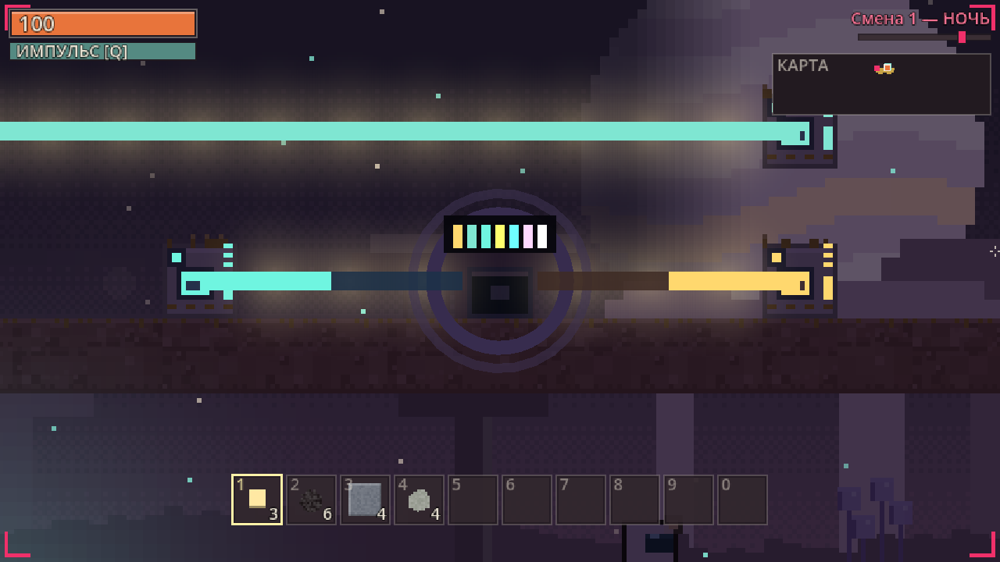

**Возрождение** — в клетке над активным ядром. Клетка занята — в ближайшей свободной.
Ядра нет — у капсулы лагеря. В сети — у ядра хозяина.

**Кот** — страж на 90 секунд. Летит к ближайшему фантому и сносит его касанием,
рой — стаей. Оставляет след-свет силы 1,5. Потом садится в ядро и копит 60 секунд
от любого луча. Если фантомов нет 10 секунд, возвращается раньше. После сигнала
выходит каждую ночь, если заряжен.

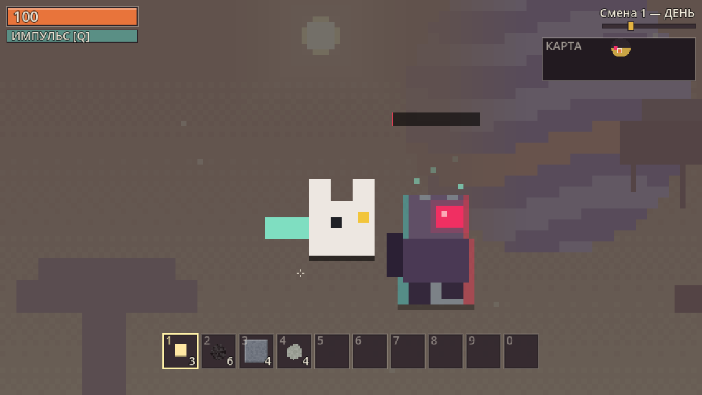

**Удержание.** Фантомы идут и днём, до 10 одновременно. Об остатке напоминают
уведомления на 150, 120, 90, 60, 30 и 10 секундах. Когда сигнал уходит, начинается
эвакуация: эпилог и итоги — добыто блоков, изготовлено предметов, уничтожено
фантомов, выполнено заданий, смертей и время.

## Ночь и оборона

**Сутки.** Полный цикл — 240 с. Утро, день и вечер безопасны. Сумерки — около 14 с:
вентиляции гудят, наверху «НОЧЬ ЧЕРЕЗ N с». Ночь — около 91 с. С рассветом новая
смена. Забег начинается на рассвете: до первой ночи полный день, около 150 с.

Кадр старой ночи со снятой башней в README не вставлен. Ночь сейчас держат луч, маяк и сирена.

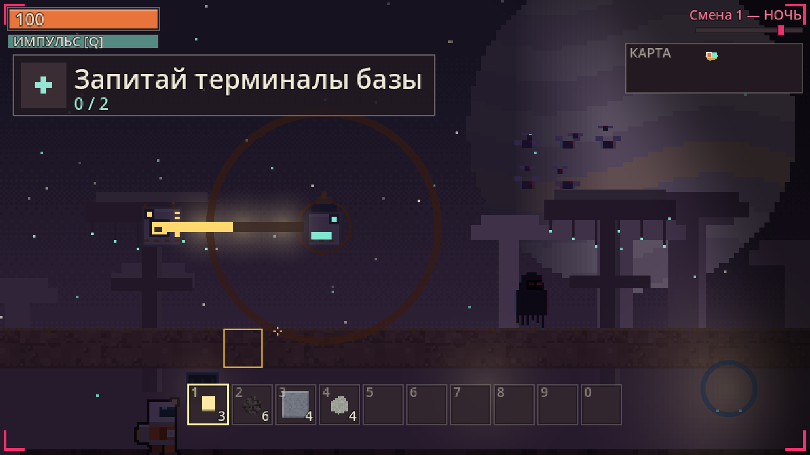

На кадре сирены карточка ещё говорит старыми словами. Кольцо и луч — текущие:
E при полном заряде гонит фантомов в 10 клетках.

**Откуда приходят.** Бюджет ночи считается от базы, не от календаря:

```
T      = min(номер смены, 3) + 0,5 × горящих горелок + 1,0 × маяков под лучом + 0,25 × накопителей
бюджет = 1 + 2 × T
живых  = 1 + T, не больше 10
```

На удержании сигнала к T добавляется 4. Две первые ночи тихие: бюджет не больше 2,
одновременно не больше одного, и это только эхо. Кто ничего не строит, не получает
осаду только от номера смены: смена в формуле не выше 3.

Новые появляются раз в 2,5–7 с из трёх ближайших незапечатанных вентиляций.
Сначала 2 с пар и гул, потом фантом. Вентиляция ближе 160 px к вам не выпускает.

**Кто приходит.**

| | Тип | HP | Удар | Когда | Повадки |
|---|---|---|---|---|---|
|  | Эхо | 100 | 24 | всегда | охотится на героя; убегает со света ярче 0,55 |
|  | Рой | 30 | 8 | горят 2 горелки и больше | стая из 4–6; летит на горящую горелку ближе 300 px; свет не пугает; при смерти — 1 медная руда с мотылька |
|  | Тень | 180 | 18 | есть накопитель или сундук с топливом | чует горелку за 640 px; съедает 1 единицу топлива в 3 с; свет не пугает; при смерти — 2 угля |
|  | Копатель | 140 | 30 | смена 4 и в мире есть стальная стена | роет глину, камень и хлам (не твёрже 1,5), чует героя сквозь породу за 600 px, грызёт решётку за 8 с; убегает от света ярче 0,8 |
|  | Двойник | 120 | 40 | свободная игра, смена 6; в главе не приходит | не больше одного; носит скафандр цели, визор цвета опасности; замирает под взглядом ближе 200 px |

Обычный фантом замечает вас за 170 px ночью (днём за 120), если видит, и слышит
шум за 260 px. Бег и копка громче ходьбы. У сундука и горелки 100 HP, у маяка 100
(под пурпурным — 200, под зелёным не ломается). У ядра 300 HP.

**Чем держаться.**

| Средство | Как работает |
|---|---|
| Свет | эхо и копатель уходят. Светокристалл — сила 1,0. Луч на своём пути — 1,0, белый — 1,5 |
| Маяк | семь действий из [таблицы цветов](#цвета). Без луча молчит |
| Сирена | кнопка паники: гонит и тех, кого свет не пугает. Лампа: зелёная — готова, жёлтая — заряд, красная — луча нет |
| Линза | маяк бьёт дальше и ярче |
| Стальная стена | копка 4,0 с; копатель её не роет |
| Решётка | только на вентиляцию: фантомы оттуда не выходят; копатель прогрызает за 8 с |
| ЛКМ по фантому | 38 урона, удар раз в 0,45 с |
| Импульс **Q** | 10 урона и оглушение на 3 с всем ближе 130 px, перезарядка 8 с |
| Вентиляция **V** | спрятаться ближе 40 px: 6 с неуязвимости, потом выталкивает, снова через 10 с |
| Кот | 90 с, касание снимает фантома; перезарядка 60 с от луча в ядро |
| Ремонт | E с хламом у повреждённого блока, +20 HP за штуку |

Чёрный ящик выпадает с убитого фантома с шансом 25 %, у двойника — всегда.
Он сразу вскрывается: 2 кристалла и обрывок журнала.

**Гибель.** Через 3 с вы появляетесь у ядра (или в капсуле лагеря, если ядра нет),
время перескакивает к рассвету. **Хотбар** остаётся мешком на месте гибели: подойдите
и заберите. Остальной инвентарь при вас. В хардкоре гибель заканчивает забег.

## Бесконечная игра

Планета не пустеет. Каждый рассвет в породе, которую вы ещё не видели, — глубже
десяти клеток от поверхности и только в тумане — камень рядом с жилой становится
той же рудой. За рассвет возвращается один процент от начального числа: уголь —
около 42 клеток. Разведанная шахта остаётся выработанной. Хлам не отрастает.

Отбитая ночь возвращает часть топлива: тень роняет 2 угля, мотылёк роя — 1 медную
руду, чёрный ящик — 2 кристалла. Ночь целиком не окупается.

После сигнала игра не кончается. На экране эвакуации есть **«Остаться на планете»**
(**C** или тап): мир тот же, ядро на месте, в карточке — «Смена N · Сигнал отправлен».
Новой цели нет. Ядро можно запустить снова. **R** начинает заново. В хардкоре
остаться нельзя.

Кадр экрана эвакуации (`docs/img/shots/endless.png`) в репозитории есть, но на нём
ещё старая подпись этапа. Кнопка «Остаться на планете» на кадре настоящая; в README
он не вставлен, чтобы не тащить старую строку.

## Сетевая игра

До 4 игроков в одной локальной сети (Wi-Fi или кабель). Один — хост, мир живёт
у него. Всё делается в главном меню, мышью или тапами.

Кадры лобби (`docs/img/lobby_create.png`, `lobby_host.png`, `lobby_browser.png`,
`lobby_ip.png`) сняты раньше светового конструктора и в этот README не вставлены.
Поля те же.

### Создать игру

| Поле | Что вписать |
|---|---|
| Имя игры | 1–24 символа, по умолчанию «Экспедиция <ник>» |
| Сид | пусто — случайный мир |
| Мест | 2, 3 или 4 (по умолчанию 4) |
| Порт | 1024–65535, по умолчанию 24642; порт 24643 занят поиском игр |
| Мир | новый или «Из сохранения…» |
| Режим | «Свободная игра» или открытая глава [кампании](#кампания-свет) — тогда мир кампании, сохранение не берётся |

Под формой написаны ваши адреса в локальной сети. После «Создать» хост попадает в
**лобби**: адрес для «По IP», список игроков с ником, видом и отметкой «готов» /
«ждём», кнопки «Закрыть игру» и «Старт». «Старт» загорается, когда все вошедшие
нажали «Готов». Хост может начать и один. Войти можно и после старта.

### Найти игру

Список игр в этой сети. В строке: имя, ник хоста, «игроков n/max», пинг, «лобби»
или «смена N», адрес, версия сборки и протокол. Серая строка недоступна, причина
рядом: другая версия, другой протокол, мест нет. «Обновить» ищет заново, «По IP»
переводит к вводу адреса.

### Подключиться по IP

Можно ввести `192.168.1.20`, `192.168.1.20:25000` или имя компьютера. Последние
5 удачных адресов показаны кнопками. Этот способ работает, даже когда поиск игру
не видит: гостевой Wi-Fi, телефон в роли хоста. Адрес хоста — на экране его лобби.

### Версии, порты, брандмауэр

- Подключиться можно, только если у хоста и у вас **одинаковые** версия сборки и протокол.
- Игра идёт по **24642/UDP**, поиск — по **24643/UDP** (широковещательный запрос, хост
  отвечает напрямую).
- **Брандмауэр Windows.** Когда вы первый раз создаёте игру, Windows спрашивает, пускать
  ли игру в сеть. Разрешите для **частных сетей**. Если окно закрыли кнопкой «Отмена»,
  игру никто не найдёт: «Панель управления» → «Брандмауэр Защитника Windows» →
  «Разрешение взаимодействия с приложением» → отметьте «ГЛИТЧ-КОРЕ» (или Godot) в
  столбце «Частные».
- **Телефон.** Android-клиент находит игры без дополнительных разрешений. Если телефон
  в роли хоста не виден в поиске, подключайтесь по IP с его экрана лобби. Точка доступа
  на телефоне работает так же, как обычный Wi-Fi.

### Что общее, а что личное

| Общее для команды | Личное у каждого |
|---|---|
| мир: тайлы, вода, блоки, сундуки, предметы на земле, лучи | инвентарь и хотбар |
| время суток, смена, этап цели, дуги ядра, отсчёт сигнала | здоровье, импульс, укрытие |
| чертежи, главы журнала, обрывки | вид и ник (видны над головой) |
| терминал читается один раз, всем приходит уведомление | новый игрок получает стартовый набор |
| топливо в горелках и запас накопителя считает хост | |

- **Удержание в сети.** Отсчёт идёт, только пока у ядра ближе 12 клеток есть живой,
  не спрятавшийся герой на связи. Иначе отсчёт стоит, но не сбрасывается. В HUD
  тогда горит «СИГНАЛ БЕЗ ПРИСМОТРА».
- **Фантомов больше.** При N игроках бюджет ночи умножается на `1 + 0,5·(N−1)`,
  лимит одновременных растёт на `2·(N−1)` (не больше 16), интервал появления делится
  на `1 + 0,35·(N−1)` (не меньше 1,5 с). Фантом идёт к ближайшему герою.
- **Команда в HUD.** Под миникартой плашка «КОМАНДА»: ник цветом скафандра, полоска
  здоровья или «погиб». На миникарте товарищ виден маячком цвета скафандра, если
  он ближе 20 клеток. Иначе маячка нет.
- **Двойник среди своих.** Когда живых двое и больше, двойник надевает ник и вид
  товарища, который дальше всех от жертвы, а охотится на того, кто дальше всех
  отбился. На миникарте маячка у него нет, на перекличку он не отвечает. Удар на
  1,5 с проявляет настоящий облик.
- **Перекличка — G** (на телефоне — кнопка G). Первое нажатие начинает: у всех
  «<ник>: перекличка! [G] — ответить». Ответить можно в течение 6 с. У ответившего
  6 с горит зелёный огонёк. Начать новую один игрок может не чаще раза в 20 с.
- **Огня по своим нет.** Импульс задевает только фантомов. ЛКМ по товарищу урона не
  наносит: слышен «клац», приходит «Свой: <ник>».
- **Вентиляция.** В одной — один герой. Если занята: «Вентиляция занята: <ник>».
- **Гибель.** Экран «ТЕБЯ НАШЛИ», взгляд глазами живого товарища (A/D — следующий).
  Через 15 с вы появляетесь у ядра, время **не** перескакивает. Мешок с хотбаром
  первые 120 с может поднять только владелец. Если погибла вся команда, все
  появляются через 3 с, время перескакивает к рассвету. На финале к итогам
  добавляются строки «<ник>: смертей N».
- **Обрыв связи.** Если клиент молчит дольше секунды, его герой стоит «без связи»:
  урона не получает и целью не служит. Вышедший при возвращении получает своего
  героя. Если хост завершает игру, клиентов возвращает в меню.

Текущая версия протокола — **19**. Подключиться к сборке с другим номером нельзя.

## Настройки

**Меньше глитча и мерцания: нет / да** — переключатель в главном меню. В обычном
режиме глитч появляется только рядом с угрозой и не дольше 0,5 с. С включённой
настройкой экранных эффектов нет, расслоение силуэта фантомов не мигает. Важные
события отмечаются спокойной вспышкой. Настройка хранится в профиле.

**Размер интерфейса** — кнопка «100 %» в главном меню, в одной строке с «Меньше
глитча»: 100, 150, 200 или 250 %, по кругу, сразу. Увеличивается всё, что поверх
мира: здоровье, карточка, подсказки, уведомления, миникарта, хотбар, инвентарь,
журнал, пауза. Мир, камера и зум не меняются. Меньше 14 px в интерфейсе нет,
основной текст — 18 px, заголовок карточки — 28 px. При первом запуске размер
считается от экрана: на мониторе (dpi не выше 110) — 100 %, на телефоне — наименьший,
при котором основной текст не ниже 4 мм. Если блоки не помещаются, лишняя строка
скрывается, а окна сами уменьшаются. Настройка хранится в профиле.

Отдельных кадров «100 %» и «250 %» без старых подписей в репозитории нет
(`docs/img/ui_scale_100.png` и `ui_scale_250.png` их ещё содержат), поэтому сюда
они не вставлены.

**Хотбар** — «Ячеек: 6» / «Ячеек: 10» в одной строке с сидом и «Хардкор». На телефоне
и при `--touch` по умолчанию 6, на ПК — 10. Переключение на 6 не теряет вещи из
ячеек 7–10: они переезжают в рюкзак, а если рюкзак полон — падают под ноги.
Клавиши 7–0 при шести ячейках молчат.

Кадр `docs/img/shots/hotbar_6.png` в репозитории есть, но на нём ещё старые строки
цели. В README он не вставлен. Шесть ячеек в текущей игре включаются этой кнопкой.

**Хардкор** — одна жизнь, без сохранений, только одиночная игра. Гибель показывает
эпитафию и итоги, R начинает новую попытку.

**Профиль** — ник и вид скафандра, см. [«Главное меню и профиль»](#главное-меню-и-профиль).

## Сохранение

- **F5** сохраняет забег, **F9** загружает. Слот один, файл `user://save_1.sav`
  (папка та же, что у профиля). Сохраняется всё: мир, вода, туман, блоки с топливом
  и запасом, предметы на земле и мешок, герой с инвентарём, время, дуги ядра,
  чертежи, журнал, тайники. Старые поля дерева узлов при загрузке
  игнорируются. Фантомы поштучно не пишутся: оставшиеся этой ночи выйдут заново.
- Пауза (**Esc**): «Сохранить» и «Сохранить и выйти в меню» пишут в тот же слот.
  Отдельного автосохранения нет. В меню **«Продолжить»** загружает самое новое
  одиночное сохранение, **«Загрузить»** показывает список.
- Сохранить нельзя, если герой погиб или забег окончен. В хардкоре F5 и F9 не работают.
- **В сети** сохраняет только хост. F5 пишет `save_1.sav`, и ещё хост сохраняет игру
  на каждом рассвете в слот `mp_<имя игры>_auto`. У клиента F5 отвечает «сохраняет хост».
  F9 в сети выключен у всех.
- Старый сейв с предметами, которых больше нет, при загрузке превращает их в то,
  из чего они состояли (слитки, кристаллы, стекло). Такие предметы больше не ставятся.

## Справочник объектов

Числа взяты из кода (`DB`, `Balance`, скрипты блоков). «Копка» — секунды, за которые
клетка ломается под ЛКМ. Мир — 640 × 180 клеток. Глубина руды — доля пути от
поверхности до дна, примерно 136 клеток: 6 % — около 8 клеток, 22 % — около 30,
45 % — около 61.

### Тайлы и руды

Порода выглядит по-разному в трёх биомах, хотя тайл один: **поверхность** (розовая
глина под горчичным лишайником), **средние пещеры** с 25 % глубины (фиолетовый камень
с бирюзовыми нитями) и **глубина у лавы** с 55 % (тёмно-красная «плоть»). На листе
каждый тайл показан в трёх биомах.


| | Тайл | Где | Копка | Что даёт |
|---|---|---|---|---|
|  | Лишайник | верхний слой поверхности | 0,6 с | хлам |
|  | Глина | 3 клетки под лишайником | 0,5 с | хлам |
|  | Камень | основная порода | 1,4 с | камень |
|  | Песок | берега у воды | 0,4 с | песок |
|  | Лишайниковая кочка | кочки на лишайнике | 0,6 с | хлам |
|  | Стебель свечника | ствол; сквозь него можно пройти | 1,0 с | волокно стебля |
|  | Шляпка свечника | без опоры падает | 0,2 с | — |
|  | Хлам | жилы до 35 % глубины, ряд над коренной породой, кучи у руин | 1,0 с | хлам |
|  | Уголь | жилы глубже 3 % | 1,8 с | уголь |
|  | Медная руда | жилы глубже 6 % (около 8 клеток) | 2,0 с | медная руда |
|  | Железная руда | жилы глубже 22 % (около 30 клеток) | 2,6 с | железная руда |
|  | Кристалл глитча | жилы глубже 45 % (около 61 клетки); в кристальных полосах — вкраплениями под поверхностью; слабо светится | 3,4 с | кристалл глитча |
|  | Светокристалл | на поверхности, 4 в лагере, по одному в руинах; свет 1,0 | 0,6 с | светокристалл |
|  | Вода | низины ниже уровня моря; течёт | — | не копается, в неё можно ставить блоки |
|  | Лава | пещеры ниже 126-й строки; светится | — | не копается, **18 урона в секунду** |
|  | Коренная порода | 3 нижние строки мира | — | не копается |
|  | Песчаник | в мире сейчас не генерируется | 1,2 с | камень |

Постройки станции и блоки, которые ставит игрок (**ПКМ** с предметом в руке;
блоки можно ставить в воздух):

| | Тайл | Где / как поставить | Копка | Что даёт |
|---|---|---|---|---|
|  | Сталь | пол лагеря, руин и небесного обломка | 3,0 с | — |
|  | Панель | стены руин, декор лагеря; в панель превращается отработавший терминал | 3,0 с | — |
|  | Терминал | 2 в лагере и по одному в 7 руинах; светится | 3,0 с | — |
|  | Стекло | окна руин, иллюминатор обломка | 0,8 с | — |
|  | Старое ядро лагеря | тайл в центре площадки; не копается. Цель игры — предмет «Радужное ядро», не этот тайл | — | — |
|  | Волокно стебля | из волокна (в отличие от стебля — твёрдое) | 1,0 с | волокно стебля |
|  | Стальная стена | из предмета, чертёж 5; копатель не роет | 4,0 с | стальная стена |
|  | Решётка вентиляции | только на вентиляцию, чертёж 6 | 1,0 с | решётка |

Медный, железный и кристальный блоки и шлюз в новых мирах не ставятся. Старый сейв
превращает предмет в слитки или кристаллы; клетка шлюза в уже сохранённом мире
остаётся, пока файл не пересобран.

### Флора

Флора — картинка: сквозь неё можно пройти, кроме стебля и шляпок свечника.
На лишайнике — пузырник, полка и дождевики; в средних пещерах — завеса гиф и
трутовики; в глубине — мембранные мешки и трубки. Ночью споры светятся.


| Поверхность: свечник | Средние пещеры: завеса гиф |
|---|---|
|  |  |

### Предметы

Рецепты руками — мгновенно. «Когда виден» — первый подбор ингредиента или чертёж
терминала. Полный список рецептов — в коде `DB._build_recipes`.

| Выход | Вход | Когда виден |
|---|---|---|
| Медный слиток | 2 медной руды | первый подбор руды |
| Железный слиток | 2 железной руды | первый подбор руды |
| Стекло | 2 песка | первый подбор песка |
| Светокристалл | 1 кристалл + 1 уголь | первый подбор (уголь есть на старте) |
| Горелка | 4 камня + 2 хлама | первый подбор (камень и хлам есть на старте) |
| Сундук | 4 медных слитка | первый подбор слитка |
| Зеркало | 2 медных слитка + 1 стекло | первый подбор слитка или стекла |
| Призма | 3 стекла | первый подбор стекла |
| Смеситель | 2 медных слитка + 2 стекла | чертёж 1 |
| Маяк | 2 железных слитка + 1 стекло + 1 кристалл | чертёж 2 |
| Коллектор | 1 медный слиток + 1 стекло | чертёж 3 |
| Накопитель | 2 железных слитка + 1 кристалл | чертёж 4 |
| Стальная стена ×4 | 2 железных слитка + 1 уголь | чертёж 5 |
| Решётка | 2 железных слитка | чертёж 6 |
| Сирена | 2 медных слитка + 1 кристалл + 1 стекло | чертёж 7 |
| Линза | 3 стекла + 2 кристалла | чертёж 8; одна всегда в небесном тайнике |
| Радужное ядро | 4 железных слитка + 3 кристалла | первое — в сундуке лагеря; чертёж 9 |

**Сырьё и топливо**

| | Предмет | Как получить | Зачем |
|---|---|---|---|
|  | Хлам | лишайник, глина, кочки, жилы хлама; тайники медика | корпус горелки; ремонт +20 HP |
|  | Камень | камень, песчаник | корпус горелки; ставится как блок |
|  | Песок | берега; тайники медика | стекло; ставится как блок |
|  | Волокно стебля | стебли свечников | блок, лестницы |
|  | Уголь | жилы; тайники геолога и пилота; 6 у героя, 8 в сундуке лагеря | **красное** топливо, 45 с; стена; светокристалл |
|  | Медная руда | жилы; тайники геолога | **зелёное** топливо, 30 с; слитки |
|  | Железная руда | жилы; тайники геолога | слитки: маяк, накопитель, стена, решётка, ядро |
|  | Кристалл глитча | жилы; тайники; чёрный ящик (2) | **синее** топливо, 60 с; маяк, накопитель, ядро, линза, сирена |
|  | Медный слиток | руками: 2 руды | сундук, зеркало, смеситель, коллектор, сирена |
|  | Железный слиток | руками: 2 руды | маяк, накопитель, стена, решётка, ядро |
|  | Стекло | руками: 2 песка | зеркало, призма, смеситель, коллектор, маяк, сирена, линза |

**Блоки** (как светят в мире — в разделе [«Свет и цвета»](#блоки))

| | Предмет | Стак | Примечание |
|---|---|---|---|
|  | Горелка | 10 | ставится |
|  | Зеркало | 20 | ставится |
|  | Смеситель | 10 | чертёж |
|  | Призма | 20 | ставится |
|  | Коллектор | 10 | чертёж; бывает в тайниках капитана и связиста |
|  | Накопитель | 5 | чертёж |
|  | Маяк | 5 | чертёж; бывает в тайнике связиста |
|  | Сирена | 5 | чертёж |
|  | Линза | 5 | не ставится сама: E у маяка |
|  | Радужное ядро | 5 | одно в сундуке лагеря |
|  | Сундук | 10 | 24 ячейки; кормит соседнюю горелку |
|  | Светокристалл | 20 | 3 у героя, 3 в сундуке лагеря |
|  | Стальная стена | 99 | чертёж; копатель не роет |
|  | Решётка | 20 | чертёж; только на вентиляцию |
|  | Чёрный ящик | 20 | 25 % с фантома, с двойника всегда; сразу 2 кристалла и обрывок |
|  | Мешок | 1 | хотбар погибшего; не исчезает |

Предметы, которых в новой игре нет (старые детали и старые постройки), при загрузке
сейва превращаются в слитки, кристаллы или стекло и больше не ставятся. В таблицу
они не включены.

### Существа

| Вид | Кто | Что делает |
|---|---|---|
|   | Игрок | 100 HP, +6 раз в 6 с; ходьба 168 px/с, бег 248. Справа — в вентиляции: неуязвим |
|    | Эхо | бродит, погоня, оглушено |
|    | Рой | споровые мотыльки |
|    | Тень | капюшон, из подола гифы |
|    | Копатель | личинка из сегментов; роет к герою |
|    | Двойник | скафандр героя, визор цвета опасности |
|  | Радужный кот | не фантом: маяк его не бьёт. 90 с, касание снимает цель. В главе «Радуга» выходит из ядра в ночь осады после семи дуг |
|  | Предмет на земле | цифра — сколько в стопке; подлетает ближе 70 px; через 5 минут исчезает |
|  | Мешок | хотбар погибшего |

Числа и повадки — в разделе [«Ночь и оборона»](#ночь-и-оборона).

### Места мира

| Вид | Место | Где | Что там |
|---|---|---|---|
|  | Лагерь | центр мира, расчищенная площадка | 2 терминала (главы 1–2), 4 светокристалла, вентиляция слева, сундук с ядром. Капсула — здесь, пока ядро не поставлено |
|  | Терминал | 2 в лагере и по одному в каждой руине, всего 9 | E ближе 42 px, удерживать 2,2 с: глава, чертёж, подарок. После этого гаснет |
|  | Руина | 7 штук, большинство под землёй | комната в породе, над станцией камень. Тайник (3–6 видов по роли хозяина), табличка (имя ближе 10 клеток), терминал. На миникарте не видна, пока не подойдёте |
|  | Небесный тайник | высоко над рельефом, не ближе 40 клеток от лагеря | обломок «Кербер-9»: снизу 9–12 пустых клеток, допрыгнуть нельзя (прыжок около 3 клеток). Лестница из блоков. В сундуке 3–6 предметов (слитки, стекло, кристаллы, уголь, коллектор, маяк, горелка) и отдельно линза. Самописец даёт обрывок |
|  | Вентиляция | у левого края лагеря и в пещерах (на сиде 31337 их 15) | **V** ближе 40 px — спрятаться на 6 с; ночью отсюда выходят фантомы; решётка запечатывает |
|  | Вода | низины ниже уровня моря | течёт; песок на берегу — стекло |
|  | Глубина | ниже примерно 60 клеток | кристаллы, железо, уголь; длинные тоннели |
|  | Лава | ниже 126-й строки | 18 урона в секунду; светится |

Что лежит в тайнике руины, зависит от роли хозяина (сид мира):

| Хозяин | Может лежать |
|---|---|
| капитан | кристаллы, стекло, железные и медные слитки, светокристаллы, коллектор |
| инженер | медные и железные слитки, уголь, стекло, горелка, сундук |
| медик | хлам, стекло, песок, светокристаллы, кристаллы, уголь |
| геолог | медная и железная руда, кристаллы, уголь, камень, железные слитки |
| связист | медные и железные слитки, кристаллы, стекло, маяк, коллектор |
| пилот | уголь, кристаллы, железные слитки, стекло, горелка, светокристаллы |
| техник | железные и медные слитки, стекло, сундуки, уголь, камень |

---

## Для разработчиков

Репозиторий: <https://github.com/grikirster-stack/glitch-core>. Один issue — один PR,
коммиты и описания на русском. Правила — в [CONTRIBUTING.md](CONTRIBUTING.md).

**Запуск.** Нужен Godot 4.7, стандартная версия. В свежем клоне папки `.godot/` нет,
поэтому сначала зарегистрируйте классы:

```bash
godot --headless --path . --import
godot --path .                          # меню
godot --path . -- --seed=31337          # сразу в мир, сид 31337
godot --path . -- --hardcore --touch    # одна жизнь; сенсорные кнопки на ПК
godot --path . -- --mp-host             # сразу хост; клиент: -- --mp-join=192.168.1.20
godot --headless --path . -- --ore-census --seed=31337
```

`--ore-census` печатает перепись руды: клетки, жилы, размер жилы, глубину.
`--days=N` добавляет N рассветов без разведки (отрастание в тумане).

**Структура.**

```
scenes/                  main.tscn — игра, menu.tscn — главное меню
scripts/autoload/        DB (тайлы, предметы, рецепты), World, Game (смены, ядро, цель),
                         Tech (журнал и чертежи), Threat, Lore, Net, Sfx, UI
scripts/core/            Balance (все числа), IDs, инвентарь, Save, Profile, Avatar
scripts/entities/        игрок, фантомы, кот, предметы на земле
scripts/machines/        горелка, зеркало, смеситель, призма, коллектор, накопитель,
                         маяк, сирена, ядро, сундук
scripts/world/           лучи (beams.gd), декор флоры
scripts/campaign/        главы «Свет»
scripts/net/             лобби, поиск в LAN, кодек, синхронизация
scripts/ui/              HUD, карточка «Сейчас», инвентарь, журнал, меню, сенсор
tools/                   автотесты, сценарии, замеры, генераторы картинок
docs/adr/                архитектурные решения
```

**Тесты** описаны в [`tools/README_TESTS.md`](tools/README_TESTS.md). Основные команды
повторяют CI:

```bash
godot --headless --path . -- --test --seed=31337          # и 4242, 12345
godot --headless --path . -- --scenario=all --seed=31337  # игровые сценарии
godot --headless --path . -- --mp-scenario=all --seed=31337
```

**Архитектурные решения.**
[ADR-001](docs/adr/0001-core-loop.md) — прежний цикл; цех из него снят.
[ADR-002](docs/adr/0002-multiplayer.md) — кооператив по локальной сети.
[ADR-003](docs/adr/0003-visual-style.md) — визуальный стиль «Споровый луг».
[ADR-004](docs/adr/0004-campaign.md) — старые главы; вместо них кампания «Свет».
[ADR-005](docs/adr/0005-light-constructor.md) — световой конструктор (принят).

**CI.** [`.github/workflows/ci.yml`](.github/workflows/ci.yml) на каждый PR гоняет
автотест на трёх сидах, анимацию, лор, звук, сохранение, сеть, сторож фризов и
игровые сценарии на трёх сидах, частями.

**Релизы** выпускаются только вручную: workflow [`Релиз`](.github/workflows/release.yml)
(`gh workflow run release.yml -f bump=auto`). Он прогоняет тесты, экспортирует
Android, Windows и Linux, ставит тег `vX.Y.Z` и публикует GitHub Release с заметками
на русском. Версия считается от последнего тега: minor, если с прошлого релиза были
PR с меткой `gameplay` или `enhancement`, иначе patch. Пробная сборка:
`gh workflow run release.yml --ref <ветка> -f bump=patch -f dry_run=true`.

**Картинки README** лежат в `docs/img/`. Окно для кадров должно быть за пределами
экрана: headless не рендерит вид мира.

```bash
# иконки предметов и тайлы — без окна
godot --headless --path . --script res://tools/gallery_dump.gd -- --seed=31337
# вид блоков, фантомов и скриншоты shots/*
godot --path . --audio-driver Dummy --disable-vsync --fixed-fps 60 --windowed \
      --position -10000,-10000 --resolution 1280x720 \
      --script res://tools/gallery_dump.gd -- --seed=31337
```

Кадры света снимают отдельные скрипты (`tools/*_shot.gd`), окно за экраном,
`timeout 120`. Список — в [`tools/README_TESTS.md`](tools/README_TESTS.md).
Иконки горелки, маяка, зеркала, смесителя, призмы, коллектора, накопителя, сирены,
линзы и ядра лежат в `docs/img/items/`. Вида этих блоков в `docs/img/world/`
галерея в headless не пишет: для `_draw` нужно окно.

**Иконка игры** — шлем «Кербер-9» на ночном небе. Рисунок — карта 16×16 в
[`tools/icon_dump.gd`](tools/icon_dump.gd).

```bash
godot --headless --path . --script res://tools/icon_dump.gd
```


Протокол плейтеста с пустыми колонками «факт» — в
[`docs/playtest-2026-11.md`](docs/playtest-2026-11.md). Цифры туда вписывает
владелец, не агент.
