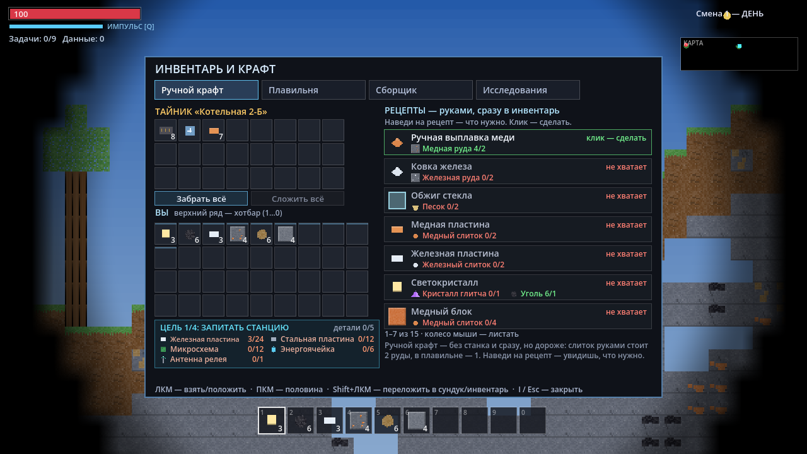
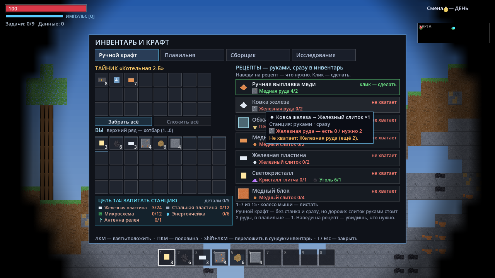
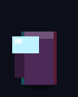
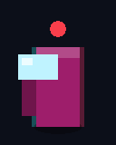
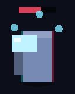

# ГЛИТЧ-КОРЕ

**Террария + Факторио + Among Us на чужой планете.** 2D-песочница-выживалка в Godot 4.7:
тайловая процедурная генерация, ручная добыча и крафт, фабричная логистика с конвейерами
и питанием, а по ночам — фантомы, которые охотятся на экипаж.

Внешних ассетов в проекте **нет вообще**: все тайлы, иконки предметов, машины, персонажи
и звуки рисуются и синтезируются кодом при запуске.

---

## Сюжет

Экспедиция «Кербер-9» высадилась на глитч-планете Кобальт-9. Связь с орбитой потеряна,
корабли эвакуации не придут. Единственный шанс — собрать **релей-ядро** из components
и запустить сигнал спасения. Пока сигнал не уйдёт, планета будет слышать вас: по ночам
из вентиляции вылезают **фантомы** — следы экипажа, оставшегося здесь навсегда.

Смена идёт циклами: **день** (безопасно, светло, можно строить) → **ночь** (фантомы
идут на охоту) → снова день. Задания у терминалов дают данные — их нужно выполнить,
чтобы открыть релей.

## Скачать / Android

Готовые сборки лежат в [Releases](https://github.com/grikirster-stack/glitch-core/releases/latest):

| Файл | Что это |
|---|---|
| `glitch-core-vX.Y.Z-android.apk` | Android, универсальный APK: arm64-v8a, armeabi-v7a, x86_64 (телефоны, планшеты, эмуляторы) |
| `glitch-core-vX.Y.Z-windows-x86_64.zip` | Windows: распаковать, запустить `glitch-core.exe` |
| `glitch-core-vX.Y.Z-linux-x86_64.zip` | Linux: распаковать, запустить `./glitch-core.x86_64` |

**Как поставить APK на телефон:**

1. Откройте страницу релиза в браузере телефона и скачайте `...-android.apk`.
2. Откройте скачанный файл. Android попросит разрешить установку из этого источника:
   «Настройки» → «Приложения» → «Специальный доступ» → «Установка неизвестных приложений» →
   выберите браузер (или файловый менеджер) → «Разрешить». Названия пунктов зависят
   от прошивки; часто Android сам предлагает кнопку «Настройки» прямо в окне установки.
3. Нажмите «Установить». Если Play Защита предупредит о неизвестном разработчике —
   «Подробнее» → «Всё равно установить».
4. Если в заметках релиза написано «подписано debug-ключом», обновление поверх прошлой
   версии не встанет: сначала удалите старую версию игры.

С компьютера: `adb install -r glitch-core-vX.Y.Z-android.apk`.

> На телефоне игра управляется касаниями: джойстик, кнопки и тапы по миру появляются сами
> на сенсорном экране — см. [«Управление на телефоне»](#управление-на-телефоне). Клавиатура
> и мышь (по USB или Bluetooth) работают и на телефоне.

### Как выходят релизы

Релиз выпускается **только вручную, по кнопке** — workflow [`Релиз`](.github/workflows/release.yml)
(Actions → «Релиз» → Run workflow, ветка main). Он делает: автотесты на сидах 31337, 4242, 12345 → экспорт Android/Windows/Linux → проверка APK
(`apksigner verify`, `aapt dump badging`: пакет, версия, три ABI, разрешения) → тег `vX.Y.Z`
и GitHub Release с файлами и заметками на русском. Тесты упали — релиза нет.

- **Версия** — от последнего тега `vX.Y.Z` (первый релиз — `v0.1.0`). Автоматически —
  minor, если у PR с прошлого тега или у закрытых ими issue есть метка `gameplay` или
  `enhancement`, иначе patch. Android `versionCode = X*10000 + Y*100 + Z`.
  Версия прописывается в `project.godot` и `export_presets.cfg` только в раннере — в main
  её не коммитят.
- **Заметки** — список смерженных PR с прошлого тега по группам (геймплей / исправления /
  прочее) и ссылка на полный diff. Посмотреть заранее: `python tools/release/plan.py --notes notes.md`.
- **Запуск**: Actions → «Релиз» → Run workflow (выбрать `bump`: auto/patch/minor/major) или
  `gh workflow run release.yml -f bump=auto`. Настоящий релиз — только с main и только если
  с прошлого тега есть новые коммиты.
- **Пробная сборка без тега и релиза**: `gh workflow run release.yml --ref <ветка> -f bump=patch -f dry_run=true`,
  файлы — в артефакте запуска (`gh run download <id>`). PR, которые трогают `export_presets.cfg`,
  `project.godot`, `release.yml` или `tools/release/`, проходят ту же сборку автоматически.
- **Подпись APK** — release-ключом (сертификат `CN=Glitch Core`) из секретов репозитория
  `ANDROID_KEYSTORE_BASE64`, `ANDROID_KEYSTORE_PASSWORD`, `ANDROID_KEY_ALIAS`; они уже заданы.
  Без секретов (например, в форке) — запасной путь: debug-ключ, сгенерированный в CI, с пометкой
  в заметках. Как ключ создавался (повторять не нужно; хранится вне репозитория):

  ```bash
  keytool -genkeypair -v -keystore glitch-core-release.keystore -storetype PKCS12 \
    -alias glitchcore -keyalg RSA -keysize 4096 -validity 10000
  base64 -w0 glitch-core-release.keystore   # → ANDROID_KEYSTORE_BASE64
  ```

  Пароль хранилища — `ANDROID_KEYSTORE_PASSWORD` (у PKCS12 он же пароль ключа), алиас — `ANDROID_KEY_ALIAS`.

Локальная сборка: шаблоны экспорта 4.7.2 (в редакторе «Editor → Manage Export Templates»),
в «Editor Settings → Export → Android» — пути к Android SDK и JDK 17. Для Android Godot
требует импорт ETC2/ASTC: CI включает его только в раннере, локально — кнопка «Fix Import»
в окне экспорта (или `rendering/textures/vram_compression/import_etc2_astc=true`; в main этот
ключ не коммитим). Затем
`godot --headless --path . --export-release "Android" build/android/glitch-core.apk`.

## Как запустить

Нужен **Godot 4.7+** (стандартная версия, .NET не требуется).

```bash
# из редактора: открыть project.godot и нажать F5
# из командной строки:
godot --path C:\PROJECT\GODOTTEST
```

Автотест логики (без окна):

```bash
godot --headless --path C:\PROJECT\GODOTTEST -- --test --seed=12345
```

В конце выводится строка `ИТОГ: проверок N, провалов 0` и ненулевой код возврата при провалах.

> **Важно про свежий чекаут.** `.godot/` не в git, поэтому в чистом клоне сначала
> нужно зарегистрировать `class_name`-классы, иначе скрипты не загрузятся:
>
> ```bash
> godot --headless --path . --import
> ```
>
> Именно этот шаг стоит в CI перед автотестами.

## Разработка

Репозиторий: <https://github.com/grikirster-stack/glitch-core>

Работа идёт через GitHub: **одна зона — один issue — один PR**. Зоны не
пересекаются по файлам, поэтому правки сливаются без конфликтов.

| Зона | Файлы | Issue |
|---|---|---|
| Мир | `scripts/autoload/world.gd` | [#2](https://github.com/grikirster-stack/glitch-core/issues/2) |
| Эффекты | `scripts/ui/world_fx.gd` | [#3](https://github.com/grikirster-stack/glitch-core/issues/3) |
| Питание | `scripts/autoload/game.gd`, `scripts/machines/machine_base.gd` | [#4](https://github.com/grikirster-stack/glitch-core/issues/4) |
| Фантомы | `scripts/entities/phantom.gd` | [#5](https://github.com/grikirster-stack/glitch-core/issues/5) |
| Тесты | `tools/**` | [#6](https://github.com/grikirster-stack/glitch-core/issues/6) |
| HUD и предметы | `scripts/ui/hud.gd`, `scripts/ui/sky_backdrop.gd`, `scripts/entities/item_entity.gd` | [#7](https://github.com/grikirster-stack/glitch-core/issues/7) |
| Игрок | `scripts/entities/player.gd` | [#8](https://github.com/grikirster-stack/glitch-core/issues/8) |
| Сценарии | `scripts/main.gd`, `tools/scenarios/**` | [#9](https://github.com/grikirster-stack/glitch-core/issues/9) |

Подробности — в [дорожной карте](https://github.com/grikirster-stack/glitch-core/issues/1)
и в `tools/README_TESTS.md`. Архитектурные решения — в `docs/adr/`: план геймплея
(баланс, автоматизация, база, враги, генеративный лор) и разбивка на PR —
в [ADR-001](docs/adr/0001-core-loop.md).

## Управление

| Клавиша | Действие |
|---|---|
| **A / D** (или **← / →**) | ходьба |
| **W / ↑ / Space** | прыжок |
| **Shift** | бег (громче — фантомы слышат) |
| **ЛКМ** | копать / бить фантома |
| **ПКМ** | строить (поставить выбранный предмет); по конвейеру или манипулятору — повернуть |
| **E** (удерживать) | взаимодействие — что именно, см. ниже |
| **Q** | импульс — отбрасывает и оглушает фантомов рядом |
| **V** | залезть в вентиляцию (фантомы вас не видят) |
| **I / TAB** | инвентарь, крафт и вкладка «Исследования» |
| **J** | журнал экспедиции: экипаж, главы журнала, обрывки |
| **P** | показать / скрыть круги питания генераторов |
| **Esc** | закрыть инвентарь или журнал |
| **F5 / F9** | сохранить / загрузить забег (один слот, `user://save_1.sav`; в `--hardcore` выключено) |
| **1…0** | выбор слота хотбара |
| **ЛКМ / ПКМ** в инвентаре | взять стопку в руку и положить / взять половину (с предметом в руке — положить 1) |
| **Shift+ЛКМ** в инвентаре | переложить стопку: сундук ⇄ инвентарь; без сундука — хотбар ⇄ рюкзак |
| **Колесо** | прокрутка списка рецептов |

**E** срабатывает на первое подходящее по этому списку:

1. терминал рядом — выполнить задание; релей-ядро рядом — запуск;
2. манипулятор **под курсором** — с предметом в руке задать фильтр, пустой рукой — снять;
3. сундук рядом — открыть;
4. генератор рядом: ТЭЦ с углём в хотбаре — загрузить топку, иначе — **рубильник**
   (вкл/выкл, то же у солнечной панели);
5. станок рядом (плавильня, сборщик, анализатор) — загрузить в него стопку из хотбара.

## Управление на телефоне

На сенсорном экране (`DisplayServer.is_touchscreen_available()`) поверх игры
появляются джойстик и кнопки. На ПК их можно включить флагом `--touch` — тогда
мышь жмёт кнопки как палец, а клавиатура и мышь работают как обычно:
`godot --path . -- --touch`.


| Касание | Действие |
|---|---|
| **джойстик** слева | ходьба; отклонить вверх — прыжок |
| **▲ прыжок** | прыжок (короткий тап тоже засчитывается) |
| **» бег** | бег вкл/выкл (защёлка — не надо держать вместе с джойстиком) |
| **E** (удерживать) | взаимодействие — то же, что клавиша E |
| **Q / V** | импульс / вентиляция; кольцо на Q — перезарядка |
| **I / J** | инвентарь / журнал; при открытом окне видны только они — тап по ним закрывает |
| **тап по миру** | копать / бить фантома; держать палец — копать дальше |
| **долгий тап** (≥ 0,4 с) по пустой клетке | поставить выбранный предмет из хотбара (по конвейеру — повернуть) |
| **строить** | режим постройки: короткий тап по миру сразу ставит предмет |
| **тап по хотбару** | выбрать слот |
| в инвентаре и журнале | тап — как ЛКМ; провести пальцем — листать рецепты и обрывки |
| экран гибели / финала | тап — новая попытка |

Пальцев сколько угодно: можно идти джойстиком и одновременно копать тапом.
Кнопки — не меньше 9 мм на экране, полупрозрачные и не заходят на HUD,
миникарту, хотбар и уведомления. Касания идут в героя через тот же шов ввода,
что и у сценариев (`Player.touch_input`, формат `test_input`), — логика движения,
копки и постройки одна на клавиатуру, мышь и палец.

## С чего начать

Первые минуты забега по шагам. Картинки сняты с настоящей игры (сид 31337) инструментом
`tools/gallery_dump.gd`; как выглядит каждый объект отдельно — в
[«Справочнике объектов»](#справочник-объектов).

**1. Осмотрись.** Ты стоишь на базе: стальная площадка, в центре — **релей-ядро** (голубое
кольцо), по бокам два **терминала** (зелёные экраны), светокристаллы и слева у края —
**вентиляция**. Забег начинается утром первой смены, до ночи ≈ 86 с. Стартовый набор
в хотбаре: 3 светокристалла, 6 угля, 2 железные пластины, 4 медной руды.


**2. Копай.** Зажми **ЛКМ** по тайлу (не дальше 5.6 клетки от себя): вокруг клетки рамка,
снизу полоса — сколько осталось. Лишайник и глина ломаются за 0.5–0.6 с и дают **хлам**,
камень (под тремя клетками глины) — за 1.4 с и даёт **камень**. Выпавший предмет
подбирается сам, если подойти ближе 70 px. На первые постройки нужно ≈ 10 хлама и 6 камня.


**3. Поставь ТЭЦ у терминала.** Терминалы работают **только под питанием**. **I** →
«Ручной крафт» → **«Угольная ТЭЦ»** (2 железные пластины из стартового набора + 6 хлама).
Выбери ТЭЦ в хотбаре и **ПКМ** по пустой клетке рядом с релеем: терминалы базы стоят
в 6 клетках от релея, ТЭЦ питает 8 клеток вокруг — одна ТЭЦ у релея накрывает оба.
Возьми **уголь** в хотбар и нажми **E** у ТЭЦ — топка загружена (1 уголь горит 45 с).
**P** показывает круг питания.


**4. Выполни задание на терминале.** Встань у терминала и **удерживай E** 2.2 с: +5 данных
и новая глава журнала (**J**). Отработавший терминал гаснет и становится панелью.
Терминалов в мире 9: два на базе и по одному в каждой из семи руин — терминал руины тоже
надо запитать (ТЭЦ или солнечная панель рядом).

**5. Открой первую технологию.** **I** → вкладка «Исследования» → **T1 «Сборка»** за
5 данных: сборщик, манипулятор, микросхемы, энергоячейки, прокат пластин в плавильне.
Узлы открываются по порядку, всего на дерево нужно 75 данных: 45 дают терминалы,
остальное — анализатор (кристаллы глитча, узел T3).


**6. Построй плавильню.** Руками слиток стоит 2 руды, в плавильне — 1. Рецепт: 6 камня
+ 4 хлама, ставится как ТЭЦ и тоже нужна в круге питания. Руда лежит глубже: медь —
с ≈ 8 клеток под поверхностью, железо — с ≈ 30, кристаллы — с ≈ 60 (таблица
[«Тайлы и руды»](#тайлы-и-руды)). Подробно — раздел [«Плавильня»](#плавильня).



**7. Собери линию.** ТЭЦ + буровая станция + конвейер + плавильня + сундук работают без
рук: бур копает столбец под собой, лента везёт руду в плавильню, слитки уезжают в сундук.
Буровая открывается узлом T3 — до этого руду носишь сам. Подробно — [«Фабрика»](#фабрика).


**8. Готовься к ночи.** На HUD «СУМЕРКИ» — до ночи ≈ 14 с. Ночь длится ≈ 91 с: из пещер
приходят **фантомы** (в первую ночь до 2 одновременно, каждую смену на одного больше).
Что помогает:

* **свет** — фантом убегает с клетки, где свет ярче 0.55: держись у светокристаллов
  (их можно ставить, крафт — кристалл + уголь);
* **ЛКМ** по фантому — 38 урона (у фантома 100), **Q** — импульс: 10 урона и оглушение
  на 3 с всем в 130 px, перезарядка 8 с;
* **V** у вентиляции — 6 с неуязвимости, потом выталкивает, снова — через 10 с;
* фантомы слышат шум: бег и копка громче ходьбы.

Погиб — через 3 с капсула на базе, время перескакивает к рассвету; **хотбар** остаётся
мешком на месте гибели (не исчезает), остальной инвентарь при тебе.


**9. Обойди руины.** В мире 7 руин: в каждой **тайник** (сундук, 3–6 предметов хозяина),
**табличка** с именем места и **терминал** с главой журнала. Журнал — **J**.


**10. Запусти релей.** Собери 24 железные пластины, 12 стальных, 12 микросхем,
6 энергоячеек и антенну релея (сборщик, узел T5), подойди к релей-ядру и удерживай
**E** 3 с. Потом 180 с держись: фантомы идут волнами и днём, среди них — двойник.
Сигнал ушёл — эвакуация и эпилог экспедиции.
Подробно — раздел [«Цель»](#цель).

## Как это устроено

### Добыча и крафт

ЛКМ по тайлу — копаешь, пока он не треснет; из него падает предмет, который надо
подобрать (подойди к нему; несобранный предмет через 5 минут исчезает, последние
30 секунд мигает). Плиты, слитки и изделия делаются в **инвентаре** на четырёх вкладках:

* **Ручной крафт** — доступен всегда, срабатывает сразу. Грубая выплавка (2 руды →
  1 слиток), ковка, обжиг стекла, пластины, блоки. Сюда же вынесены первые постройки,
  иначе не с чего начать: плавильня, угольная ТЭЦ, солнечная панель, конвейер, сундук,
  а после узла T1 — сборщик.
* **Плавильня** — нужно стоять рядом с построенной плавильней. Подробно —
  в разделе [«Плавильня»](#плавильня) ниже.
* **Сборщик** — нужно стоять рядом со сборщиком: микросхемы, энергоячейки, конвейеры,
  сундуки, манипулятор, буровая станция, анализатор, глубинный бур и другое.
* **Исследования** — дерево технологий из пяти узлов: T1 «Сборка», T2 «Оборона»,
  T3 «Бурение», T4 «Герметизация», T5 «Релей». Узлы открываются по порядку за
  **данные**: 5, 10, 15, 20 и 25. Данные дают задания у терминалов (+5) и анализатор
  (+1 за кристалл).

Рецепт закрытого узла виден в списке **серым**, с подписью «нужен T1»;
клик по нему только подсказывает, какой узел открыть, а станки такие рецепты не берут.

#### Окно инвентаря

**I / TAB** — инвентарь и крафт, **E** у сундука или тайника руины — то же окно с сундуком
сверху (в заголовке — имя тайника). Слева сундук, под ним твой инвентарь (верхний ряд —
хотбар 1…0) и цель «Релей-ядро»: иконка, название и «есть/нужно» по каждой детали.

* **ЛКМ** — взять стопку «в руку» (она рисуется у курсора с количеством) и положить в
  другую ячейку; **ПКМ** — взять половину или положить по одному.
* **Shift+ЛКМ** — сразу переложить стопку в сундук или из него; **«Забрать всё»** —
  весь сундук в инвентарь, **«Сложить всё»** — весь рюкзак в сундук (хотбар остаётся).
* Закрыл окно с предметом в руке — он вернётся в инвентарь (нет места — в сундук,
  совсем никак — под ноги).
* **Наведи** на рецепт — подсказка: что получится, станция и время, по каждому входу
  «есть N / нужно M» (нехватка — красным) и почему сейчас нельзя: «Не хватает: …»,
  «Заперто: нужен узел T1 — вкладка «Исследования»», «Подойди к плавильне ближе».
  Справа в строке рецепта — короткий ярлык: «клик — сделать», «не хватает», «нужен T1».
* После клика строка вспыхивает (зелёным — получилось, красным — нет), внизу окна —
  «Скрафчено: …» или «Загружено в плавильню: …». На вкладках «Плавильня» и «Сборщик»
  над списком написано, есть ли станок рядом и под питанием: станок работает сам,
  клик только загружает в него сырьё.



### Фабрика

* **Питание — это бюджет.** Угольная ТЭЦ даёт **6** единиц мощности в радиусе
  **8 клеток** (одна единица угля горит 45 с, в топку влезает 12), солнечная панель —
  **2** в радиусе **6 клеток** и только днём. Машина тянет мощность: буровая 2,
  плавильня 1, сборщик 2, манипулятор 0.5, анализатор 2, глубинный бур 4.
* Каждая машина питается от **ближайшего** работающего генератора, в чей радиус попала
  (мощности соседних генераторов не складываются). Если нагрузка генератора больше его
  мощности, все его машины **замедляются** в одной пропорции:
  `efficiency = clamp(мощность / нагрузка, 0, 1)`. Вне радиуса машина стоит.
* Лампа на генераторе: зелёная — норма, жёлтая — перегруз, красная — выключен
  рубильником. Выключенная ТЭЦ уголь не жжёт. **P** — показать круги питания.
* Уголь в ТЭЦ — руками (**E**) или с конвейера / манипулятора.
* **Буровая станция** (узел T3) копает столбец под собой до 16 клеток вниз, по одному
  тайлу за 2 с, и выдаёт добытое наружу. **Глубинный бур** (T4) — то же, но 1.2 с
  и до 40 клеток.
* **Конвейер** перевозит предметы в направлении стрелки (ПКМ — повернуть) и сам сдаёт
  их в постройку, в которую упирается.
* **Манипулятор** (T1) раз в 1.2 с переносит один предмет из клетки сзади в клетку
  спереди. Берёт из сундука, с конвейера и готовое из станка; кладёт на конвейер,
  в сундук, станок, ТЭЦ или анализатор — и только то, что приёмник примет. ПКМ —
  повернуть, **E** с предметом в руке — фильтр «только это».
* **Анализатор** (T3) разбирает кристалл глитча на 1 данные за 20 с, в лоток
  помещается 10 кристаллов.
* **Сундук** (24 слота) копит всё, что доехало; **E** рядом — открыть.
* Готовое станок отдаёт сначала на соседний конвейер, потом в соседнюю постройку,
  которая это примет, потом — манипулятору, который из него берёт; иначе роняет на землю.

### Плавильня

Первый станок забега: руда → слитки, слитки → пластины и сталь, песок → стекло.
Главная причина её строить — **экономия руды**: руками слиток стоит 2 руды,
в плавильне — 1 (правило ADR-001 D3: ручной путь вдвое дороже).

#### Как выглядит

Ассетов нет — плавильня рисуется кодом, как и всё остальное.

* **В мире** — квадрат на одну клетку (16×16 px), ржаво-коричневый, со светлой полосой
  по верху. В нижней половине — **горнило** 10×7 px: под питанием оно оранжевое
  и мерно пульсирует к жёлтому.
* **Без питания** корпус темнеет, горнило гаснет до ровного бурого, без мерцания — по этому
  издалека видно, что станок стоит.
* **Идёт плавка** — над станком полоска прогресса 12×2 px: тёмная подложка и голубая
  заливка. Нет полоски — плавильня сейчас ничего не плавит.
* **В инвентаре и хотбаре** — иконка: коричневый квадрат с оранжевым горнилом внизу.

#### Как получить и поставить

1. Вкладка «Ручной крафт» → **«Плавильня»**: 6 камня + 4 хлама. Рецепт открыт с самого
   начала (T0).
2. Выбери плавильню в хотбаре и нажми **ПКМ** по пустой клетке: там должен быть воздух,
   без другой постройки и не там, где стоишь ты. Иначе — «Сюда нельзя поставить».
3. Поставь рядом генератор: ТЭЦ — плавильня в 8 клетках от неё, или солнечную панель —
   в 6 клетках (работает только днём).

#### Питание

Плавильня тянет **1** единицу мощности — это самый лёгкий станок после манипулятора.

* **Нет питания** — не работает вовсе: загруженное лежит, прогресс стоит.
* **Перегруз** — плавит медленнее, во столько раз, во сколько нагрузка генератора больше
  его мощности. Пример: ТЭЦ (6) кормит 3 сборщика и 2 плавильни — нагрузка 3·2 + 2·1 = 8,
  `efficiency` = 6 / 8 = 0.75, и железный слиток выходит не за 2.0 с, а за ≈ 2.7 с.
  На генераторе при этом горит жёлтая лампа.
* Одна солнечная панель (2) держит на полной скорости две плавильни.

#### Как загрузить

Плавильня сама решает, что плавить, — достаточно положить в неё сырьё. Путей четыре:

| Способ | Что сделать | Тонкости |
|---|---|---|
| Инвентарь | **I / TAB** → вкладка «Плавильня» → клик по рецепту | стоять ближе 90 px (≈ 5.6 клетки) к плавильне, иначе «Подойди к плавильне ближе (≤ 5 клеток)»; ингредиенты уходят из инвентаря в станок, результат — когда станок доплавит |
| Хотбар + **E** | взять сырьё в хотбар, встать ближе 44 px (≈ 2.7 клетки), нажать **E** | уходит **вся стопка**; если ближе 40 px стоит сундук или генератор, **E** сработает на них (см. «Управление») |
| Конвейер | направить ленту стрелкой в плавильню | лента сдаёт всё, что плавильня принимает |
| Манипулятор | сзади — сундук, конвейер или другой станок, спереди — плавильня | берёт только то, что плавильня примет, — лишнее не хватает |

Плавильня принимает только то, что входит хоть в один её **открытый** рецепт: медный
слиток до T1 (он нужен лишь прокату меди) или стальную пластину до T2 (стальная стена)
станок не примет ни через **E**, ни от манипулятора (тот такое и не схватит) — предмет
не застрянет внутри. Конвейер с таким предметом встанет у входа, пока узел не откроют.
После открытия станок берёт его сразу. Так же устроен сборщик. Запас входа не ограничен.

#### Рецепты

| Рецепт в игре | Вход | Выход | Время | Узел |
|---|---|---|---|---|
| Выплавка железа | 1 железная руда | 1 железный слиток | 2.0 с | T0 |
| Выплавка меди | 1 медная руда | 1 медный слиток | 1.6 с | T0 |
| Плавка стекла | 2 песка | 1 стекло | 2.2 с | T0 |
| Стальная пластина | 2 железных слитка + 1 уголь | 1 стальная пластина | 3.5 с | T0 |
| Прокат меди | 2 медных слитка | 1 медная пластина | 2.0 с | T1 «Сборка» |
| Прокат железа | 2 железных слитка | 1 железная пластина | 2.0 с | T1 «Сборка» |
| Стальная стена | 2 стальные пластины | 4 стальные стены | 2.0 с | T2 «Оборона» |

Время — при полном питании. Освободившись, плавильня проходит рецепты **сверху вниз**
и берёт первый открытый, на который хватает загруженного. Поэтому железные слитки
вместе с углём уйдут в сталь, а без угля — в прокат железа (если T1 открыт) или будут
ждать уголь.

**Руками или в плавильне:**

| Что | Руками | Плавильня |
|---|---|---|
| Железный слиток | 2 руды | 1 руда |
| Медный слиток | 2 руды | 1 руда |
| Стекло | 2 песка | 2 песка |
| Медная / железная пластина | 2 слитка | 2 слитка (T1) |
| Стальная пластина | нельзя | 2 слитка + уголь |

Ручной крафт срабатывает мгновенно, но тратит вдвое больше руды; плавильня экономит руду,
работает сама и под питанием, пока ты копаешь или прячешься.

#### Куда девается результат

Готовое плавильня отдаёт по порядку (соседи — сверху, справа, снизу, слева):

1. на соседний **конвейер** — кроме ленты, которая везёт в саму плавильню;
2. в соседнюю **постройку**, которая это примет: сундук, сборщик, другую плавильню
   (две плавильни вплотную — слитки из первой сами уходят во вторую);
3. **манипулятору**, который берёт из плавильни: до 20 готовых предметов ждут в станке;
4. иначе — **на землю** рядом (и через 5 минут исчезает).

Проверенная сценарием `inserter_chain` линия без рук (ТЭЦ — в радиусе):

```
[сундук с рудой] → [манипулятор] → [конвейер →] → [плавильня] → [конвейер →] → [сундук]
```

Короче — `[плавильня] → [манипулятор] → [сундук]`: манипулятор сам забирает слитки.

#### Сейчас и по ADR-001

| | Сейчас (в коде) | По ADR-001 (ещё не сделано) |
|---|---|---|
| Питание | бюджет: перегруз замедляет, рубильник, лампа на генераторе | индикатор «нагрузка / выход» генератора в HUD ([#34](https://github.com/grikirster-stack/glitch-core/issues/34)) |
| Рецепты | запертые T1/T2 серые, станок их не берёт | цифры может поменять калибровка ([#33](https://github.com/grikirster-stack/glitch-core/issues/33)) |
| Машинная цепочка | манипулятор, конвейер, сундук — линия без рук | — |
| Прочность | у машин 60 HP, но пока их никто не бьёт | фантомы атакуют базу ([#27](https://github.com/grikirster-stack/glitch-core/issues/27)), ремонт хламом ([#29](https://github.com/grikirster-stack/glitch-core/issues/29)) |
| Сталь | стальные пластины для релея, стальная стена (T2) | турель и шлюз из стальных пластин — оборона ([#31](https://github.com/grikirster-stack/glitch-core/issues/31)) |
| Релей | четыре этапа цели, удержание 180 с с двойником, эпилог на финальном экране | трекер этапа в HUD ([#34](https://github.com/grikirster-stack/glitch-core/issues/34)) |

### Опасность

Фантомы появляются ночью (и всегда, когда запущен релей). Они ищут игрока по шуму:
бег и копка шумят. Убить можно только вблизи (ЛКМ) или импульсом (**Q**). Вентиляция
(**V**) — укрытие на 6 с: внутри ты неуязвим, потом выталкивает, снова — через 10 с.
Подробнее о фантомах — в [«Справочнике объектов»](#существа).

### Цель

Цель — в четыре этапа (ADR-001 § 4.7); текущий этап виден в инвентаре («ЦЕЛЬ N/4»),
смена этапа — уведомлением:

1. **Запитать станцию** — прочитать оба терминала базы (им нужно питание): +10 данных,
   главы 1–2 журнала, релей отзывается.
2. **Собрать данные** — открыть узел T5 «Релей»: антенна релея появляется в рецептах.
3. **Собрать релей** — 24 железные пластины, 12 стальных, 12 микросхем, 6 энергоячеек
   и антенна релея; у релей-ядра удерживай **E**.
4. **Удержать сигнал** — 180 секунд. Фантомы идут и днём (до 10 одновременно), двойник —
   обязательно, даже в первую смену. Сигнал ушёл — эвакуация и эпилог экспедиции из лора.

## Справочник объектов

Всё, что есть в игре, с картинкой: где найти, как получить и что делает. Числа — из кода
(`DB`, `Balance`, скрипты машин). Картинки — `docs/img/`, их пересобирает
`tools/gallery_dump.gd` (перебирает `DB.item_defs`, `DB.tile_defs`, машины из
`MachineBase.place_machine` и `Balance.PHANTOMS`, так что новые объекты попадут туда сами):

```bash
# иконки предметов и тайлы — без окна
godot --headless --path . --script res://tools/gallery_dump.gd -- --seed=31337
# вид в мире и скриншоты: окно за пределами экрана, без звука, ~15 с, выходит само
godot --path . --audio-driver Dummy --windowed --position -10000,-10000 --resolution 960x540 \
      --script res://tools/gallery_dump.gd -- --seed=31337
```

«Копка» — секунды, за которые тайл ломается под ЛКМ. Глубина руды — доля пути от
поверхности до дна мира (≈ 136 клеток): 6 % ≈ 8 клеток, 22 % ≈ 30, 45 % ≈ 61.
**В работе** — объект уже есть в данных (`IDs`, `DB`, `Balance`), но его поведение
делает открытый issue.

### Тайлы и руды

Природные — генерирует мир (`World.generate`, мир 640 × 180 клеток):

| | Тайл | Где | Копка | Что даёт |
|---|---|---|---|---|
|  | Лишайник | верхний слой поверхности | 0.6 с | хлам |
|  | Глина | 3 клетки под лишайником | 0.5 с | хлам |
|  | Камень | основная порода под глиной; по глубине три биома — розовая глина, фиолетовые пещеры в мицелии, красная «плоть» у лавы (вид меняется, тайл тот же) | 1.4 с | камень |
|  | Песок | берега у воды (низины ниже уровня моря) | 0.4 с | песок |
|  | Лишайниковая кочка | кочки на лишайнике (4.5 % колонок) | 0.6 с | хлам |
|  | Стебель свечника | свечники на лишайнике, кроме площадки базы; сквозь стебель можно пройти | 1.0 с | волокно стебля |
|  | Шляпка свечника | шляпки свечников; без опоры падает | 0.2 с | — |
|  | Хлам | жилы до 35 % глубины, ряд над коренной породой, кучи у руин | 1.0 с | хлам |
|  | Уголь | жилы глубже 3 % (почти сразу под землёй) | 1.8 с | уголь |
|  | Медная руда | жилы глубже 6 % (≈ 8 клеток) | 2.0 с | медная руда |
|  | Железная руда | жилы глубже 22 % (≈ 30 клеток) | 2.6 с | железная руда |
|  | Кристалл глитча | жилы глубже 45 % (≈ 61 клетка); в кристальном биоме — вкраплениями прямо под поверхностью; слабо светится (0.15) | 3.4 с | кристалл глитча |
|  | Светокристалл | на поверхности (1.5 % колонок), 4 на базе, по одному в руинах; свет 1.0 — фантомы его боятся | 0.6 с | светокристалл |
|  | Вода | низины ниже уровня моря (строка 52); течёт и заполняет ямы | — | не копается; в неё можно ставить блоки |
|  | Лава | пещеры ниже строки 126; светится (0.4) | — | не копается; **18 урона/с** |
|  | Коренная порода | 3 нижние строки мира | — | не копается; бур на ней останавливается |
|  | Песчаник | в мире сейчас не генерируется | 1.2 с | камень |

Постройки станции и то, что ставит игрок (**ПКМ** с предметом в руке):

| | Тайл | Где / как поставить | Копка | Что даёт |
|---|---|---|---|---|
|  | Сталь | пол базы и руин | 3.0 с | — |
|  | Панель | стены руин, декор базы; в панель превращается отработавший терминал | 3.0 с | — |
|  | Терминал | 2 на базе, по одному в каждой из 7 руин; светится (0.25) | 3.0 с | — (задание: см. [«Места мира»](#места-мира)) |
|  | Стекло | окна руин | 0.8 с | — |
|  | Релей-ядро | центр базы; светится (0.5) | — | не копается |
|  | Медный блок | ставится из предмета | 2.4 с | медный блок |
|  | Железный блок | ставится из предмета | 2.8 с | железный блок |
|  | Кристальный блок | ставится из предмета; светится (0.2) | 2.6 с | кристальный блок |
|  | Волокно стебля | ставится из волокна (в отличие от стебля — твёрдое) | 1.0 с | волокно стебля |
|  | Стальная стена | ставится из предмета; копатель её не роет — **в работе** ([#31](https://github.com/grikirster-stack/glitch-core/issues/31)) | 4.0 с | стальная стена |
|   | Шлюз (закрыт / открыт) | ставится из предмета; сам открывается перед игроком — **в работе** ([#31](https://github.com/grikirster-stack/glitch-core/issues/31)) | 3.0 с | шлюз |
|  | Решётка вентиляции | ставится из предмета; закрывает спавн из вентиляции — **в работе** ([#31](https://github.com/grikirster-stack/glitch-core/issues/31), [#27](https://github.com/grikirster-stack/glitch-core/issues/27)) | 1.0 с | решётка |

### Предметы

Рецепты: «руками» — вкладка «Ручной крафт» (**I**), «плавильня» и «сборщик» — нужно стоять
ближе 90 px к станку (или загрузить его — см. [«Плавильня»](#плавильня)). T0 открыт сразу,
T1…T5 — узлы исследований (5 / 10 / 15 / 20 / 25 данных). Время — при полном питании.
«Тайники» — в сундуках каких хозяев руин встречается (роль хозяина задаёт лор сида).

**Сырьё**

| | Предмет | Как получить | Зачем |
|---|---|---|---|
|  | Хлам | лишайник, глина, кочки, тайл «хлам»; тайники: медик | плавильня, ТЭЦ; **E** с хламом у повреждённой машины — ремонт +20 HP за штуку |
|  | Камень | камень, песчаник; тайники: геолог | плавильня; ставится как тайл «камень» |
|  | Песок | песок у воды; тайники: медик | стекло; ставится как тайл |
|  | Волокно стебля | стебли свечников | ставится как тайл «волокно стебля» |
|  | Уголь | уголь; тайники: геолог, пилот; 6 штук в стартовом наборе | топливо ТЭЦ (45 с), стальная пластина, светокристалл |
|  | Медная руда | медная руда; тайники: геолог; 4 штуки на старте | медный слиток |
|  | Железная руда | железная руда; тайники: геолог | железный слиток |
|  | Кристалл глитча | кристалл глитча; тайники: медик, геолог, связист | микросхема, энергоячейка, светокристалл, кристальный блок, прожектор; анализатор → данные |

**Слитки и компоненты**

| | Предмет | Как получить | Зачем |
|---|---|---|---|
|  | Медный слиток | руками: 2 медной руды (1.0 с); плавильня: 1 руда (1.6 с); тайники: связист, техник | медная пластина, медный блок |
|  | Железный слиток | руками: 2 железной руды (1.2 с); плавильня: 1 руда (2.0 с); тайники: пилот, техник | железная пластина, стальная пластина, железный блок |
|  | Стекло | руками или в плавильне: 2 песка (1.0 / 2.2 с); тайники: медик, связист | солнечная панель, анализатор, прожектор, антенна |
|  | Медная пластина | руками: 2 медных слитка (1.0 с); плавильня, T1: 2 слитка (2.0 с); тайники: инженер, связист | микросхема, сборщик, манипулятор, солнечная панель, антенна |
|  | Железная пластина | руками: 2 железных слитка (1.2 с); плавильня, T1: 2 слитка (2.0 с); тайники: капитан, инженер, техник; 2 штуки на старте | ТЭЦ, конвейер, сундук, сборщик, буровая и др.; **24 — в релей** |
|  | Стальная пластина | плавильня: 2 железных слитка + 1 уголь (3.5 с), T0; тайники: капитан, инженер, пилот | глубинный бур, стальная стена, турель, шлюз; **12 — в релей** |
|  | Микросхема | сборщик, T1: 1 медная пластина + 2 кристалла (3.0 с); тайники: капитан, связист | буровая, анализатор, турель, шлюз, глубинный бур; **12 — в релей** |
|  | Энергоячейка | сборщик, T1: 1 железная пластина + 1 кристалл (3.0 с); тайники: капитан, медик, пилот | турель; **6 — в релей** |

**Постройки** (как выглядят в мире и что делают — в таблице [«Машины»](#машины))

| | Предмет | Как получить | Стак |
|---|---|---|---|
|  | Угольная ТЭЦ | руками: 2 железные пластины + 6 хлама (2.5 с); тайники: пилот | 5 |
|  | Солнечная панель | руками: 1 медная пластина + 1 стекло (2.0 с); тайники: капитан, связист | 5 |
|  | Плавильня | руками: 6 камня + 4 хлама (2.0 с); тайники: техник | 5 |
|  | Конвейер | руками: 1 железная пластина → 1 (1.5 с); сборщик, T1: 1 пластина → **2** (1.5 с); тайники: инженер, техник | 30 |
|  | Сундук | руками: 4 железные пластины (2.5 с); сборщик, T1: 3 пластины (2.0 с); тайники: техник | 10 |
|  | Сборщик | руками, T1: 4 железные + 2 медные пластины (3.0 с); тайники: инженер | 3 |
|  | Манипулятор | сборщик, T1: 1 железная + 1 медная пластина (2.0 с) | 30 |
|  | Буровая станция | сборщик, T3: 4 железные пластины + 2 микросхемы (4.0 с); тайники: инженер, геолог | 5 |
|  | Анализатор | сборщик, T3: 4 железные пластины + 2 микросхемы + 2 стекла (4.0 с) | 3 |
|  | Глубинный бур | сборщик, T4: 1 буровая + 4 стальные пластины + 2 микросхемы (6.0 с) | 3 |
|  | Светокристалл | руками: 1 кристалл + 1 уголь (0.8 с); тайл «светокристалл»; тайники: капитан, медик, пилот; 3 на старте | 20 |

**Блоки и оборона**

| | Предмет | Как получить | Зачем |
|---|---|---|---|
|  | Медный блок | руками: 4 медных слитка (1.0 с) | строительный блок |
|  | Железный блок | руками: 4 железных слитка (1.0 с) | строительный блок |
|  | Кристальный блок | руками: 3 кристалла (1.0 с) | светящийся блок; **2 — в антенну релея** |
|  | Стальная стена | плавильня, T2: 2 стальные пластины → **4** (2.0 с) | самый прочный блок (копка 4.0 с) |
|  | Шлюз | сборщик, T2: 2 стальные пластины + 1 микросхема (3.0 с) | дверь для базы — **в работе** ([#31](https://github.com/grikirster-stack/glitch-core/issues/31)) |
|  | Решётка вентиляции | сборщик, T4: 2 железные пластины (1.5 с) | закрыть вентиляцию — **в работе** ([#31](https://github.com/grikirster-stack/glitch-core/issues/31)) |
|  | Турель-разрядник | сборщик, T2: 3 стальные пластины + 2 микросхемы + 1 энергоячейка (5.0 с) | **в работе** ([#31](https://github.com/grikirster-stack/glitch-core/issues/31)): пока не ставится |
|  | Прожектор | сборщик, T3: 2 медные пластины + 1 стекло + 1 кристалл (2.5 с) | **в работе** ([#31](https://github.com/grikirster-stack/glitch-core/issues/31)): пока не ставится |

**Релей и лор**

| | Предмет | Как получить | Зачем |
|---|---|---|---|
|  | Антенна релея | сборщик, T5: 6 медных пластин + 4 стекла + 2 кристальных блока (8.0 с) | последняя деталь релея, см. [«Цель»](#цель) |
|  | Мешок | падает на месте гибели: в нём весь хотбар | подойди — заберёшь, что влезет; не исчезает |
|  | Чёрный ящик | будет выпадать из фантомов — **в работе** ([#27](https://github.com/grikirster-stack/glitch-core/issues/27)) | данные и обрывок журнала |

### Машины

Ставятся **ПКМ** на пустую клетку (воздух, без другой постройки, не там, где стоишь).
Прочность у всех 60 HP; ремонт — **E** с хламом в хотбаре рядом с машиной, +20 HP за
штуку. Питание, перегруз и лампы — раздел [«Фабрика»](#фабрика). Картинки: слева —
работает под питанием, справа — без питания.

| Вид | Машина | Питание | Что делает |
|---|---|---|---|
|   | Угольная ТЭЦ | **даёт 6** в радиусе 8 клеток | жжёт уголь: 1 штука — 45 с, в топку влезает 12. Уголь — **E** с углём в хотбаре, конвейером или манипулятором; **E** без угля — рубильник. Шкала справа от топки — запас топлива, из трубы идёт сиреневый дым, пока ТЭЦ работает; лампа: зелёная — норма, жёлтая — перегруз, красная — выключена |
|   | Солнечная панель | **даёт 2** в радиусе 6 клеток | бесплатно, но только днём (пока освещённость выше 0.35 — гаснет с началом ночи); солнце над панелью — работает |
|   | Плавильня | тянет 1 | руда → слитки, слитки → пластины и сталь, песок → стекло; горнило светится, голубая полоса — идёт плавка. Всё о ней — [«Плавильня»](#плавильня) |
|   | Сборщик | тянет 2 | собирает микросхемы, энергоячейки, конвейеры, сундуки, манипуляторы, буры, анализатор, антенну; шестерня крутится под питанием. Сам выбирает первый открытый рецепт, на который хватает загруженного |
|   | Буровая станция | тянет 2 | копает столбец под собой до 16 клеток вниз, по тайлу за 2 с, начиная с самого нижнего; добытое отдаёт на соседний конвейер или в соседнюю постройку. Коренная порода и релей её останавливают |
|   | Глубинный бур | тянет 4 | то же, что буровая, но тайл за 1.2 с и до 40 клеток вниз; двойной стержень |
|  | Конвейер | не нужно | везёт предметы по стрелке, 1.5 клетки/с, и сам сдаёт их в постройку, в которую упирается; ставится сразу в сторону соседней постройки, **ПКМ** — повернуть |
|   | Манипулятор | тянет 0.5 | раз в 1.2 с переносит один предмет из клетки сзади (тёмная полоса) в клетку спереди (светлая); берёт только то, что приёмник примет. **ПКМ** — повернуть, **E** с предметом в руке — фильтр (цветной квадрат в углу), пустой рукой — снять |
|   | Анализатор | тянет 2 | кристалл глитча → 1 данные за 20 с; в лотке до 10 кристаллов (точки снизу). Кристаллы — **E**, конвейером или манипулятором |
|  | Сундук | не нужно | 24 слота; **E** рядом — открыть. Конвейер и станки кладут в него, манипулятор берёт |
|  | Турель-разрядник | тянет 2 | **в работе** ([#31](https://github.com/grikirster-stack/glitch-core/issues/31)): 120 HP, бьёт фантомов в 7 клетках на 20 урона раз в 0.8 с |
|  | Прожектор | тянет 1 | **в работе** ([#31](https://github.com/grikirster-stack/glitch-core/issues/31)): свет силой 2.0 от сети, гаснет при питании ниже 50 % |

### Существа

| Вид | Кто | Что делает |
|---|---|---|
|   | Игрок | 100 HP, +6 HP раз в 6 с; ходьба 168 px/с, бег 248 (громче). Копает и строит в 5.6 клетки. В вентиляции (справа) темнеет и обведён кольцом: неуязвим 6 с, потом выталкивает, снова — через 10 с. Гибель: через 3 с капсула на базе, хотбар — мешком на месте гибели (с флагом `--hardcore` — конец забега) |
|    | Фантом | 100 HP, удар 24 вблизи. Слева направо: бродит (тёмно-фиолетовый); погоня — малиновый, красная точка над головой; оглушён — бледный, полоса HP и голубые искры. Видит игрока в 170 px ночью (120 днём), слышит шум в 260 px; бежит со света ярче 0.55. Появляется ночью в пещерах (не ближе 340 px к игроку): в смену N — до 1 + N одновременно, раз в 6 с; во время релея — до 5, раз в 3.5 с, и днём тоже |
|  | Предмет на земле | выпадает из тайла; цифра — сколько в стопке. Подлетает к игроку ближе 70 px; через 5 минут исчезает (последние 30 с мигает), одинаковые рядом сливаются |
|  | Мешок | хотбар погибшего игрока; с иконкой первого предмета. Не исчезает и ни с чем не сливается |

Типы фантомов по ADR-001 — **в работе** ([#27](https://github.com/grikirster-stack/glitch-core/issues/27)):
таблица уже лежит в `Balance.PHANTOMS`, в игре пока один фантом (как «эхо»).

| Тип | HP | Скорость | Удар | Свет | С какой ночи | Особое |
|---|---|---|---|---|---|---|
| эхо (`echo`) | 100 | 160 | 24 | бежит от 0.55 | 1 | — |
| рой (`swarm`) | 30 | 200 | 8 | не боится | 2 | стая по 5 |
| тень (`shade`) | 180 | 120 | 18 | не боится | 3 | — |
| копатель (`burrower`) | 140 | 90 | 30 | бежит от 0.80 | 4 | роет породу не твёрже 1.5 |
| двойник (`doppel`) | 120 | 168 | 40 | не боится | 6 | не больше одного; на удержании сигнала релея — с любой ночи |

### Места мира

| Вид | Место | Где | Что там |
|---|---|---|---|
|  | База | центр мира, расчищенная площадка | релей-ядро, 2 терминала (главы журнала 1–2), 4 светокристалла, вентиляция у левого края; здесь же точка респауна |
|  | Терминал | 2 на базе, по одному в каждой руине — всего 9 | работает **только под питанием** (в круге ТЭЦ или солнечной панели). **E** ближе 42 px, удерживать 2.2 с: +5 данных, глава журнала этого места; после — гаснет |
|  | Релей-ядро | центр базы, пульсирующее кольцо | **E** ближе 56 px, удерживать 3 с — запуск, если в инвентаре весь набор (см. [«Цель»](#цель)); потом 180 с держаться (этап 4 цели) |
|  | Руина | 7 штук, равномерно по миру | стальной пол, стены-панели, окна, светокристалл; **тайник** — сундук на крыше с 3–6 предметами по роли хозяина; **табличка** у левого края — имя места проступает ближе 160 px; **терминал** с главой журнала |
|  | Вентиляция | у левого края базы и в пещерах (сколько — зависит от сида) | **V** ближе 40 px — спрятаться на 6 с. Спавн фантомов из вентиляций и решётки — **в работе** ([#27](https://github.com/grikirster-stack/glitch-core/issues/27), [#31](https://github.com/grikirster-stack/glitch-core/issues/31)) |
|  | Вода | низины ниже уровня моря, берега из песка | течёт и заполняет ямы; не копается |
|  | Лава | глубокие пещеры, ниже строки 126 | 18 урона в секунду; светится |
|  | Глубина | ниже ≈ 60 клеток | кристаллы глитча (фиолетовые), железо, уголь; тоннели — удобно строить |

Что лежит в тайнике, зависит от роли хозяина руины (`World.RUIN_LOOT`, 3–6 разных позиций):

| Хозяин | Может лежать |
|---|---|
| капитан | энергоячейки, микросхемы, стальные и железные пластины, светокристаллы, солнечная панель |
| инженер | медные, железные и стальные пластины, конвейеры, буровая станция, сборщик |
| медик | хлам, стекло, песок, светокристаллы, энергоячейка, кристаллы |
| геолог | медная и железная руда, кристаллы, уголь, камень, буровая станция |
| связист | микросхемы, медные пластины и слитки, кристаллы, стекло, солнечная панель |
| пилот | уголь, энергоячейки, железные слитки, стальные пластины, угольная ТЭЦ, светокристаллы |
| техник | железные и медные слитки, конвейеры, сундуки, железные пластины, плавильня |

## Устройство проекта

```
scenes/main.tscn          главная сцена
scripts/autoload/         DB (база тайлов/предметов/рецептов), World (генерация),
                          Game (состояние, смены, питание, релей), Tech (исследования),
                          Lore (лор), Threat (угроза, пока заглушка), Sfx (синтез звука), UI
scripts/core/             идентификаторы, Balance (все числа), инвентарь, стопка предметов
scripts/entities/         игрок, фантомы, дроп с земли
scripts/machines/         буровая и глубинный бур, плавильня, сборщик, конвейер, сундук,
                          манипулятор, анализатор, генераторы (ТЭЦ, солнце)
scripts/ui/               HUD, инвентарь, журнал, финальный экран
tools/test_runner.gd      автотест логики (запускается флагом --test)
tools/gallery_dump.gd     картинки для README → docs/img/ (см. «Справочник объектов»)
```

Мир генерируется на `FastNoiseLite`: рельеф, пещеры, жилы руд, поверхностная станция
с терминалами и релей-ядром. Столкновения считаются вручную по сетке тайлов
(`World.move_body`), рендер — через `TileMapLayer` с тайлсетом, который собирается
в рантайме.
