# ADR-003. Свой визуальный стиль Кобальта-9: мир, флора, свет, герой

| Поле | Значение |
|---|---|
| Статус | **Принят**: концепт A «Споровый луг» + кобальтово-синее железо из B; решения по § 10 — issue #102 (владелец может переиграть) |
| Дата | 2026-11-02 |
| Снимок кода | `main` @ `da9ec5d` (после ADR-002 #85 и сенсорного управления #98) |
| Issue | #84 (закроется PR внедрения, не этим) |
| Связано | ADR-002 § 4.6 (`Look`, `Avatar`) и #97 (MP-L — скафандр и кастомизация), #87 (MP-B) |
| Авторы | координатор + Claude |
| Рендеры | `tools/style_concepts.gd` → `docs/adr/img/0003/*.png` (команда — § 9) |

> Задача — арт-дирекшн, не код. Ниже три **разных** прочтения одного вайба. Каждый концепт
> нарисован кодом (как вся графика игры) на одной и той же композиции: поверхность днём,
> пещера ночью, разрез биомов и лист деталей. Игра не менялась; выбор — за владельцем.

---

## 1. Контекст: почему сейчас «как Terraria»

| Сейчас (по коду) | Почему читается как Terraria/Minecraft |
|---|---|
| `DB._paint_tile`: земля = коричневый шум, трава = зелёная полоса сверху, камень = серый шум, руды = цветные крапинки | ровно та же «земля–трава–камень», та же фактура «соль-перец» в каждом квадрате |
| `World._place_tree`: ствол `TREE` + шапка `LEAVES` | земное дерево: коричневый ствол, зелёный куб листвы |
| `SkyBackdrop`: синий градиент, круглое солнце/луна, звёзды | земное небо; ничего не говорит, что мы на чужой планете |
| `Player._draw`: красный «боб», визор, рюкзак | силуэт крюмейта Among Us (владелец уже решил менять) |
| Порода одна на всю глубину | 180 рядов мира выглядят одинаково, биомов нет |

Скриншоты «до»: `docs/img/shots/base_day.png`, `docs/img/shots/mining.png`, `docs/img/shots/night_phantom.png`,
`docs/img/player_facing.png`.

### 1.1. Уточнение владельца (обязательные рамки)

1. **Референс — «Территория падальщиков»** (Scavengers Reign, 2023). Берём принципы и вайб, не существ,
   растения и кадры (§ 2).
2. **Всё остаётся квадратным**: сетка 16×16, блочные силуэты, пиксельные прямоугольники. Никаких
   скосов, скруглений и органических кривых вместо квадратов. Своеобразие — палитрой, материалом
   и фактурой **внутри** квадрата, составом биомов, флорой из блоков, светом и глитчем.
   В рендерах нет ни одного круга или наклонной грани: только прямоугольники и пиксели
   (даже планеты на небе — «макропиксели» 2×2).
3. Три концепта — три прочтения этого вайба в квадратной форме, у каждого **три биома по глубине**
   (поверхность, средние пещеры, глубина у лавы), и они заметно различаются.

---

## 2. Референс: «Территория падальщиков» — что берём, чего не берём

Сериал Джо Беннетта и Чарльза Хюттнера (Max, 2023) вырос из короткометражки-вызова «оживить
сюрреалистическую фантастику Мёбиуса»; авторы называют Мёбиуса и Миядзаки «встроенными в ДНК».
Из интервью и разборов (источники в § 11):

| Принцип сериала | Как переносим в «ГЛИТЧ-КОРЕ» |
|---|---|
| Экосистема как «машина Руба Голдберга»: цепочки причин и следствий, симбиоз, паразиты; каждый биом — замкнутая петля | флора и фантомы привязаны к своему биому и **реагируют на машины игрока** (рой идёт на бур, тень пьёт ТЭЦ — это уже в ADR-001 § 4.5); флора растёт на технике базы |
| Тактильность: фоны такие плотные по фактуре, что «слышно, как они звучат на ощупь»; резиновое, хрусткое, щетинистое | фактура **внутри** квадрата 16×16 у каждого материала своя (войлок/нити, слои осадка, «отсортированные» столбцы), а не общий шум |
| Свет от жизни: биолюминесценция как источник света мира | в пещерах светятся флора и руды-кристаллы; ночью поверхность подсвечена спорами/планктоном/антеннами |
| Мир опасен, но не злой; «мы в нём гости» | исполинская флора на среднем плане (масштаб), база «обрастает», а не стоит на газоне |
| Приглушённые землистые и пастельные палитры с яркими биолюминесцентными акцентами | у каждого концепта ограниченная палитра (~24 цвета): пастельная основа + 1–2 «живых» акцента |
| Изношенная техника, долго простоявшая в чужом мире | металл базы с лишайником/ракушками/кабелями, ржавчина на хламе |

**Чего не берём:** конкретных существ, растений, кораблей и кадров сериала; линейную графику
Мёбиуса и плавные органические силуэты (у нас — квадраты); анимацию персонажей сериала;
его «тихий» темп без угрозы — у нас ночь и фантомы остаются (ADR-001). Всё названное ниже —
наше: Кобальт-9, глитч, экспедиция «Кербер-9».

---

## 3. Общие правила всех трёх концептов

### 3.1. Форма

* Тайл — квадрат 16×16, коллизии и размеры не меняются (§ 8).
* **Автотайлинг внутри квадрата.** У каждого тайла маска открытых сторон (верх/право/низ/лево):
  открытый верх даёт кайму (лишайник, водоросли, антенная трава) и наросты, торчащие в пустую
  клетку над ним; открытый низ (потолок пещеры) — свисающие гифы, ракушки, «капли» сортировки;
  открытые бока — тёмную кайму 1 px. Край тайла всегда прямой.
* Флора — из прямоугольников: стебли 1–4 px, шляпки/пузыри/кроны — блоки. Квадратные пузыри,
  кораллы с ветвями под прямым углом, кроны из вертикальных полос.
* Дальний план — «макропиксели» 2×2 и 4×4: светила, исполины, горы.

### 3.2. Язык читаемости (общий для всех концептов — меняется только цвет)

| Что | Как кодируется (не только цветом) |
|---|---|
| Руды | **узор**, одинаковый во всех концептах: медь — диагональные жилы; железо — квадратные самородки; уголь — чёрные блоки 3×2 с бликом; кристалл — вертикальные призмы, светится; хлам — пластина с заклёпками. Тёмный контур 1 px вокруг узора; 1 пиксель-блик слабо светится — руду видно издалека и в темноте |
| Опасность | фантомы: глаза/визор цвета `danger` **светятся** + цветовое расслоение (красная/циановая копия силуэта) + мерцание; ночь — уголки-скобки `danger` по краям HUD. Глитч-эффекты (сдвиг строк, расслоение) в мире появляются **только вокруг угрозы** — «глитч = опасность» |
| Интерактив | рамка 1 px цвета `interact` вокруг объекта + клавиша `E` над ним; в хотбаре выбранный слот — та же рамка |
| Лава | всегда светится и освещает окрестность (тёплый свет); вода полупрозрачна |

### 3.3. Слоты цвета скафандра (совместимо с ADR-002 § 4.6 `Look`)

`Look` = 4 индекса по 4 бита. Во всех концептах они значат одно и то же:

| Часть `Look` | Что меняет | В рендерах |
|---|---|---|
| Цвет скафандра (0..15) | основной цвет корпуса/рукавов/штанин | 5 вариантов на листе |
| Шлем / визор (0..15) | форма шлема и визора (2 варианта показаны на листе) | `helm` 0/1 |
| Аксессуар (0..15) | фонарь на шлеме/груди/плече, антенна, «ничего» | `acc` lamp/antenna/none |
| Рюкзак / баллоны (0..15) | размер и форма ранца/баллонов | `acc` tank — удлинённый ранец |

Вторичный цвет (ткань/металл), визор, фонарь и контур задаёт концепт, игрок их не меняет —
так любой из 16 цветов игрока остаётся читаемым на фоне мира. Габарит героя — нынешний
`Player.SIZE` 12×22 (антенна/фонарь выступают за него, коллизия та же). Позы рисуются из
прямоугольников, как сейчас в `body_layout()` (шов #58), добавляются ключи «рука», «шлем», «баллон».

---

## 4. Три концепта

Во всех рендерах одна композиция: **(а)** поверхность днём — база на панелях, ТЭЦ, солнечная панель,
терминал (с отметкой «можно взаимодействовать»), релей на ферме, фонарь, герой; **(б)** пещера ночью —
средние пещеры переходят в глубину у лавы, руды пяти видов, все пять фантомов, конус фонаря героя;
**(в)** разрез биомов поверхность → средние пещеры → глубина; **(г)** лист: 16 тайлов ×4,
флора трёх биомов (часть — ночью), герой в 3 позах ×6, 5 вариантов кастомизации ×4,
5 фантомов ×4, машины ×2, небо день/сумерки/ночь, палитра.

Сводно: [`compare_scenes.png`](img/0003/compare_scenes.png) — три концепта (строки: споры, риф,
сигнал; слева день, справа ночь).

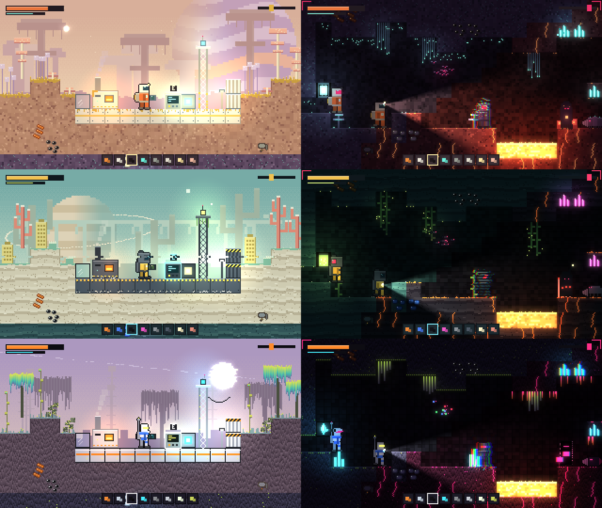

---

### 4.1. Концепт A. «Споровый луг» (`spore`)

**Мудборд.** Тёплый пастельный полдень на чужом лугу. Персиковое небо в мелкой взвеси спор,
в полнеба — бледно-сиреневый газовый гигант в полосах. Вдали — грибные столовые горы, ближе —
исполинские «свечники» в дымке. Земля — розоватая глина в горчичном лишайнике, никакой зелёной травы.
Под землёй — фиолетовые пещеры, затянутые мицелием, его нити светятся бирюзой. В глубине — тёплая
красная «плоть» планеты с мембранными мешками. Глитч — **чужеродное**: живой мир спокоен,
ломается картинка только там, где фантом или аномалия.

| Поверхность днём | Пещера ночью |
|---|---|
| 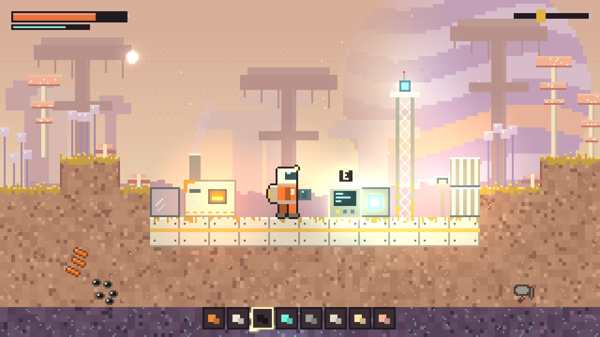 | 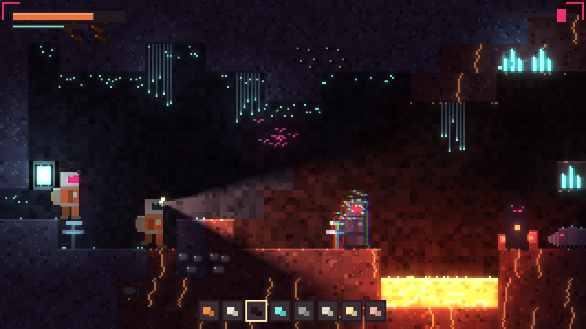 |

| Разрез биомов | Лист |
|---|---|
| 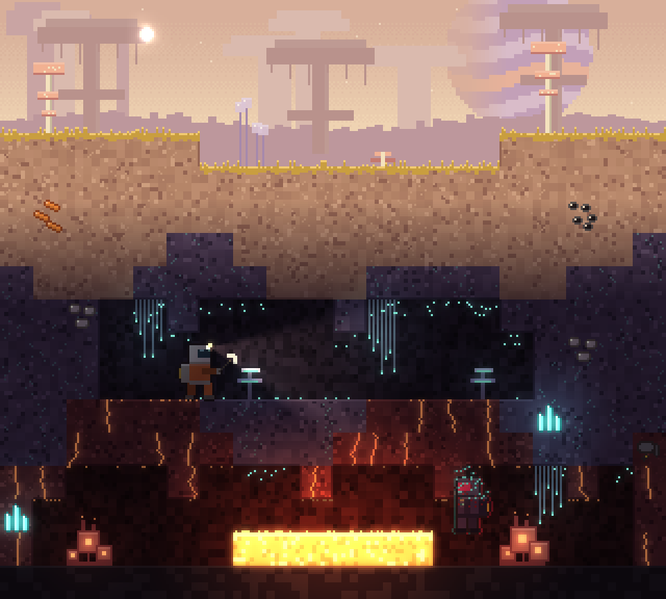 | 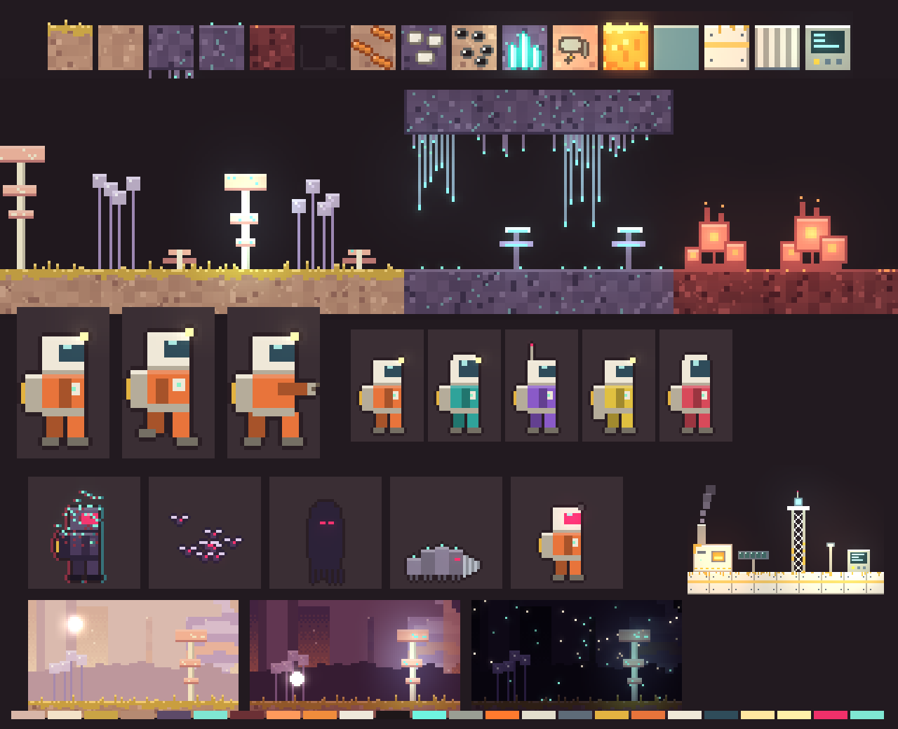 |

**Палитра** (24 рабочих цвета; полный список — `PAL.spore` в скрипте):

| Роль | Hex | Роль | Hex |
|---|---|---|---|
| небо день, верх / горизонт | `#D8B6A8` / `#F3E2C8` | небо ночь | `#161220` → `#33243C` |
| поверхность: глина / тень / блик | `#B58A72` / `#94685A` / `#CDA48A` | лишайник / кончики | `#C9A445` / `#F2D27A` |
| средние пещеры: порода / тень | `#5D4A68` / `#3D3049` | свечение мицелия (био) | `#7FE6D2` |
| глубина: «плоть» / тень | `#6B3035` / `#461D25` | жар трещин | `#FF9A5C` |
| медь / железо / уголь | `#F08C3C` / `#EEE8DA` / `#1E1719` | кристалл / хлам | `#6FF5E0` / `#9A9E94` |
| металл базы / рамы / разметка | `#E3DDCD` / `#5E6B78` / `#E3B341` | экран терминала | `#8CF0C8` |
| скафандр (по умолч.) / ткань / визор | `#E8743B` / `#EFE8D8` / `#2F4C5A` | фонарь | `#FFE7A0` |
| **интерактив** | `#FFF1A8` | **опасность** | `#F0306A` |

**Материалы и биомы.**

| Биом | Порода (фактура внутри квадрата) | Кромки | Флора |
|---|---|---|---|
| Поверхность | розовая глина: мягкие пятна 4×4 («войлок»), светлые нити мицелия | сверху горчичный лишайник 2–4 px + торчащие ворсинки | «Свечник» (стебель со стопкой квадратных шляпок-дождевиков, ночью споры на шляпках светятся), «Пузырник» (связка квадратных сиреневых пузырей на нитях), низкая «полка» |
| Средние пещеры | фиолетовый камень, нити светятся бирюзой | с потолка — гифы со светящимися кончиками | «Завеса» мицелия, трутовики-полки на ножке (светится нижняя кромка) |
| Глубина у лавы | тёмно-красная «плоть», светящиеся трещины | корка, редкие угли | мембранные мешки на общем корне (квадрат в квадрате, светящееся ядро), трубки, сочащиеся спорами |

**Металл базы:** кремовая эмаль, голубовато-серые рамы, жёлтая полоса; на верхней кромке
панелей прорастает лишайник, ТЭЦ в мху, у фермы релея — пятна лишайника. Дым ТЭЦ — сиреневые споры.

**Небо и свет.** День — тёплый амбиент `#FFF6EA`, маленькое белое солнце, гигант со светлой стороной.
Сумерки — сливово-оранжевое небо, светлая кромка гиганта, амбиент `#B8889A`. Ночь — почти чёрно-сливовое
небо, гигант в тени, **споры в воздухе светятся** бирюзой; на флоре загораются споры.
Чужое небо даёт газовый гигант в полнеба и взвесь спор — у Земли такого нет.

**Глитч (дозированно).** Только (1) вокруг фантомов — расслоение каналов, распад эха на светящиеся
споры; (2) у излучателя релея — блоки «артефактов сжатия» 2×2 (релей ловит сигнал); (3) у кристаллов
в пещере — редкие битые блоки. Мир без угрозы глитча не показывает → глитч сам по себе предупреждение.

**Скафандр «Кербер-9», тип A.** Мягкий «надувной» костюм: корпус 10×10 из ткани основного цвета,
**большой квадратный шлем** 10×9 из светлой ткани с визором на передней половине, фонарь на углу
шлема, ранец-фильтр спор с жёлтым патроном, массивные боты, отдельная рука (в копке —
вытянута с резаком). Варианты: высокий шлем с большим визором, антенна вместо фонаря, удлинённый ранец.

**Фантомы.** Эхо — тёмно-фиолетовая копия скафандра, верх **распадается светящимися спорами**,
визор `danger`; рой — споровые мотыльки (тельце 2×2, крылья-пиксели, глаз `danger`); тень — капюшон,
из подола свисают гифы, две щели глаз; копатель — личинка из сегментов разной высоты со споровыми
бугорками и ступенчатым буром; двойник — скафандр игрока, но визор цвета опасности и фонарь не горит.

**Машины и UI.** Машины — кремовые короба с жёлтой разметкой, топка ТЭЦ светится лавовым.
HUD: тёмно-сливовые плашки, здоровье — цвет скафандра по умолчанию, импульс — био-бирюза,
хотбар — рамка `interact`, ночь — скобки `danger` в углах.

---

### 4.2. Концепт B. «Сухой риф» (`reef`)

**Мудборд.** Кобальт-9 — высохшее море. Прохладное бирюзово-мятное небо, низко над горизонтом
окольцованная планета и две квадратные луны. Вдали — окаменевший исполин: позвоночник и рёбра-арки
над равниной. Земля — выбеленный слоистый осадок, как дно лагуны; на нём ветвистые кораллы с
прямыми углами и пористые губки-колонны. Ниже — сине-зелёные «ламинариевые» пещеры, в воздухе
светится планктон. В глубине — чёрный базальт гидротермальных источников, рыжие бактериальные
маты, трубочники. Глитч — **погода**: ночью небо рвёт полосами сияния.

| Поверхность днём | Пещера ночью |
|---|---|
| 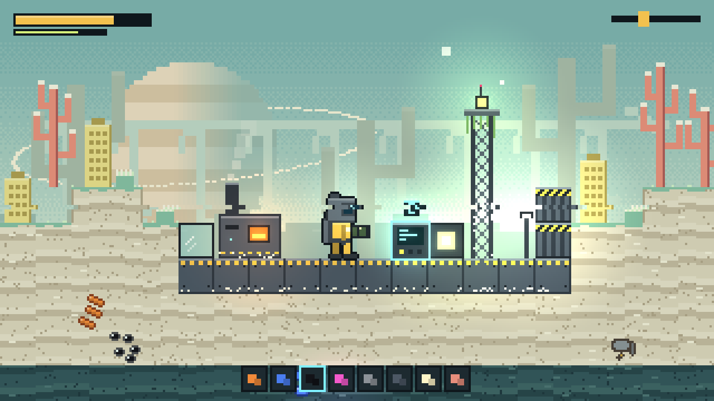 | 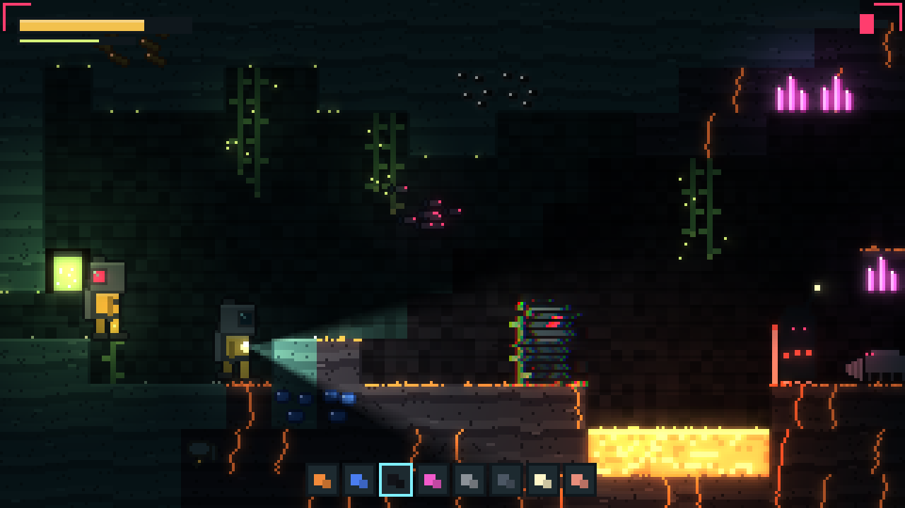 |

| Разрез биомов | Лист |
|---|---|
| 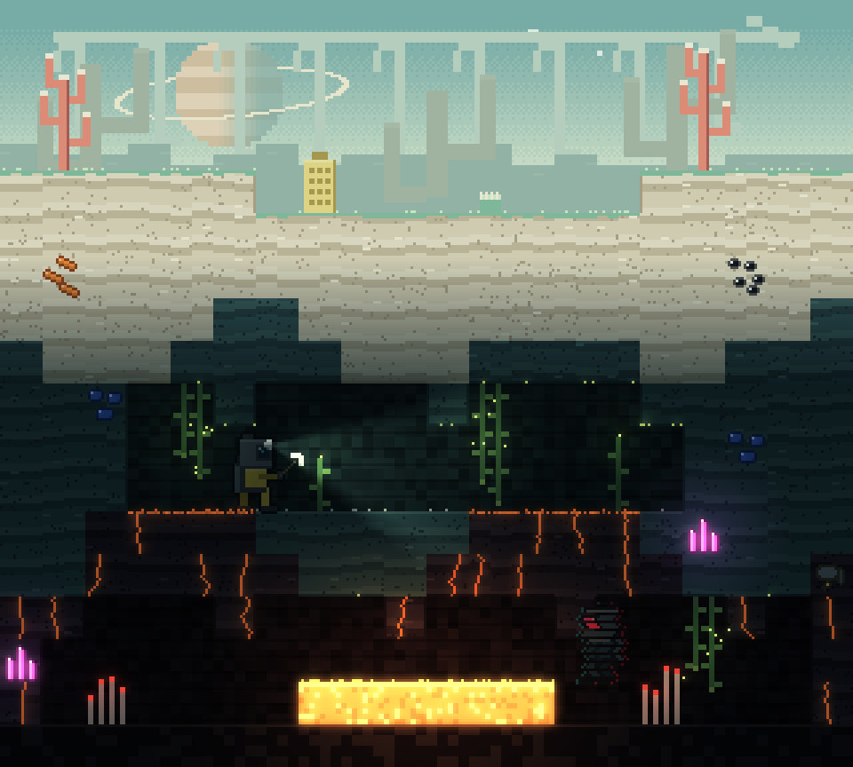 | 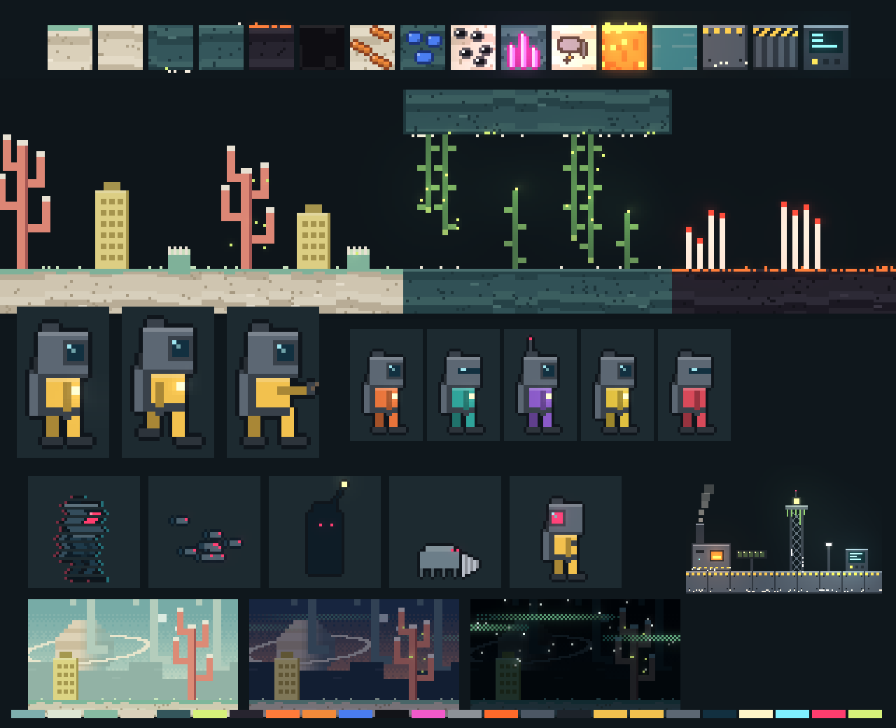 |

**Палитра** (`PAL.reef`):

| Роль | Hex | Роль | Hex |
|---|---|---|---|
| небо день, верх / горизонт | `#7EAFAE` / `#DCE6D3` | небо ночь | `#07111A` → `#163036` |
| поверхность: осадок / тень / блик | `#DAD0BA` / `#AFA288` / `#F0E8D6` | водоросли / кончики | `#86BBA2` / `#D2EAC6` |
| средние пещеры: порода / тень | `#34565B` / `#20393F` | планктон (био) | `#D6F27A` |
| глубина: базальт / тень | `#27242F` / `#15131B` | бактериальный мат | `#FF7B3A` |
| медь / **железо — кобальт** / уголь | `#F28A3A` / `#4A7DF0` / `#121318` | кристалл / хлам | `#F25ACB` / `#8C9298` |
| металл базы / рамы / разметка | `#4C5764` / `#1D232A` / `#F2C14E` | экран | `#7FF0E6` |
| скафандр (по умолч.) / металл / визор | `#F2C14E` / `#5C6773` / `#123040` | фонарь | `#FFF6C8` |
| **интерактив** | `#7FF0FF` | **опасность** | `#FF3D6E` |

**Материалы и биомы.**

| Биом | Порода | Кромки | Флора |
|---|---|---|---|
| Поверхность | выбеленный осадок горизонтальными слоями (полосы по 3 px), поры, обломки раковин | сверху корка водорослей 1–2 px, редкие полипы | «Ветвянка» (коралл, ветви под прямым углом, кончики выбелены), «Губка» (колонна с решёткой пор), «Актиния» (квадратное основание, бахрома через пиксель; ночью светится) |
| Средние пещеры | сине-зелёный камень теми же слоями | ракушки на потолке, точки планктона | ламинария с потолка и пола (ленты 2 px, лопасти 3×2, поплавок-кончик), светящийся планктон в воздухе |
| Глубина у лавы | чёрный базальт, светящиеся трещины | **рыжий бактериальный мат** по верхней кромке | трубочники (белые трубки, алые кончики), чёрные курильщики |

Железо здесь **кобальтово-синее** — оправдывает имя планеты и самая различимая пара «медь/железо».

**Металл базы:** тёмный оружейный металл, жёлто-чёрная разметка, снизу обрастает ракушками;
с фермы релея свисают водоросли.

**Небо и свет.** День — холодный амбиент `#F2FAF4`, окольцованная планета, луны. Сумерки — тёмно-синий
верх, лососевый горизонт, на небе — первые полосы сияния. Ночь — почти чёрное небо, **глитч-сияние**:
горизонтальные полосы, порванные сдвигами строк, мерцают зелёным.

**Глитч.** (1) Сияние на небе (сумерки/ночь); (2) фантомы — «помеха»: силуэт нарезан строками
(каждая третья выпадает, соседние сдвинуты), рядом рвутся строки кадра; (3) днём одна полоса
сдвига у горизонта. В пещере, кроме фантомов, глитча нет.

**Скафандр, тип B — водолазный.** **Шлем-короб шире плеч** 12×11 из металла с квадратным
иллюминатором в толстой раме, узкий корпус основного цвета, два баллона за спиной и шланг к шлему,
грузовые боты, фонарь на груди. Варианты: щелевой визор вместо иллюминатора, антенна на шлеме,
удлинённые баллоны.

**Фантомы.** Эхо — тёмная копия водолаза, нарезанная строками помехи; рой — косяк «рыб» (тело 4×2,
хвост, глаз `danger`); тень — бездонная фигура с **приманкой на стебле** (светящийся квадрат над
головой — видно издалека); копатель — краб с панцирем и буром; двойник — **иллюминатор на затылке**
и цвета опасности.

**Машины и UI.** Металлические короба, жёлто-чёрная разметка, ракушки. HUD — глубоководный
сине-чёрный, здоровье жёлтое, импульс — планктон.

---

### 4.3. Концепт C. «Сигнальная чаща» (`static`)

**Мудборд.** Жизнь Кобальта-9 питается сигналом. Сиреневое пасмурное небо, солнце **нарезано
строками** со сдвигом, через всё небо тянется обломанное кольцо. Растут антенны: тонкие стебли с
мигающими квадратными приёмниками, кусты из «листьев-экранов» с телевизионным шумом, деревья,
чьи кроны «отсортированы» в вертикальные градиенты (кислотно-жёлтый → бирюза → фиолет).
Порода — тоже «отсортирована»: каждый столбец пикселей идёт от светлого к тёмному.
В средних пещерах — решётчатые кристаллы и светящийся «дата-мох». В глубине всё «повреждено»:
пурпурные трещины, капли сортировки с потолка, «битые цветы» с RGB-расслоением.
Глитч — **биология**: он везде, но упорядочен.

| Поверхность днём | Пещера ночью |
|---|---|
| 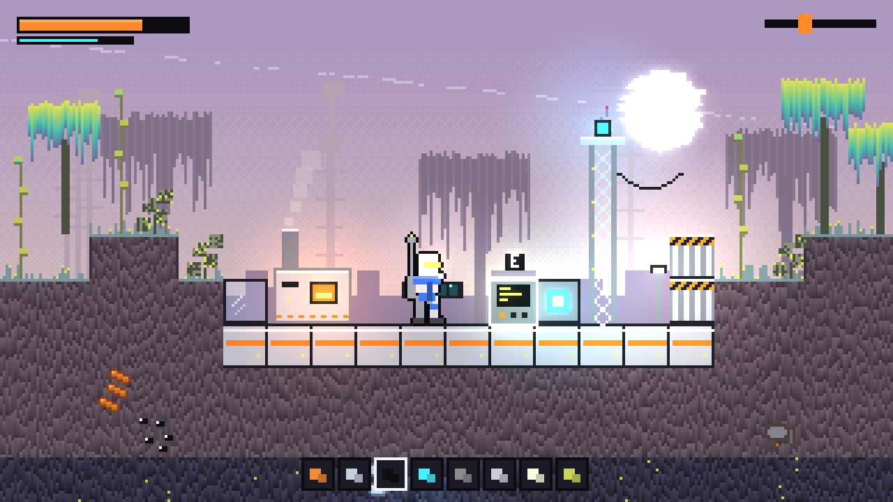 | 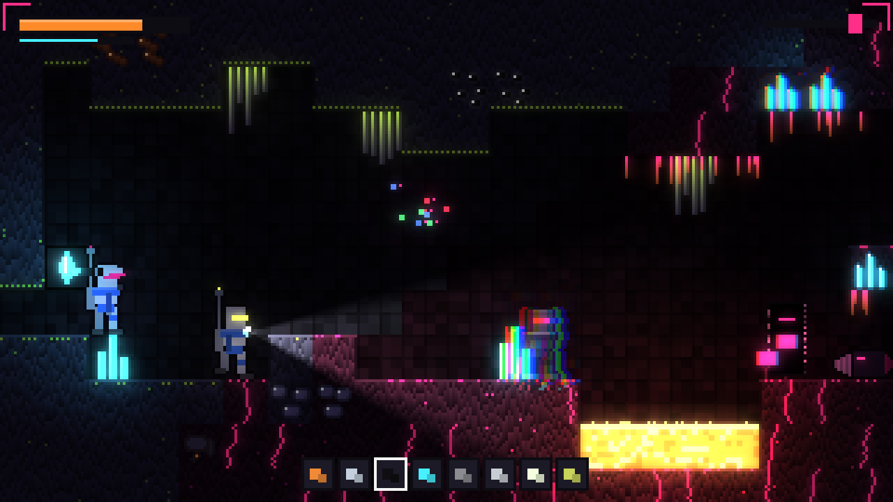 |

| Разрез биомов | Лист |
|---|---|
| 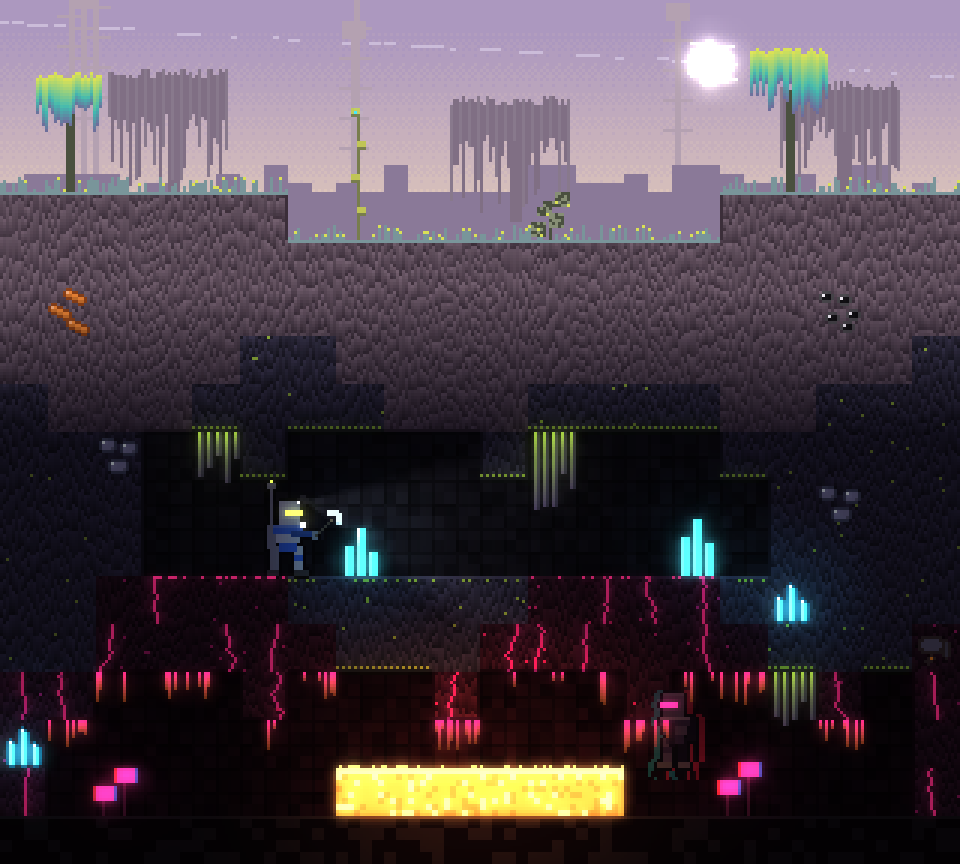 | 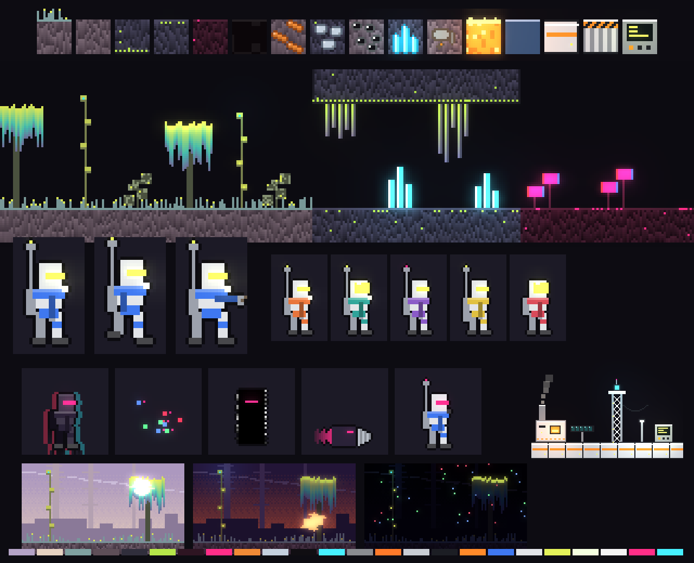 |

**Палитра** (`PAL.static`):

| Роль | Hex | Роль | Hex |
|---|---|---|---|
| небо день, верх / горизонт | `#B4A3C6` / `#E6D2C2` | небо ночь | `#07070E` → `#191530` |
| поверхность: порода / тень / блик | `#5E4E58` / `#3E323C` / `#7A6874` | антенная трава / кончики | `#7FA0A0` / `#E4F25A` |
| средние пещеры: порода / тень | `#302E3C` / `#1D1C26` | дата-мох (био) | `#B6E64A` |
| глубина: порода / тень | `#2E1522` / `#180A12` | «повреждение» | `#FF2E88` |
| медь / железо / уголь | `#F08A36` / `#C4D0DE` / `#100E12` | кристалл / хлам | `#46F0FF` / `#8A8C90` |
| металл базы / рамы / акцент | `#C9CDD4` / `#1C1E24` / `#FF8A2A` | экран | `#E4F25A` |
| скафандр (по умолч.) / панели / визор | `#3F78F0` / `#E2E4E8` / `#E4F25A` (светится) | фонарь | `#F4FFE0` |
| **интерактив** | `#F4F4F4` | **опасность** | `#FF2E88` |

**Материалы и биомы.**

| Биом | Порода | Кромки | Флора |
|---|---|---|---|
| Поверхность | «отсортированная» порода: столбцы отрезками 4–10 px от светлого к тёмному | антенная трава (стебли 1–5 px, кислотные кончики) | «Сортировщик» (крона вертикальными градиентами), «Антенник» (стебель с квадратными приёмниками, мигают), «Шумоцвет» (листья 5×5 с ТВ-шумом, один лист сдвинут) |
| Средние пещеры | тёмно-сиреневая, редкие светящиеся «битые пиксели» | шахматный дата-мох по кромкам | сталактиты сортировки (градиенты вниз), решётчатые кристаллы-призмы |
| Глубина у лавы | бордово-чёрная, пурпурные трещины | с потолка — капли сортировки пурпур → лава | «битые цветы» (блок с RGB-расслоением на стебле) |

**Металл базы:** светлый, чёрные рамы, оранжевая полоса, мигающие светодиоды; с фермы релея
свисают кабели.

**Небо и свет.** День — сиреневый амбиент, нарезанное солнце, обломки кольца. Сумерки —
фиолетово-оранжевое. Ночь — звёзды из R/G/B пикселей («битая матрица»), на шпилях вдали мигают
красные огни.

**Глитч.** Везде, но по правилам: сортировка — только у флоры и глубины; RGB-расслоение — у фантомов,
кристаллов и «битых цветов»; разрыв строк — у фантомов и над релеем; нарезка — у солнца.

**Скафандр, тип C — экзокостюм.** Высокий узкий шлем 7×8 с **горящей щелью-визором**
(видно в темноте), широкие наплечники основного цвета, белые панели, тонкие ноги с наколенниками,
**мачта антенны** над ранцем — самый высокий силуэт. Варианты: полнолицевой светящийся визор,
красный огонь антенны, удлинённый ранец.

**Фантомы.** Эхо — тёмная копия экзокостюма, капли сортировки вниз, сильное расслоение 2 px;
рой — «пакеты» 2×2 трёх каналов; тень — **чёрная дыра в кадре** с шумной кромкой и щелью глаз;
копатель — блок-бур с отсортированным пурпурным шлейфом; двойник — щель визора пурпурная, не жёлтая.

**Машины и UI.** Светлые короба в чёрных рамах, оранжевые полосы. HUD — почти чёрный,
здоровье оранжевое, импульс — циан.

---

## 5. Сравнение

| Критерий | A «Споровый луг» | B «Сухой риф» | C «Сигнальная чаща» |
|---|---|---|---|
| **Уникальность** (vs Terraria/Minecraft/Starbound) | высокая: глина + горчичный лишайник, грибная флора, газовый гигант. Ближе всего к «Территории падальщиков» | **самая высокая**: белый слоистый осадок, кораллы, рёбра исполина, кобальтовое железо — ни на что не похоже | высокая, но рискует уйти в «неоновый киберпанк», а сортированные кроны издали похожи на ивы |
| **Атмосфера** «планета живёт, мы гости» | сильная: тёплый день, светящиеся споры ночью, исполинские свечники | сильная, «мёртвое море» — тише и холоднее, одиночество | сильная тревога, но «живого» меньше — больше «сломанного» |
| **Роль глитча** | только угроза/аномалия → **глитч = опасность** | погода (сияние) + угроза | биология: везде |
| Читаемость руд, мин. ΔE между рудами (CIE76) | 27.9 (железо/хлам) | **54.3** (уголь/хлам) | 25.5 (железо/хлам) |
| Руда против породы, мин. ΔE | 22.2 (хлам на глине) | 10.2 (уголь на базальте) | 15.0 (уголь в глубине) |
| Опасность против «живого» света (`danger` vs `bio`), ΔE | 113 | 112 | 123, **но `danger` = цвет свечения глубины (ΔE 0)** — в глубине опасность сливается с фоном |
| **Дальтонизм** (дейтеранопия, Machado 2009; [`compare_cvd.png`](img/0003/compare_cvd.png)) | руды ΔE ≥ 20, узоры спасают; `danger` тускнеет — держится на мерцании, свечении и форме | руды ΔE ≥ 30 (лучший); `danger` уходит в оливковый, спасает свечение | кристалл и пурпур глубины сходятся (ΔE 38); руды ≥ 25 |
| Читаемость интерактива | светлая рамка на тёплом — хорошо | циановая рамка на мятном небе днём слабее | белая рамка — хорошо |
| Риск светочувствительности | низкий (глитч редкий) | средний (мерцающее сияние ночью — нужен переключатель) | **высокий** (много мерцания — переключатель обязателен) |
| **Стоимость кадра** (gl_compatibility, Android) | ≈ как сейчас: тайлы — атлас, свечение — `glow_texture`; +1 слой эмиссии | как A + небо ночью перерисовывается 12 Гц (сияние) — ≈ +0.1 мс на слое неба | как A + мигание флоры (анимированные тайлы), RGB-расслоение у кристаллов/цветов (×3 рисования), больше источников света — риск упереться в `MAX_GLOWS` |
| **Объём работ** | средний: ~8 PR (§ 7) | средний: как A | большой: + шейдерные эффекты, больше анимированных тайлов, больше тонкой настройки читаемости |

ΔE посчитаны по палитрам `PAL` скрипта (sRGB → CIE Lab; дейтеранопия — матрица Machado et al. 2009,
тяжесть 1.0). Ниже ~10 — цвета легко спутать, 20+ — различимы уверенно.

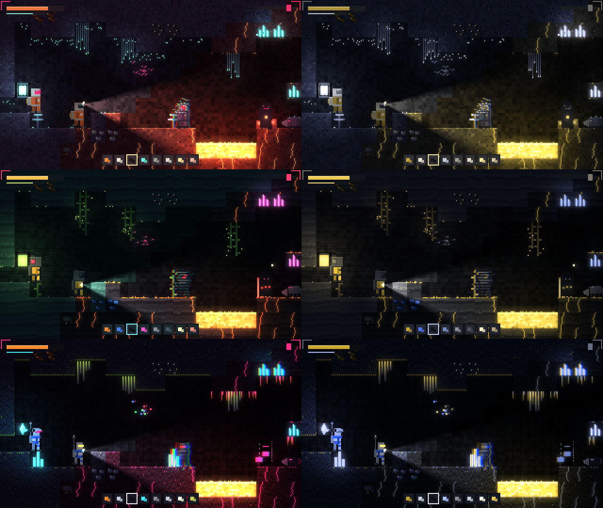

**Что показала симуляция дальтонизма.** Во всех концептах красно-пурпурный `danger` при
дейтеранопии теряет «тревожность». Поэтому опасность в любом концепте кодируется **не только
цветом**: светящийся визор, расслоение силуэта, мерцание и уголки-скобки HUD. Руды держатся
на узоре и яркости — цветом их почти не приходится различать.

---

## 6. Рекомендация

**A «Споровый луг»** как основа: он ближе всего к «Территории падальщиков» (пастель, живая
экосистема, свет от жизни), глитч в нём остаётся сигналом опасности, а значит, лучше читается,
дешевле всех в кадре и безопаснее для светочувствительных.

Из B стоит взять **кобальтово-синее железо** (самая различимая пара руд и смысл имени планеты)
и слоистую фактуру для средних пещер, если владелец захочет «прохладнее». C стоит выбрать, только
если важнее всего бренд «глитч-кор». Тогда до внедрения нужно развести `danger` и свечение
глубины и сделать переключатель «меньше глитча».

---

## 7. План внедрения (после выбора)

Issues на эти PR заводятся **после** выбора концепта. Каждый PR приносит рендеры «до/после» через
`tools/gallery_dump.gd` (и обновляет `docs/img/`), замер `tools/perf_probe.gd`/`freeze_probe.gd`/
`hud_probe.gd` на тех же сидах и зелёные `--test` на трёх сидах.

### 7.1. Волны

| Волна | PR | Что | Зона файлов | Не пересекается с |
|---|---|---|---|---|
| V1 | **Палитра и тайлы** | `DB._paint_tile` по концепту; атлас с вариантами кромок по маске соседей; **биом по глубине — визуальный вариант** того же id (без новых тайлов, дропов, формата сохранения); узоры руд | `scripts/autoload/db.gd` (раздел рисования), `scripts/autoload/world.gd` (только выбор атласной клетки в `set_cell`/`_build_atlas_cache` + пересчёт 4 соседей) | ADR-002 (сеть шлёт id, не варианты) |
| V2 | **Флора** | `World._place_tree` → флора концепта из тех же `TREE`/`LEAVES` (непроходимость прежняя) + **декор-слой** (`TileMapLayer` без коллизий) для пещерной и глубинной флоры, выводится из сида и тайлов — в сохранение не идёт | `world.gd` (генерация флоры), `db.gd` (тайлы флоры), новый `scripts/world/decor.gd` | — |
| V3 | **Небо и свет** | `SkyBackdrop`: светила и дальний/средний план концепта, палитры день/сумерки/ночь; цвета `CanvasModulate`; **слой эмиссии** (второй `TileMapLayer` в отдельном `CanvasLayer`, на который не действует `CanvasModulate`) | `scripts/ui/sky_backdrop.gd`, `scripts/ui/world_fx.gd` (цвета свечения), `scripts/main.gd` (одна секция: цвета tint) | #78/#34 (HUD) — только после его мержа, если трогаем `main.gd` |
| V4 | **Скафандр «Кербер-9» + кастомизация** — **общий PR с #97 (ADR-002 MP-L)** | `Avatar` по концепту, ключи `body_layout()` «рука/шлем/баллон», 16 цветов + варианты шлема/аксессуара/ранца | `scripts/core/avatar.gd`, `player.gd` (`_draw`, `body_layout`), `phantom.gd` (`_draw_doppel`), `tools/anim_test.gd` | #81 (ввод `player.gd`) уже смержен (#98); V4 трогает только рисование и идёт после #87 (MP-B, вынос в `Avatar`) |
| V5 | **Фантомы** | `_draw_echo/_swarm/_shade/_burrower` по концепту (глитч — только здесь) | `scripts/entities/phantom.gd` (раздел ОТРИСОВКА) | #92 (MP-F, логика фантомов) — только раздел рисования |
| V6 | **Машины и HUD-акценты** | `_draw` машин и `MachineBase._draw_body` (цвета, «обрастание»), HUD: цвета плашек, рамка интерактива, скобки опасности | `scripts/machines/*.gd` (только `_draw*`), `scripts/ui/hud.gd` (константы цветов) | после мержа #78 (HUD-обучение) |
| V7 | **Глитч-эффекты и доступность** | разрыв строк при событиях (релей, двойник раскрыт) — короткий экранный шейдер **по событию**, не постоянно; настройка «меньше глитча/мерцания» | новый `scripts/ui/glitch_fx.gd` + шейдер, профиль (`Profile`, ADR-002) | #87 (профиль) — одна строка-настройка |

V1 → V2 → V3 последовательно (общие `db.gd`/`world.gd`); V4 и V5 идут параллельно с V2–V3
(другие файлы); V6 — после #78; V7 — последним.

### 7.2. Технические решения для всех концептов

* **Автотайлинг** — варианты в атласе: 16 масок на тайл (или 4 — только верх/низ, этого хватает
  для кайм концептов). Атлас 31 тайл × 16 вариантов × 3 биома ≈ 1.5 МБ RGBA; генерация сейчас
  7.2 мс на 31 тайл → ожидаем ~0.3 с при старте один раз (можно лениво по биомам). В кадре —
  ноль: это тот же `TileMapLayer`.
* **Свечение** — без постобработки (рендерер `gl_compatibility`, HDR-glow в 2D недоступен):
  эмиссивные пиксели — второй атлас на слое без `CanvasModulate`, ореолы — нынешние
  `glow_texture` в `WorldFX` с лимитом `MAX_GLOWS = 48`.
* **Мигание флоры** — анимация кадров тайла в `TileSetAtlasSource` (без скриптов в кадре).
* **Глитч у фантома** — 2–3 дополнительных `draw_rect` со сдвигом (как сейчас у эха), не шейдер.

### 7.3. Если выбран A «Споровый луг» — содержание PR

| PR | Конкретно | Приёмка (кроме тестов на трёх сидах) |
|---|---|---|
| V1 Палитра и тайлы | `PAL.spore` → константы цветов в `db.gd`; фактуры: «войлок» 4×4 + нити мицелия (поверхность), бирюзовые нити (средние), «плоть» со светящимися трещинами (глубина); кромки по маске: лишайник сверху, гифы снизу; узоры руд § 3.2; металл — кремовая эмаль с лишайником; железо — светлое (или кобальтовое из B, вопрос 1) | `gallery_dump`: тайлы и `shots/*` до/после; ΔE руд ≥ 20 при дейтеранопии (пересчёт той же формулой) |
| V2 Флора | «Свечник» вместо дерева (стебель `TREE`, шляпки `LEAVES` — та же проходимость, `floating_tree_cells` без изменений), «Пузырник» и «полка» — декор; пещеры: завеса гиф, трутовики; глубина: мембранные мешки | сценарии генерации мира зелёные; число деревьев в `gen_stats` прежнее |
| V3 Небо и свет | газовый гигант макропикселями 2×2, белое солнце, мезы и исполины в дымке; споры в воздухе (ночью светятся); tint: день `#FFF6EA`, сумерки `#B8889A`, ночь `#3A3050`; слой эмиссии для гиф, кристаллов, лавы, экранов | `hud_probe`: `SkyBackdrop.stat_us` не больше нынешнего + 10 %; `freeze_probe` p95 |
| V4 Скафандр (с #97) | тип A: квадратный шлем 10×9 с визором, тканевый корпус, ранец-фильтр с жёлтым патроном, отдельная рука, боты; `Look`: 16 цветов, 4 шлема, 4 аксессуара (фонарь/антенна/нет/двойной фонарь), 4 ранца | `anim_test`: зеркалирование новых ключей; лист вариантов `menu_test` |
| V5 Фантомы | эхо распадается спорами + расслоение 1 px; рой — споровые мотыльки; тень — капюшон с гифами; копатель — личинка с буром; двойник — визор `danger`, фонарь не горит | `phantom_probe` — мкс на фантома не больше нынешнего + 20 % |
| V6 Машины и HUD | кремовые короба, жёлтая разметка, мох на ТЭЦ, споровый дым; HUD — сливовые плашки, рамка `#FFF1A8`, скобки `#F0306A` ночью | после #78; `hud_probe` |
| V7 Глитч и доступность | блоки 2×2 у релея при приёме сигнала, разрыв строк при раскрытии двойника (по событию, ≤ 0.5 с); настройка «меньше глитча» | ручная проверка на Android-сборке (#80) |

---

## 8. Что не меняем

* Механики, баланс, числа `Balance`, поведение фантомов и машин.
* **Размер тайла 16, сетку, коллизии**, id тайлов и предметов, дропы, твёрдость, формат сохранения
  и сетевой протокол (ADR-002 шлёт id тайлов; вариант кромки/биома считается локально).
* `Player.SIZE` 12×22 и размеры фантомов (антенна/фонарь — только рисунок).
* Модель света (`CanvasModulate` + `glow_texture`), туман войны, рендерер.
* Принцип «всё рисуется кодом, ассетов нет».

---

## 9. Как воспроизвести рендеры

```
godot --headless --path . --script res://tools/style_concepts.gd            # все концепты, ~15 с
godot --headless --path . --script res://tools/style_concepts.gd -- --only=reef
```

Скрипт рисует всё попиксельно в `Image` (окно не нужно), к игре не подключён и игровые скрипты не читает.
Палитры — словарь `PAL`; общий язык руд/опасности — функции `_ore`, `phantom`, `interact_mark`.

---

## 10. Открытые вопросы (владельцу)

1. **Какой концепт?** A / B / C или смесь (например, A + кобальтовое железо из B).
2. Переименовать ли тайлы и предметы под мир (`Трава` → «Лишайник», `Бревно` → «Волокно стебля»,
   `Листва` → «Шляпка»)? Это тексты, механика та же; затрагивает журнал и рецепты.
3. Глубины смены биомов: предложение — средние пещеры с 25 % глубины (как железо сейчас),
   глубина — с 55 % (кристаллы, лава).
4. Палитра цветов скафандра для `Look` (16 цветов): брать из палитры концепта или общую?
5. Нужен ли переключатель «меньше глитча/мерцания» уже в V1 (для C — обязателен)?
6. Обновлять ли README и галерею `docs/img/` в каждом PR волны или одним PR в конце?

---

## 11. Источники по референсу

* Cartoon Brew — «Scavengers Reign Team Talks Through The Worldbuilding Process»:
  https://www.cartoonbrew.com/series/scavengers-reign-team-talks-through-the-worldbuilding-process-for-their-sci-fi-thriller-series-exclusive-233879.html
* AWN — «Scavengers Reign: Unpacking the Free-Spirited ASMR Mind Trip»:
  https://www.awn.com/animationworld/scavengers-reign-unpacking-free-spirited-asmr-mind-trip
* Inverse — рецензия (короткометражка как вызов «оживить Мёбиуса»): https://www.inverse.com/entertainment/scavengers-reign-review-max-sci-fi
* Bubbleblabber — интервью с Джо Беннеттом:
  https://www.bubbleblabber.com/2023/10/interview-scavengers-reign-co-creator-joseph-bennett-creates-an-intergalactic-chain-reaction/
* Isis Magazine — интервью с Чарльзом Хюттнером: https://isismagazine.org.uk/?p=23100
