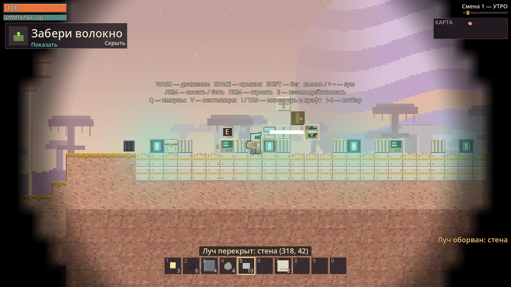

# Плейтест «Свет», ноябрь 2026

Наблюдатель записывает время и слова участников с их сессии на указанной сборке.
Ниже отдельно приведены результаты оконного прогона и технических проверок ADR-006.

Связано: [ADR-005](adr/0005-light-constructor.md) § 12, issue #181.

## Кто и как

Те же двое детей, что в первом плейтесте ADR-005: сын (10 лет) и дочь.
Две сессии по 20 минут с каждым. Запись экрана. Взрослый не подсказывает,
пока ребёнок сам не попросит. Если попросил — записать вопрос и что ответили.

Сборка — та, что в `main` после влития README. Сид свободной игры записать.
Кампания всегда на сиде 31337.

## Что записывать в сессии

На каждую сессию — отдельный лист. Пустые клетки заполняет владелец.

| Поле | Сессия 1 | Сессия 2 |
|---|---|---|
| Кто | | |
| Дата и время | | |
| Сборка (тег или коммит) | | |
| Кампания или свободная игра | | |
| Глава, на которой остановился | | |
| Дошёл ли до конца открытых глав | | |
| Время от старта главы «Огонь» до первого луча, с | | |
| Время до первой поставленной горелки в свободной игре, с | | |
| Вопросы вслух (дословно) | | |
| «Почему маяк не работает?» — показал на конец луча? да / нет / не было | | |
| Где застрял дольше минуты | | |
| Что делал вместо карточки «Сейчас» | | |
| Читал ли текст карточки или смотрел только картинку | | |
| Жалоба на размер букв (да / нет, на каком экране) | | |
| Телефон или ПК | | |

Если маяк молчит, не объяснять. Спросить: «покажи, где луч кончается».
Записать, куда показал палец: на маяк, на горелку, на конец луча, на стену, «не знаю».

## Метрики ADR-005 § 12

Колонка «факт» пустая, пока владелец не проведёт сессии.
Автоматические строки можно снять без детей — команда в последнем столбце.
Пока сессий не было, в «факт» ничего не вписано.

| Метрика | Было (ADR) | Цель | Факт | Как снять |
|---|---|---|---|---|
| Высота строки основного текста на 6,1″ | 1,7 мм | ≥ 4 мм | | `tools/ui_scale_test.gd` в `--test`: порог `UI.BODY_MM_PHONE` = 4 мм. Экран ребёнка замерить линейкой по записи |
| Глава, на которой ребёнок 10 лет бросает | 2 («Конвейер», снята) | проходит все открытые главы без подсказки взрослого | | лист сессии. В `Campaign.CHAPTERS` шесть глав; меню открывает следующую после пройденной. Сколько из них ребёнок проходит без подсказки — эта клетка, не код. |
| Время от старта главы «Огонь» до первого луча | — | ≤ 90 с | | секундомер от карточки «Поставь горелку» до красной полосы. Бот: `--scenario=campaign` |
| Доля дня в копке и стройке против окон | не мерили | окна ≤ 15 % времени | | по записи: секунды с открытым инвентарём или журналом / длина сессии |
| Понимает, почему маяк молчит | нет | показывает пальцем на конец луча | | вопрос из листа сессии |
| Топлива за день руками против расхода за ночь | — | 20–30 против 10–15 | | `--scenario=night_autopilot` печатает расход; руками — по записи сессии |

## Что не записывать за детей

- Не дописывать «понял» и «понравилось», если ребёнок этого не сказал.
- Не заполнять «факт» по прогону бота и выдавать это за плейтест.
- Не проводить сессию на сборке, где карточка ещё говорит про питание.

## Короткий прогон: темп и выбор цвета

Для #239. Бот ночь не судит: стоит и цвет не выбирает. Этот лист — руками,
10–15 минут, один ребёнок ~10 лет (или взрослый «как в первый раз»). Запись
экрана, сид записать, кампанию не мешать. Молчать, пока не спросят; вопрос и
ответ — дословно. Не сказал — клетка пустая, не дописывать.

1. День до первой ночи (~149 с). Темп и пустые промежутки дольше 12 с.
2. Ночь средней базы (2 горелки, 1 маяк): цвет выбирает сам, записать почему.
3. Следующая ночь той же базы, маяк только жёлтый, против роя. Смерть должна
   читаться как «не тот цвет», не как «нечестно».

| Наблюдение | День | Ночь, свой цвет | Жёлтый против роя |
|---|---|---|---|
| Понял без вики (цитата или «не сказал») | | | |
| Где застрял дольше 12 с | | | |
| Что спасло | | | |

## Живая база

Приёмка [ADR-006](adr/0006-living-base.md) и [задачи D1](https://github.com/grikirster-stack/glitch-core/issues/318).
В `v0.8.0` (`8412df0`) вошли A1–A3, B1–B3 и C1–C2. Рабочая версия
включает обучение C3 из [PR #331](https://github.com/grikirster-stack/glitch-core/pull/331)
(`8ec38d0`) и доработки по этому прогону.

### Маршрут для наблюдателя

Откройте новый мир на ПК и физическом Android с одним сидом. Запишите устройство,
сборку, масштаб и момент появления лагеря. Игроку покажите только игру. Засекайте
реальное время, в том числе чтение карточек и инвентаря. Для второго варианта
планировки откройте новый мир с тем же набором.

| Отрезок | Что наблюдать |
|---|---|
| Первые две минуты | Выбор стороны пристройки, установка панели и двери, крафт грядки и коллектора. Записать время первого волокна в лотке, отдельно время подбора. Попросить показать выход. |
| До заката | Открытая теплица с прямым лучом либо мастерская с крышей и проёмом. Один раз перекрыть луч или заполнить выход. Отметить первую замеченную подсказку и время до возобновления выпуска. |
| Следующий день | Поставить сундук у стрелки, развернуть пресс входом к волокну. Уйти в шахту на минуту дневного света. Записать выпуск, расход и какую часть пристройки оплатили панели. На закате сравнить прямой коллектор и накопитель. |
| Первые десять минут | Проверить сохранение, продолжение работы и подготовку входа. При обычном старте первые две ночи тихие. Сутки занимают четыре минуты, поэтому наблюдение за двумя налётами продолжается после десятой минуты. |
| Ночи с налётами | Отметить время предупреждения, сторону входа и итог. Изменить один проход между волнами. Если устройство повреждено, проверить ремонт камнем или хламом с пустым запасом панелей. |
| После второго налёта | Скрыть помощь на две минуты. Записать первое действие, возвращение к мастерской и фактические затраты. Только затем спросить, что игрок хотел сделать дальше. |
| Отдельный проект | Зажечь шесть дуг, передать сигнал и проверить, что в том же мире можно двигаться, строить и начать следующую передачу. В кампании проверить собственный финал главы. |

### Оконный прогон на ПК

Сид `31337`, Windows, Godot 4.7.2, NVIDIA Quadro T1000, окно 1280×720.
Агент управлял обычной свободной игрой через клавиатуру и мышь
[пошагового стенда](playtest-freeplay.md#запуск). Между сериями действий
мир стоял на паузе. Значения ниже даны в секундах **игрового времени**.

| Наблюдение | Факт |
|---|---|
| Первый выпуск | К 15,6 с одно волокно лежало в лотке. Обе машины собраны из стартового набора. Карточка «Забери волокно» сохранилась до подбора. |
| Перекрытая теплица | В 16,5 с после установки панели погасла грядка, плашка показала стену в клетке (318, 42). Снял коллектор, разобрал панель и поставил коллектор на клетку дальше. В 22,6 с белый луч снова достиг грядки. Восстановление за 6,1 с. |
| Ручная и автоматическая выдача | В 23,3 с нажал E у лотка и получил волокно. В 25,7 с над грядкой была крыша, а у выхода стоял сундук из трёх оставшихся медных слитков. К началу третьей смены грядка выпустила 26 волокон, лоток оставался свободным. |
| Две волны | Первые две ночи прошли спокойно. На третью ночь пришла волна с востока, на четвёртую с запада. Обе повредили по участку стены. К 936,7 с было два налёта, у героя 100 HP и ноль смертей. |
| Две минуты после второй волны | Скрыл карточку, заложил пролом и продлил восточную стену. Запас панелей уменьшился с восьми до четырёх. Через 120 игровых секунд выпуск волокна вырос с 49 до 58, лоток по-прежнему разгружался. |

### Выпуск и расход

В сценарии `press` герой провёл минуту под землёй. За это время в выходном
сундуке накопилось восемь панелей. Из них шесть ушли на пристройку.
В отдельной линии за две полные смены пресс выпустил 48 панелей. На первом
рассвете в сундуке было 24, одну потратили на стену, к следующему рассвету
осталось 47. После заката обычная грядка остановилась, а грядка с накопителем,
заряженным днём от второго коллектора, продолжила выпуск. Ремонт остановленной
грядки камнем с пустым запасом панелей проверяет `raid_no_panels`.

### Регрессии и сеть

Основной автотест прошёл на сидах `31337`, `4242` и `12345` с 561, 559
и 561 успешной проверкой соответственно. Отдельно прошли 246 проверок
сохранений и 135 проверок сетевого протокола. Схема пакетов осталась на версии 27.
Проверка налёта сохраняет мир дважды — во время гудка и после ранения фантома.
После загрузки продолжается тот же налёт, у фантома сохранены место и здоровье.
После отражения без поломки герой получает два хлама. Итог и номер награды
переживают следующую загрузку.

Пять LAN-сценариев прошли 250 проверок. В них входят поздний вход во время
налёта, перенос метки базы, сетевой инвентарь и повторное подключение к сохранению.
Отдельный прогон `mp_light` прошёл 59 проверок синхронизации света, а
`mp_workshop` — 12 проверок работы и производительности сетевой мастерской.
Прогон после выхода через меню выявил зависание от прицела далеко за картой.
Поиск цели теперь ограничен досягаемостью кирки. Проверка воспроизводит также
случай, когда в этом направлении перед героем есть доступная стена.

Реестр из 107 игровых сценариев прогнали тремя частями на каждом из трёх
сидов. Для проверки перерисовок HUD использовали реальные часы. Ускоренный
режим `--fixed-fps 60` сдвигает игровые часы относительно секундомера этой
проверки. Функциональные проверки прошли. В микротесте пересчёта 20 горелок
лимит 1 мс срабатывает нестабильно. На сиде `4242` по два из трёх контрольных
прогонов превысили лимит на обеих сборках. Диапазон одиночных замеров составил
0,48–1,93 мс на `main` и 0,61–1,37 мс в пилоте.

### Мастерская из 20 устройств

Godot 4.7.2, Windows, Intel Core i9-8950HK. На каждой сборке запущены два
процесса без окна. Восемь коллекторов освещали восемь грядок, четыре пресса
выпустили панели, один клиент получил их состояние. Интервал измерения 34 с.
Трафик приведён по счётчикам полезной нагрузки приложения за секунду.

| Сборка | Кадров хоста | p95, мкс | Максимум, мкс | Хост → клиент, Б/с | Клиент → хост, Б/с |
|---|---:|---:|---:|---:|---:|
| `main` / `8412df0` | 4 925 | 8 613 | 24 878 | 1 569 | 810 |
| Пилот ADR-006 | 4 590 | 15 437 | 50 771 | 1 569 | 810 |

В итоговом прогоне p95 укладывается в 16 мс с запасом 0,56 мс. Максимальный
интервал вырос до 50,8 мс. Лимиты трафика составляют 12 000 Б/с к клиенту
и 4 000 Б/с к хосту. В промежуточной сборке p95 достигал 16 262 мкс.
Для повтора используйте [команду и описание стенда](../tools/README_TESTS.md#приёмка-мастерской-adr-006-318).

### Запись первого знакомства

| Поле | ПК | Физический Android |
|---|---|---|
| Устройство, сборка, сид, масштаб | | |
| Первое волокно и восстановление, секунды по записи | | |
| Найденные подсказки, вопросы, помощь взрослого | | |
| Форма комнаты и указанная сторона выхода | | |
| Сторона налёта, поломка и ремонт | | |
| Первое действие за две минуты без карточки | | |
| Намерение со слов игрока | | |

Поля заполняются после сессии с новичком. На стенде 26 ноября ADB вернул
пустой список подключённых устройств. Управление касаниями входит в сценарии
`guide_touch`, `touch_build`, `hotbar_rows` и `raid_touch_repair`.

## Прогон 26 ноября 2026, Linux, `e8df0b1`

Godot 4.7.2, Linux, Intel UHD Graphics (TGL GT1), Mesa 23.2.1. Коммит
`e8df0b1`. Это отдельный прогон, не повтор Windows-таблиц выше. Кадры длиннее
100 мс в `--test` записаны как предупреждения, не как провалы.

### Автотест и сценарии

| Сид | `--test` | Кадр, среднее / максимум | Кадров > 100 мс | Сценарии, части 1/3, 2/3, 3/3 |
|---|---|---|---|---|
| 31337 | 559 / 0 | 7,67 / 1 020,01 мс | 11 из 4 561 | 36/662, 36/717, 35/636 |
| 4242 | 559 / 0 | 7,37 / 617,97 мс | 10 из 4 571 | 36/662, 36/717, 35/636 |
| 12345 | 559 / 0 | 7,61 / 1 152,68 мс | 10 из 4 568 | 36/662, 36/717, 35/636 |

Провалов нет. В каждой части указаны сценарии и проверки.

`guide_chain`, игровое время, на всех трёх сидах: первое волокно за 15,4 с.
Восток без шахты: 31337 `(326, 43)`, 4242 `(326, 35)`, 12345 `(326, 44)`.

`press`: за минуту под землёй 8 панелей в выходном сундуке, буфер 0, 2 партии.
К первому рассвету 24 панели, одну потратили на стену, к следующему рассвету 47.
Одинаково на 31337, 4242 и 12345.

Налёт: контакт 2,30 с, предупреждение не короче 25 с. Ночи 1 и 2 без налёта
(фаза 0), ночь 3 начинает предупреждение (фаза 1). Телефонная плашка:
«Поставь каркас: тап панелью у лагеря». Починка камнем возвращает выпуск:
в `raid_touch_repair` камень 12 → 11.

### LAN и мастерская

Пять LAN-сценариев: 250 проверок, 0 провалов. Команда:
`godot --headless --path . -- --mp-scenario=mp_free_mark,mp_raid_late_join,mp_save_rejoin,mp_inventory,mp_actions --seed=31337`.

`mp_workshop`, два процесса без окна, 20 устройств, интервал 34 с. Трафик —
счётчики полезной нагрузки за секунду. Windows-таблица выше к этому прогону
не относится. Сценарий до `e8df0b1` в дерево не входил: его скопировали в
рабочую копию `8412df0` только для замера «до».

| Сборка | Кадров хоста | p95, мкс | Максимум, мкс | Хост → клиент, Б/с | Клиент → хост, Б/с | Проверки |
|---|---:|---:|---:|---:|---:|---|
| до, `8412df0` | 4 929 | 8 735 | 10 039 | 1 568 | 810 | 12 / 0 |
| после, `e8df0b1` | 4 930 | 8 331 | 9 850 | 1 570 | 810 | 12 / 0 |

Обе сборки внутри 16 мс, 12 КБ/с к клиенту и 4 КБ/с к хосту. После
входа ADR-006 p95 и максимум чуть ниже, трафик почти тот же.

### Окно, сид 31337

Окно 1280×720 за экраном, `--fixed-fps 60`, `--audio-driver Dummy`,
масштаб интерфейса профиля 1,5. Мир стоял на паузе между сериями ввода.
Время ниже — игровое, из `state.json`.

| Наблюдение | Факт |
|---|---|
| Старт | Карточка «Поставь каркас у лагеря», плашка «Поставь каркас: ПКМ панелью у лагеря», клетка героя (316, 43), время 0,8 с. |
| Каркас и дверь | Каркас (320, 41), панели 12 → 11. Дверь (321, 41). Карточки дошли до двери, затем до грядки. |
| Крафт грядки | Клик по строке рецепта с учётом масштаба панели, не масштаба интерфейса. Медь 3 → 2, волокно стебля 4 → 2, в слоте появилась «Споровая грядка». |
| Постановка | Грядка (321, 42) в 65,0 с. Карточка «Подведи белый луч», плашка «Нет белого луча». |
| Луч | Коллектор на (319, 42) повёрнут, пока грядка не загорелась. Карточка «Дождись первого волокна», плашка «Грядка растёт под белым лучом». |
| Первое волокно | В 78,5 с в лотке 1, выпущено 1. Это 12,0 с после зажигания. Карточка «Забери волокно», плашка «Забери волокно: [E] у грядки». 15,4 с сценария — отдельный замер: там есть крафт и постановка, здесь только рост. |
| Перекрытие | В 79,2 с панель встала на (320, 42), запас 11 → 10, грядка погасла. Плашка «Луч перекрыт: стена (320, 42)». В 79,9 с текст тот же. Карточка осталась «Забери волокно». |

Восстановление луча в этом окне не замерено. Поставленная панель не ушла ни
копанием, ни клавишей X. ЛКМ с пустой руки, прицел на клетку (320, 42),
удержание 180 кадров: добыто клеток осталось 1, панелей 10, грядка погашена,
плашка звала забрать коллектор, потому что прицел после серии смотрел на
машину. X снимает только машину под курсором, не тайл. Это ограничение замера
окна, не правка игры. Повтор окна не запускался: соседний прогон уже ждал
тот же замок Godot.

Поля детской сессии выше оставлены пустыми. Их заполняет владелец после
сессии на ПК и на физическом Android.
